# Tearoff - Real-time Racing Overlays

<div align="center" style="padding-bottom: 20px;">
  
</div>

A personal sim racing overlay built with React and Electron, with iRacing support and beta support for Le Mans Ultimate.

> Tearoff is an independent fork of [irDashies](https://github.com/tariknz/irdashies) by Tarik Alani, taken at v2.1.1 and developed separately since. Much of this README still describes the upstream feature set. Compared with upstream, this fork has its own update feed, unsigned builds, no analytics, and no RaceOS driver-rating lookup.

## Try it out

Download the latest `Setup.exe` from the [releases page](https://github.com/dev1antdev/tearoff/releases).

Install the Windows .exe and run it. The build is not code signed, so Windows SmartScreen warns on the first install. The application will automatically update from this repository's releases when a new version is available. For overlays to appear over the simulator, use windowed or borderless mode.

## Table of Contents

- [Introduction](#introduction)
- [Supported simulators](#supported-simulators)
- [Available overlays](#available-overlays)
- [Prerequisites](#prerequisites-for-development)
- [Installation](#installation-for-development)
- [Usage](#usage-for-development)
- [Folder Structure](#folder-structure)
- [Storybook](#storybook)
- [Package (create .exe)](#package-create-exe)
- [Testing](#testing)
- [Linting](#linting)
- [Developing on Mac](#developing-on-mac)
- [Acknowledgments](#acknowledgments)
- [License](#license)

## Introduction

This project is built with React and Electron and retrieves live telemetry from iRacing and Le Mans Ultimate to power configurable overlays and race utilities.

See the [latest release notes](https://github.com/dev1antdev/tearoff/releases/latest) for the latest updates.

## Supported simulators

iRacing is the primary supported simulator. Le Mans Ultimate support is in beta as of [v2.0.0](https://github.com/tariknz/irdashies/releases/tag/v2.0.0), with a limited set of supported widgets.

Choose **Auto**, **iRacing**, or **Le Mans Ultimate** in **Settings > General > Simulator**. Auto detects the running simulator and follows simulator changes without restarting Tearoff. If both simulators are active when detection runs, iRacing takes priority; select Le Mans Ultimate explicitly if needed. Unsupported widgets are hidden for the active simulator.

### Le Mans Ultimate setup and limitations

1. In LMU, enable **Settings > Gameplay > Enable Plugins**, then restart the simulator.
2. Start Tearoff and load into an LMU session to receive telemetry.

**Supported overlays:** Standings, Relative, Class Fields, Timing Tower, Input, Lap Trace, Pitlane Helper, Corner Names, Battle, Flag, Flag Panel, Traffic, Faster Cars From Behind, Slow Car Ahead, Rejoin Indicator, Information Bar, System Performance (without its Sim row), Tyres, Tyre & Brake Wear, Chassis, Damage, Hybrid (for cars that have the system), Lift and Coast Lights, Shift Light, Friction Circle, Brake Performance, Minimap, Track Map, Flat Track Map, Elevation, Cruise, Track Notes, Weather (without its wind cell), Weather Forecast, Lap Delta, Sector Delta, Corner Delta, Delta Speed, Timing, Lap Timer, Car Systems, Fuel Calculator, Fuel Saver, Pit Stop, Finish Projection, Stint History, Garage Cover, Widget Group, and the Pit Wall with its panels: Our Car, Class Rivals, Stint Timeline, Crew and Stints, Car Laps, Race Charts and Race Log. Telemetry Inspector is also available for diagnostics. All other widgets are currently unavailable in LMU: Radar, Blind Spot Monitor, the Gantry, Tachometer, Heart Rate, Wind, Stint Plan, Strategy Timeline, Stream Chat and the Broadcast overlays.

- Standings use class colours and manufacturer badges, with best-lap ordering in practice and position ordering in races. Driver ratings, incident counts, and team data are not yet integrated; car numbers are placeholders, and iRacing rating columns are hidden.
- Corner Names and Lap Trace corner feedback depend on available LMU track data. Unnamed turns use turn numbers where provided.
- Lap Trace does not yet check LMU lap validity, so laps invalidated by track limits may still become saved references. Imports support iRacing `.ibt` files and Garage 61 CSV laps, with no native LMU telemetry-file import.
- Input and Lap Trace need your own car's telemetry, which can be unavailable while spectating or in the garage.
- The steering wheel is drawn at the range of the driver's own wheel when LMU knows it, otherwise at the steering lock of the car setup, and at the cockpit animation's range only until the setup has been read. The animation's range turned the drawn wheel about half as far again as the real one on an LMGT3.
- Lap positions are estimated between updates; cars without full telemetry may update in larger steps. Automatic units are metric, and Pitlane Helper currently uses a fixed 60 km/h pit limit.
- Virtual energy: Hypercar, LMDh and LMGT3 cars run on virtual energy, LMP2 and LMP3 on fuel. The optional **VE** column in Standings and Relative shows what each car has left to run on, with a pump icon marking a figure that is fuel. The Fuel Level item shows your virtual energy ahead of the litres, and Pitlane Helper shows what the next stop is set to put in. Fuel Calculator counts a car on virtual energy in percent of its energy and a fuel-limited car in litres; see [Fuel Calculator](#fuel-calculator).
- LMU in-game replays do not yet have iRacing's replay-aware handling. LMU session recording and playback tools are development tools.

## Available overlays

The features below describe iRacing support. See [Supported simulators](#supported-simulators) for LMU availability and limitations.

Screenshots show example layouts. Each widget's appearance and visible information can be configured in Settings.

### Input trace

Displays the throttle, clutch, and brake input traces, as well as the current gear and speed.

**Features:**

- Input source, chosen at the top of the widget's settings:
  - **Car**: what the car receives, the throttle and brake after traction control, ABS and shift cuts. Works while you watch another car and in replays, where the sim gives that car's inputs.
  - **Pedals**: what you press, the raw pedal position before the assists.
  - Where the chosen source has no value, the other one is shown rather than nothing.
- Input trace visualization (throttle, brake, ABS and traction control marks, steering)
  - Configurable stroke width (1-10px)
  - Configurable max samples (50-1000)
  - Toggle individual inputs (throttle, brake, ABS, traction control, steering)
  - ABS activity marked on the brake trace and traction control on the throttle trace, as an overlay or a highlighted fill beneath the curve. Traction control activity is reported by Le Mans Ultimate only; iRacing publishes the dial but not when it cuts.
- Input bar display (clutch, brake, throttle, ABS and traction control indicators)
  - Toggle individual inputs (clutch, brake, throttle, ABS, traction control)
  - A full-travel marker above each pedal, lit while the pedal is flat, whichever source is shown
  - Optional side-by-side bars: a narrow strip of pedal travel beside a wide strip of what the car received, with the brake's wide strip optionally taken from the brake line pressure
  - Optional force feedback bar, which turns amber while the force is clipping
- Current gear display with speed (auto/mph/km/h units) and dynamic sizing to fit container
- Optional speed-first gear layout
- Steering wheel visualization with multiple styles (default, formula, LMP, NASCAR, U-shape, ring) and color themes (light/dark)
  - Angle readout in degrees: past 270° (default), always, or never
  - Optional rotation arc around the wheel, always or only at a standstill
  - Manual wheel rotation range, for a wheel whose range the sim gets wrong
  - Front wheel angle and steering ratio under the wheel (Le Mans Ultimate only)
- Optional steering meter: a bar that fills from its centre toward the steered side, with scale marks at a configurable spacing
- Customizable display order for all components
- Drag-and-drop layout editor to arrange traces, bars, steering, the steering meter, gear, and ABS indicators
- Multiple Input widgets with independent layouts, including a gear-only layout for a detached gear indicator
- Optional background shift flash at redline or custom Tachometer shift points, with a configurable colour
- Adjustable background opacity
- Option to show only when on track
- Session visibility settings (Race, Lone Qualify, Open Qualify, Practice, Offline Testing)

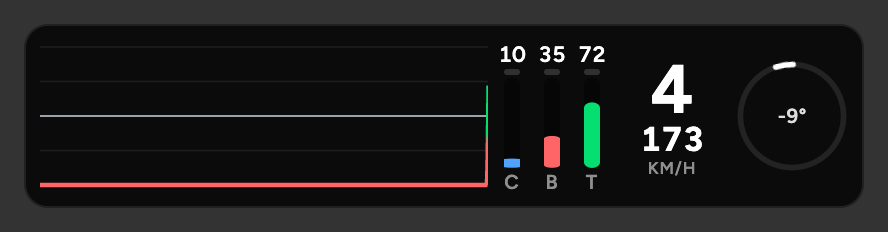

### Lap Trace

Compares your current lap against a saved reference to show where you gain or lose time.

**Features:**

- Automatically saves the fastest reference lap for each car and track, with clean-lap checks in iRacing
- Import reference laps from iRacing `.ibt` telemetry files or Garage 61 CSV laps
- Compare throttle, braking, and gear changes against the reference, with ABS activity where available
- Configurable audio or visual countdowns to reference braking points, with audio-device selection and a minimum brake-pressure filter
- Corner feedback showing time gained or lost, braking distance, and minimum speed where corner data is available


### Tachometer

Displays a real-time tachometer with optional RPM text display.

**Features:**

- Tachometer with optional RPM text display
  - Car-specific LED color and RPM thresholds (powered by [lovely-car-data](https://github.com/Lovely-Sim-Racing/lovely-car-data))
  - Custom shift points configuration per car and gear
  - Multiple indicator styles (glow, pulse, border) with customizable colors
  - Horizontal or vertical orientation
  - Consistent sizing across different cars
  - Option to show RPM text above the tachometer
  - Optional oil and water temperature displays, with configurable placement and overheat warnings
- Resizable and adjustable background opacity
- Option to show only when on track
- Session visibility settings (Race, Lone Qualify, Open Qualify, Practice, Offline Testing)

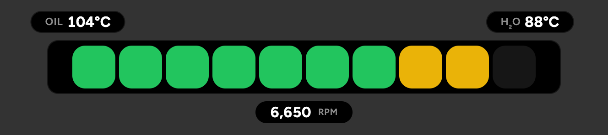

### Shift Light

A standalone shift indicator for drivers who do not need the full Tachometer widget.

**Features:**

- Automatic shift cues or custom shift points for each car and gear
- Glow, border, or pulse indicators with configurable colour
- Optional RPM readout


### Widget Group

Places several widgets in one frame and shows them on the overlay as one widget. Works under iRacing and Le Mans Ultimate.

**Features:**

- Move and resize the group in edit mode like any widget, or set its width and height in its settings
- One scale for the whole group, and a scale of its own for each widget in it
- Position, size and drawing order of each widget, set one at a time in any order, with a preview of the saved layout
- Layout editor in the settings: drag widgets and their edges, with snapping to the grid, the frame and each other, then save, revert or reset the layout
- Several groups, each with its own frame, scale, widgets and layout. A widget is in one group at most, and deleting a group returns its widgets to the overlay
- Each group has its own session visibility rules, hide shortcut and browser source, while each widget inside keeps its own settings
- A widget in the group leaves its own place on the overlay and returns to it, as it was, when removed. Switching the group off hides the widgets in it

### Car Systems

Displays your car's in-car adjustments in one compact widget.

**Features:**

- Live brake bias, ABS, traction control, and other adjustments supported by your car
- Car-specific control labels, including brake migration, brake valves, and engine maps
- Configurable columns, with independent options to hide unsupported or switched-off systems
- The dial you just moved lights up, and the widget can stay off screen until you move one: it then appears for a few seconds with every column in its usual place
- The ABS column lights while ABS is working, and an optional small figure under the brake bias shows how far it has moved since the car last stood in the pits
- Works under Le Mans Ultimate, with a column list of its own: brake bias, ABS, traction control (TC), TC slip, TC cut, brake migration and the engine or motor map, plus the anti-roll bars, the wipers and the setup's regeneration level, which are off by default. A dial the car does not have reads `--`, or is left out with the option above. Under LMU the TC column also lights while traction control cuts power, each dial can show the top of its scale (`6/11`), and the names are the sim's own, the same on every car. The regeneration level is the garage's figure and may not follow a change made on track


### Tyres

Shows the state of your tyres and brakes, one axle per block. Le Mans Ultimate only: iRacing does not publish tyre temperatures while the car is moving.

**Features:**

- Tyre temperature across the tread, drawn as a gradient from the outer shoulder to the inner one, with the average as the headline number
- Choice of which temperature to show: tread surface, the rubber layer under it, or the carcass
- Working window that follows the temperature the sim states for the fitted compound, or one you set yourself: blue when cold, green in the window, yellow to red when overheating
- Live tyre pressures in psi, kPa or bar, optionally coloured against a target hot pressure per axle
- A pressure is drawn blue while its tyre is cold (carcass under 65 °C by default), whatever the target says: a cold pressure cannot be judged against a hot target
- Optional offset under each pressure, showing how far it sits below the highest of the four, averaged over a few seconds
- Brake temperature per axle, coloured against its own working window
- Optional tread remaining per tyre and the compound fitted to each axle
- Optional load bar under each tyre: its share of the load on all four wheels, growing outwards from the centre of the car and full at 50%, red when the wheel carries next to nothing. Le Mans Ultimate withholds tyre load, so the share is taken from suspension load and is an estimate: the split between left and right is sound, the split between front and rear is approximate
- Optional tyre deflection in millimetres, red when the wheel is off the ground
- Adjustable background opacity, session visibility and an option to show only when on track

### Tyre & Brake Wear

Shows how long your tyres and brake discs will last: what is left on each wheel, what a lap costs and the laps that makes. Le Mans Ultimate only: iRacing refreshes tread only while the car is in the pits and publishes nothing about brake discs.

**Features:**

- The four wheels as the car has them, the front axle above the rear, with the compound fitted between each pair of tyres
- Tread left on each tyre in percent, amber at or below 30 and red at or below 15, with the wear per lap and the whole laps left under it, red at five laps or fewer. Optionally the minutes those laps take at your pace, and the tread expected when the fuel or virtual energy on board runs out
- The wear per lap is the middle one of your last five clean laps on that tyre, so one lock-up does not swing the forecast; it can be switched to what the lap under way is heading for. A tyre without a lap of its own starts from the session's laps on the same compound, then from what the compound cost in earlier sessions on this track in this car. Such estimates are drawn in grey italics
- Before any of that exists the widget shows the tread with `--/lap`, and from a quarter of the way round the first lap what that lap is heading for, in italics. The first clean lap replaces it
- Brake disc thickness on each wheel in millimetres, or the share of usable disc left, with the wear per lap and the laps left to the failure thickness once they are below 999. `FAIL` marks a disc at or below its failure thickness, or one that no longer wears under braking
- A flat tyre is marked `FLAT`
- Disc thickness comes from the REST API of Le Mans Ultimate. Where it does not answer the brake section shows dashes; when it stops answering mid-session the section says so instead of holding the last reading, which would look like a disc that had stopped wearing
- Each section can be switched off; adjustable warnings, background opacity, session visibility and an option to show only when on track. While a team-mate drives the car the sim publishes no wheel data, and the widget hides

**What is yours to set.** Le Mans Ultimate states neither the tread at which a tyre is finished nor the thickness at which a disc fails, so both are settings. _End Of Life_ is 0 % by default: the laps are counted to a tyre with no tread at all, which no tyre reaches in practice, so raise it to the tread at which your tyres stop working. The two failure thicknesses are 0 by default, which leaves them to a thickness the widget saw a disc of that car stop wearing at, and failing that to 25 mm for a Hypercar or LMP2 and 30 mm for an LMGT3 or GTE car. Those two figures are TinyPedal's and have not been confirmed under Le Mans Ultimate. An LMP3 has none, and shows thickness and wear without life or laps left.

**What is confirmed and what is not.** One recorded race stands behind this widget: an LMGT3 on mediums that wears about half a percent of tread a lap, some two hundred laps to nothing, and loses one to three micrometres of its 36 and 32 mm discs a lap, which puts their laps left far beyond the cap. Not seen on any recording: a tyre change, wets, a set run to a low tread, a prototype's carbon discs, a brake change, a flat tyre and a failed brake, so how a failure reads is built on how the sim is understood to report it.

### Chassis

Shows how your car sits on the road, a row per figure. Le Mans Ultimate only: iRacing publishes no ride height, camber or toe while the car is moving.

**Features:**

- Ride height at the four corners in millimetres, with a bar each and a red warning below a bottoming height you set per axle
- Rake as an angle and in millimetres, blue when the nose is the higher end
- Roll at the front and rear axle, positive with the right side higher, and optionally the share of the roll the front axle takes
- Camber at each wheel, amber when a wheel is upright or leaning out
- Toe as the total of each axle, in or out, or at each of the four wheels
- Optional suspension travel at the four corners
- The sim publishes no wheelbase or track widths, so the rake and roll angles use lengths you enter (2800 mm and 1800 mm by default) and are as good as those numbers; the millimetres are the sim's own
- Each row can be switched off; adjustable background opacity, session visibility and an option to show only when on track

### Damage

Shows your car from above and what has happened to it. Le Mans Ultimate only: iRacing publishes no body, aero or suspension state.

**Features:**

- Car diagram, nose up: eight body zones around the outline, grey when sound, amber for a light dent, red for a heavy one, and black with a red edge for bodywork that has come off
- A wheel in each corner, coloured by suspension damage from green through amber and orange to red. A flat tyre is an empty red rim, and a wheel that has come off is black with a red edge. Detached parts pulse, which can be switched off
- Last impact: a red wedge towards where the car was hit, for 15 seconds. A touch too light to be contact with a car or a wall, such as a kerb or the floor on the road, is not marked unless it leaves damage
- Aero, body and suspension integrity and the tread left on the most worn tyre, in per cent, each turning red at a threshold you set. The figure in the middle of the car is the aero figure, the body figure or nothing, and can count damage up instead of integrity down
- Repair line: what the pit menu is set to repair, in the sim's own words, and the time it adds to the next stop. It appears once there is something to repair
- A thermometer in the car while the sim shows its overheating warning
- Options to show the widget only when the car is damaged and only when on track, plus background opacity and session visibility

**What is confirmed and what is not.** One recorded race stands behind this widget, with five knocks to the nose. Confirmed on it: a light dent in the front zone, when an impact happened and where it came from, the aero damage figure, and the repair the pit menu offers ("Do Not Repair" and "Repair Body"). Not seen on any recording, and built on how the sim is understood to report them: dents in the other seven zones, heavy dents, a lost rear wing, a lost wheel, a flat tyre, suspension damage and its scale, the overheating warning, and a repair that has actually been chosen, so the repair time has only ever read zero. Any of these may turn out to be drawn in the wrong place or not at all. The force below which an impact is not marked rests on the same five impacts: three knocks against other cars read 1,233 to 3,017 on the sim's own scale, two brushes read 40 and 63, and the line is drawn at 250.

### Friction Circle

Shows how hard your car is cornering against how hard it is braking or accelerating, in g. Works under iRacing and Le Mans Ultimate.

**Features:**

- A dot at the current reading, with a fading trail of the last few seconds (1 to 10, four by default)
- Rings at each whole g and a cross through the centre; the edge of the circle is a scale you set, from 1 to 6 g. A reading beyond it is drawn on the edge, with the dot in amber
- Choice of direction: where you are thrown (up under braking, to the right in a left-hand corner) or where the car is being pushed (the other way round)
- Lateral and longitudinal g as figures in the top corners, and the highest of each over the last five seconds in the bottom corners
- A dashed ring at the best lateral g the car has held through a corner lately, which a kerb or a single spike does not move
- For two seconds after an impact the maxima and the ring are not raised, so a knock is not taken for grip. Le Mans Ultimate states when the car was hit; under iRacing the moment your incident count rises stands in, which misses contact that costs no incident points
- The rings, the trail, the dashed ring and the figures can each be switched off; adjustable background opacity, session visibility and an option to show only when on track

iRacing's readings include gravity and Le Mans Ultimate's do not, so on banking and on a gradient the iRacing dot sits off centre by the slope's share of 1 g.

### Brake Performance

Shows how hard you stopped: the peak deceleration of each braking zone against your best. Works under iRacing and Le Mans Ultimate; the wheel lock times are Le Mans Ultimate only.

**Features:**

- Peak deceleration in g of the braking zone in progress, then of the last one completed. A zone runs from the brake going on to the brake coming off; pumping the pedal within a quarter of a second is one zone, and a stop shorter than 0.3 s or softer than 0.5 g is not counted
- How the last stop compares with your best, as a percentage or in g: green when harder, amber when softer
- Choice of what "best" means: the hardest stop of roughly the last minute, which follows the tyres and the fuel load, or the hardest of the session
- Zone detail: the speed the stop began and ended at, how far and how long it ran, its average deceleration, and how long the ABS was working. While you are on the brakes it shows the entry speed with the distance and time running
- Speeds in km/h or mph, following the sim or set by hand; the distance follows in metres or feet
- Wheel lock time: how long a front and a rear wheel were locked under braking on this lap, amber above zero and red from one second. Le Mans Ultimate only, because iRacing publishes no wheel speeds
- A stop that runs into something is discarded and never becomes a best. Le Mans Ultimate states when the car was hit; under iRacing the moment your incident count rises stands in
- Adjustable background opacity, session visibility and an option to show only when on track

**What is confirmed and what is not.** On a recorded Le Mans Ultimate race in an LMGT3 the widget finds 26 braking zones in four minutes, with a best of 2.39 g, and discards the two stops that ran into another car. That car has ABS and never locked a wheel, so the lock times have only ever read zero on a recording. On a recorded iRacing race a single frame of 3.68 g, with no incident counted for it, stands as the best stop of the race where the hardest clean stop is 2.16 g: under iRacing a kerb strike or a light touch can still be taken for braking.

### Hybrid

The hybrid battery of your car: how much charge is left, whether the motor is deploying or regenerating, and what the lap has cost. Le Mans Ultimate only, and drawn only for a car that has the system: a car whose motor never states what it is doing and whose battery charge never moves, such as a GT3, an LMP2 or an LMP3, gets no widget at all rather than an empty one.

**Features:**

- Battery charge as a large figure and a bar: red when nearly empty, amber when nearly full, because a full battery has nowhere to put what the next braking zone recovers. Both thresholds are adjustable, and the figure can pulse ten times as it enters either band
- A chip that reads DEPLOY, REGEN or IDLE
- Charge used and recovered on this lap, in percentage points. For the first seconds after the line they hold last lap's totals, marked LAST, so they can be read on the straight
- Net: what this lap is on course to add to or take from the battery, measured against your last clean lap at the same point of the track. Blank until a lap has been driven from the line without a visit to the pits
- Seconds the motor has spent deploying on this lap
- Optional motor row: motor and coolant temperature coloured against overheat thresholds, motor speed, torque, power and the sim's regeneration reading, in Celsius or Fahrenheit and kW, hp or PS
- Adjustable decimals, background opacity, session visibility and an option to show only when on track

**Not verified yet.** No recording of a hybrid car exists, so the widget is built from the sim's data layout and from how TinyPedal reads the same fields, and has only been tested on hand-built data. In particular:

- The motor states (idle, deploying, regenerating) are numbered as TinyPedal numbers them. Where the sim states none for a car whose charge moves, the state is inferred from the charge rising or falling
- The units of the motor row are unconfirmed. Temperatures may be written in Celsius or in Kelvin, so a reading above 200 is taken as Kelvin; the regeneration reading is taken to be a power in kilowatts
- Which cars have a hybrid system is read from the car, not from a list of classes: the widget appears once the motor states what it is doing, or once the charge is seen to move. A car for which the sim states no motor state therefore gets its widget at the first deployment or braking zone rather than at once
- Under iRacing the widget is switched off until a session in a hybrid car has been captured to confirm the names and scales of its battery data

### Lift and Coast Lights

A strip of lights for the top of the screen that follows Le Mans Ultimate's own lift-and-coast signal, the one behind the lights in the car when an energy-saving target is set. Le Mans Ultimate only: iRacing has no such signal.

**Features:**

- The strip fills as the signal rises: one light for any signal at all, every light when it is full
- The lit lights turn from violet to pink once the signal passes a threshold you set (80 % by default): lift now
- Without a target, in a car or a session that has none, the signal reads zero and the strip stays dark, or is not drawn at all with **Hide While Dark**
- ABS takes the whole strip in yellow while it works, and traction control in blue while it cuts power. Each can be switched off
- 3 to 20 lights, filling right, left, up or down, with an optional mirrored second strip; the lights size themselves to the box
- Transparent by default, with an adjustable background, session visibility and an option to show only when on track

**Not verified yet.** The signal reads zero for the whole of the one recording there is, a GT3 with no saving target, so how it rises on the approach to a corner and where the sim's own lights change have not been seen. The 80 % threshold is the point TinyPedal changes colour at. Two further stages, a locked wheel and wheelspin, are specified but switched off and greyed in the settings: they need the slip ratio of each wheel, which Tearoff does not measure yet.

### Standings

Displays standings information for the current session.

**Features:**

- Driver information: position, car number, country flags, driver name, team name, pit status
  - Country flags: Support for 250+ countries, can be enabled/disabled, shows iRacing flag for unaffiliated drivers
  - Driver name format: Multiple display formats (e.g., "J. Smith", "John S.", "John Smith", etc.)
  - Configurable name subtext: Show the team below the driver name or the driver below the team name; team names appear beneath driver names by default in team sessions
  - Pit status indicators: DNF (red), TOW (orange, animated), OUT (green), PIT (yellow, animated), last pit lap number, repair/meatball flag (orange dot), penalty/black flag (orange), slowdown (orange, animated)
  - Optional pit time display
  - Pit lap display mode: Show pit lap number or laps since last pit
  - Compact Mode: Three levels (Off, Compact, Ultra) for maximum information density
  - Incidents & Off-tracks: Driver rows highlight in yellow when they go off-track
  - Spectator Support: Automatically follows the driver you are watching in iRacing
- Driver Tags: Assign color-coded visual indicators to specific drivers
  - Preset groups: Dangerous, Friend, Twitch, YouTube — each with a unique icon and color
  - Custom groups with custom names, colors, and icons (600+ icons or uploaded images)
  - Display styles: icon badges or compact colored pills
  - Driver labels: custom display names that alternate with the real driver name on a configurable timer
  - Toggle the driver tag column on or off per widget
- Car details: manufacturer (with option to hide if single-make series), tire compound
- Driver badges with multiple format options (license/rating combinations)
  - Full iRating: Option to display the full iRating value instead of just the badge
- Styling customizations: toggle minimal license badges, minimal status badges, position background color, and car number background/border independently
- Timing information: gap, interval, best lap time, last lap time (multiple time format options)
  - Configurable decimal precision (1, 2, or 3) for gap and interval
  - Gap and interval display in practice and qualifying sessions
  - Lapped cars in laps: a car more than a lap behind reads "-2L" instead of a time, while cars on the same lap read in seconds. The gap always works this way; the interval does when **Interval Display** is **Laps When Lapped**, the default for a new dashboard (**Time** keeps "3:35")
  - A last lap the sim gave no time is dimmed and marked with a warning sign: a lap voided for track limits or a cut, or an out-lap (Le Mans Ultimate only; can be switched off)
  - Optional **Avg 5** and **Avg 10** columns: each car's average lap time over its last 5 and its last 10 laps, each in a time format of its own like Last and Best. A column reads `--` until the car has that many laps; it never shows the average of fewer. Off by default, in iRacing and Le Mans Ultimate
  - **Averages over** (Options tab) chooses which laps those two columns count. **Clean laps**, the default: laps Tearoff watched from line to line with the car never on pit road, so in-laps and out-laps are left out, and so is the lap a car was on when it was first seen. Nothing else is left out: a lap under yellow counts, and so does a lap Le Mans Ultimate voided for track limits, with the time it took. **All laps**: every lap that has a time, pit laps included
  - Optional **vs stint** column, the one the [Timing Tower](#timing-tower) has: the average clean lap of the stint a car is on, less that of an earlier stint of the same car, negative and green when it is quicker, positive and red when slower, `--` until the stint has three clean laps and there is an earlier stint to compare with. **Pace against** (Options tab) holds it against the previous stint or the previous driver. Off by default, in iRacing and Le Mans Ultimate. While the column is on Tearoff records the race for it; while it is off nothing is recorded on its account
- Optional column headers
- Class headers:
  - Estimated race lap counts, or scheduled totals in fixed-lap races
  - Compact Strength of Field values and optional manufacturer counts
  - Cars still running of the cars entered ("12/14") once a car of the class is out
- Class ordering: Use iRacing's class order or sort by each class leader's overall position
- Optional Push-to-Pass column, showing a driver's active state and remaining time in supported series
- Configurable radio icon duration, so recent transmissions remain visible without flickering
- iRating change display, with optional hypothetical estimates during online practice
- Lap time deltas (configurable number of laps: 1-5)
- Title bar with session progress bar
- Header and footer bars with customizable items and display order:
  - Session name, session time (remaining/elapsed), session clock time, incident count
  - Enhanced incident display showing your count against the initial and subsequent incident limits (e.g. "3 / 8 / 12 x")
  - Session clock time: the in-game time of day in the system's, the 24-hour or the 12-hour format, with how fast the in-game day runs beside it ("x2") when that is not real time. The speed is measured from the sim's two clocks, so it appears about five seconds into a session
  - Optional countdown beside the clock to the next of sunrise, midday, sunset and midnight ("4:47:40"), in real time or in in-game time. Neither sim says when the sun rises and sets, so you enter the two times for a track once, in the item's own settings while a session at that track is running; they are kept with the track, and there is no countdown for a track that has none
  - Brake bias, local time, track wetness, precipitation, humidity, wind speed/direction
  - Air and track temperature (Metric/Imperial units)
  - Track name
  - Fuel level, last and best lap times, top speed, manufacturer position, and class rank
  - Overall position against the field, and places gained or lost since the grid (in class or overall)
  - Session laps as a lap number, or as laps done against your own projected distance at the flag ("2.72 / ~10.3 +1")
  - Session time: configurable mode (Remaining/Elapsed), format, and label style
  - Accurate race clock for fixed-lap races (calculated from P1 average lap time)
  - Remaining-lap estimates in lone qualifying
- Driver standings configuration:
  - Drivers to show around player
  - Drivers to show in other classes
  - Minimum drivers in player's class
  - Top drivers to always show
  - Configurable divider line between pinned and remaining drivers
- Optional position change column (arrows vs qualifying grid baseline)
- All drivers shown immediately at practice/pre-qualifying start (sorted by car number)
- Toggle to strip car numbers from driver names
- Customizable display order for all columns
- Widget scaling from 50% to 200%
- Adjustable background opacity
- Option to show only when on track
- Option to use live position standings (updates continuously vs only at start/finish line)
- Session visibility settings (Race, Lone Qualify, Open Qualify, Practice, Offline Testing)


### Relative

Displays drive relative delta information for the current session.

**Features:**

- Driver information: position, car number, country flags, driver name, team name, pit status
  - Country flags: Support for 250+ countries, can be enabled/disabled, shows iRacing flag for unaffiliated drivers
  - Driver name format: Multiple display formats (e.g., "J. Smith", "John S.", "John Smith", etc.)
  - Pit status indicators: DNF (red), TOW (orange, animated), OUT (green), PIT (yellow, animated), last pit lap number, repair/meatball flag (orange dot), penalty/black flag (orange), slowdown (orange, animated)
  - Optional pit time display
  - Pit lap display mode: Show pit lap number or laps since last pit
  - Compact Mode: Three levels (Off, Compact, Ultra) for maximum information density
  - Incidents & Off-tracks: Driver rows highlight in yellow when they go off-track
  - Spectator Support: Automatically follows the driver you are watching in iRacing
- Driver Tags: Assign color-coded visual indicators to specific drivers
  - Preset groups: Dangerous, Friend, Twitch, YouTube — each with a unique icon and color
  - Custom groups with custom names, colors, and icons (600+ icons or uploaded images)
  - Display styles: icon badges or compact colored pills
  - Driver labels: custom display names that alternate with the real driver name on a configurable timer
  - Toggle the driver tag column on or off per widget
- Car details: manufacturer (with option to hide if single-make series), tire compound
- Driver badges with multiple format options (license/rating combinations)
- Styling customizations: toggle minimal license badges, minimal status badges, position background color, and car number background/border independently
- Relative delta timing display with configurable precision
- Timing information: best lap time, last lap time (multiple time format options: full, mixed, minutes, seconds-full, seconds-mixed, seconds)
  - A last lap the sim gave no time is dimmed and marked with a warning sign (Le Mans Ultimate only; can be switched off)
  - Optional **Avg 5** and **Avg 10** columns, the average of each car's last 5 and last 10 laps over clean laps or all laps, as in [Standings](#standings); they need a wider widget than the default
  - Optional **vs stint** column with its **Pace against** choice, the pace of each car's stint against an earlier one, as in [Standings](#standings); off by default
- Optional Push-to-Pass column, showing a driver's active state and remaining time in supported series
- Configurable radio icon duration, so recent transmissions remain visible without flickering
- Lap time delta column (configurable number of laps: 1-5)
- Optional flag contour: draws a colored border around the widget when a session flag is active, with configurable border width
- iRating change display (optional)
- Enhanced gap calculation with advanced options:
  - Interpolation methods (linear, cubic spline)
  - Configurable max lap history (3, 5, 7, or 10 laps)
  - Uses position/time records for accurate multi-class gaps
- Title bar with session progress bar
- Header and footer bars with customizable items and display order:
  - Session name, session time (remaining/elapsed), session clock time, incident count
  - Brake bias, local time, track wetness, precipitation, humidity, wind speed/direction
  - Air and track temperature (Metric/Imperial units)
  - Track name
  - Fuel level, last and best lap times, top speed, manufacturer position, and class rank
  - Overall position, places gained since the grid, and session laps as laps done against your projected distance
  - Session time: configurable mode (Remaining/Elapsed), format, and label style
- Configurable number of drivers to show around player (1-10)
- Optional position change column showing positions gained or lost within each class from the qualifying grid during races
- Optional pit-stall filtering to hide stopped drivers while keeping pit-road traffic and the focused car visible
- Toggle to strip car numbers from driver names
- Customizable display order for all columns
- Adjustable background opacity
- Option to show only when on track
- Option to use live position (updates continuously vs only at start/finish line)
- Session visibility settings (Race, Lone Qualify, Open Qualify, Practice, Offline Testing)


### Class Fields

The field at a glance: one chip per class with the cars still running and the cars entered, for a multi-class race where the full Standings table is not on screen. Works in iRacing and Le Mans Ultimate.

**Features:**

- Each class as the Standings draw it, its name on the class colour, followed by the cars still running of the cars entered: "12/14"
- A car is out once it is parked in its garage, has retired or been disqualified, or has left the session. A car stopped at its pit box is still running, and so is a car that has finished: the end of the race is not counted as cars going out
- Classes ordered by the overall place of each class's leader, so the strip reads as a legend of the race, or fastest class first as the Standings list them
- Your own class outlined; while you watch a car during a team-mate's stint, the class of the car you are watching
- Optional count of the cars out, and of the class's cars in the pit lane
- A row or a column, and a limit on the classes shown that always keeps your own
- Adjustable background opacity, session visibility and an option to show only when on track

iRacing has no garage flag: a car that is not in the world counts as out, which covers both a driver who has left and one sitting in the garage, so most of a practice field reads as out. Le Mans Ultimate states the garage stall and the finish status for every car.

### Timing Tower

The whole field in one dense table, a row a car: made for a panel of [the Pit Wall](#the-pit-wall), where it fills the panel and scrolls under a header row that stays, and usable on the overlay as a window of its own. Off by default. Works in iRacing and Le Mans Ultimate.

Where the overlay Standings is trimmed to the cars around you, the tower lists everybody, with the pace of each car beside its times: the average of its last 5 and last 10 laps, and how its stint compares with the one before.

**Features:**

- A tab for each class and one for **All**. It opens on the class of your own car, in class order with places and gaps in class; **All** is the whole field in overall order, each number on its class colour, with places overall, the gap to the leader of the race and the interval to the car one row up. A session of one class has no tabs
- Your own car in amber. That is your own entry, which stays yours while a team-mate drives it and while the camera is on another car. The list keeps its row in view, as the order changes and when you change tab, until you scroll the list yourself
- Columns, in this order, each of which can be switched off: **P**, **#**, **Driver** with the team under the name, **Gap**, **Int**, **Last**, **Best**, **Avg 5**, **Avg 10**, **vs stint**, **Sect**, **Stops**, **Stint**, **Energy**, **Tyres**
- After the driver's name, a tag: **PIT** in the pit lane, **OUT** on the lap a car leaves it on, **GAR** in its garage, **AWAY** when it is not in the world, **DNF** and **DQ**
- **Last** is purple when it is the best lap of the class and green when it is the car's own best; **Best** is purple for the best of the class. A last lap Le Mans Ultimate gave no time is dimmed and marked
- **Avg 5** and **Avg 10** by the Standings' own rule: `--` until the car has that many laps, never the average of fewer
- **vs stint**: the average clean lap of the stint a car is on, less the average clean lap of an earlier stint of the same car. Negative and green is quicker than before, positive and red is slower. It reads `--` until the stint has three clean laps and there is an earlier stint with a clean lap to compare with. A clean lap here is one the sim timed, off pit road, not under a full-course yellow and not the first lap of a race
- **Sect** (Le Mans Ultimate): three squares for the car's most recent first, second and third sector. Purple is the best of the class, green the car's own best, amber slower than that, grey no time yet. While a lap is under way the squares of the sectors not driven yet are still the lap before's
- **Stops** and **Stint**: pit stops made, and laps completed since the last
- **Energy** (Le Mans Ultimate): virtual energy left in percent for a car that runs on it, and fuel left, marked with a pump, for one that does not
- **Tyres**: the compound, or four marks where the wheels differ. For the cars of your own class, beside it: the laps the car has run on its tyres and the tread left, as in `17 ~86%`. See [the tyres of your class](#the-tyres-of-your-class) below. Both can be switched off, which leaves the compound
- Two switches in the tower's header, each starting from a setting and kept for as long as the tower stays on screen: **Averages over** clean laps or all laps, as in [Standings](#standings), and **Pace against** the previous stint or the previous driver. The previous driver is the most recent stint somebody else drove, which after a double stint is not the stint before. A header short of room writes them shorter before it takes a second row: **Avg** and **vs**, then **Clean** and **Prev stint**; pointing at a button gives its name in full
- On a panel too narrow for every column the tower leaves columns out rather than scroll sideways, the least important first: Stops, Int, Best, Sect, Tyres, Energy, Stint, Avg 10, Last, Gap, Avg 5, vs stint. What the Tyres column carries beside the compound goes before any column does, the tread first and then the laps: they are shown where there is room for them, which a tower of 930 or wider has with every column on. The place, the number and the driver always stay
- Name format, the team line, the status tag, background opacity, session visibility and an option to show only when on track. Its type does not follow the General font size: use the tower's own scale

**What each sim gives.** Under iRacing the tower has no **Sect** and no **Energy** column, since iRacing times nobody else's sectors and publishes no fuel for another car, and its **Stops** are the stops seen since the tower was first shown. Le Mans Ultimate counts the stops itself.

#### The tyres of your class

No sim says that a rival changed tyres. Tearoff works the laps on a set out backwards from now, one stop at a time, from the stints and stops the race history holds, and writes them with how sure they are:

- **Bare**, as in `17`: another compound was seen on the car after a stop, or it has not stopped since the start
- **With `?`**, as in `17?`: told from how long the car stood at a stop. Longer than its refill and its driver change explain by what four tyres take, and a set likely went on then; shorter than four tyres take, and the set before is likely still on, which is how a car comes to show more laps than its stint has
- **With `+`**, as in `17+`: at least that many. Counted from a stop that cannot be judged, a spell in the garage, or laps Tearoff did not see, at which any set may have gone on

The tread is an estimate, marked `~`: what a lap costs your own car's tread on that compound, the mean of its four wheels over its clean laps, times the laps the other car has run on its set. It is your wear applied to their laps, and another car wears its tyres differently. It reads `--` until your own car has three clean laps on the compound, in this session or in earlier ones on the same track, and for a compound you have not run. Where the laps are only a floor it reads `<` in place of `~`: no more than that.

Your own car shows its real tread, without a mark, and the laps since its ledger last saw a tyre go on. So does every other car where the sim publishes its tread, which Le Mans Ultimate does offline against the AI: there a reading that goes back up in the pits is a set seen to go on, and the figure is the sim's own. Online a rival's tread reads 100 % all race; Tearoff takes a reading for the car's own only once it has been seen to fall, and estimates until then.

What a refill takes is costed with the rates Le Mans Ultimate states for your own car, and so is a change of four tyres, unless you set **Tyre Change Takes** on the tower's Columns tab. Both stand for the rest of the class, which is a guess. Under iRacing there are no such rates and no tread to read: a set is either the one from the start, one seen to change compound, or at least as old as the laps since the last stop, and only the laps are shown.

What it gets wrong: a change of two tyres, which takes little longer than a slow refill and is counted as none; a repair or a penalty served at the stop, which reads as time for tyres. What it cannot tell, and marks `+`: a new set of the same compound at a stop whose refill it cannot reckon, which online is every stop of a car whose fuel the sim withholds. None of this has been checked against a race with pit stops: no recording of one exists.

Cars of other classes show their compound and nothing more. While the laps are shown Tearoff records the race for them.

**What it knows, and from when.** The stints behind **vs stint** and the laps on a set of tyres are the race history's: they are known from when Tearoff began recording the race, and showing either is what has the race recorded. The sector bests are the quickest sectors driven since the tower was first shown in the session, and are kept while its window is hidden or closed; only the first sector also takes the sim's own best, which reaches back to the start of the session. Le Mans Ultimate's own best figures for the second and third sectors are not sector bests and are not used.

**Not verified yet.** Nothing of the tower has been seen in a live game. The one Le Mans Ultimate recording has no pit stop and no driver change, so the pace against an earlier stint, the stops and the tags have been checked on staged data only, and the sector marks on the recording's two and a half laps of green running.

### Track Map

Displays a track map with the current position of the cars on track and the track layout with the turn numbers / names. Works in iRacing and Le Mans Ultimate.

**Features:**

- Real-time car positions on track (live telemetry)
- Track layout visualization
- Optional turn numbers and names display
  - Toggleable high contrast backgrounds for turn name labels
  - Adjustable turn name font sizes
- Pit lane highlighting with "P" indicators for cars in the pits
- Show/hide car numbers on driver circles
- Configurable driver and player circle sizes (10-100px)
- Configurable track line width (1-100px) and outline width (1-150px)
- Option to invert track colors (black track with white outline)
- Option to use highlight color for player circle
- Custom player car icon: upload an image (PNG, JPG, GIF, WebP, SVG) to replace your player circle
- Option to use an inverted color for the leader to make them stand out
- Multi-class support
- Session visibility settings (Race, Lone Qualify, Open Qualify, Practice, Offline Testing)
- Race positions: Driver circles can display their current race position
- Off-track highlighting: Car markers highlight when a driver goes off the track (yellow outline)
- Styling customizations: toggle minimal track outline and minimal car marker shadows

**In Le Mans Ultimate:**

- The circuit is drawn from the map that comes with the session, the same one the Minimap uses: bundled for 31 circuits, otherwise drawn from your first full lap. Until then the widget says that it has no map of the track yet
- The car marked as yours is your own entry, also while a team-mate drives it, or the car the camera is on
- A sector under a local yellow flag is painted yellow over the whole width of the road
- The game times three sectors and does not say where they start, so sector colours, sector marks and the yellow sector appear once you have driven one clean lap of the circuit, from the line and back to it. The starts are kept for the circuit from then on. Until then the map is drawn without them rather than with the sectors in the wrong place
- Turn numbers and names are shown only on the circuits whose bundled map has them, and sit on the road rather than beside it
- Cars are never outlined as off track: the game does not report it for other cars
- With "show only when on track" the map stays up while you watch a car on track, such as a team-mate's stint


### Minimap

A close-range map of the track around the car you are watching, with the cars near you. Works in iRacing and Le Mans Ultimate.

**Features:**

- A circular map centred on your car, showing the stretch of track within a range you choose (75 to 800 m)
- Every car in range as a marker coloured by class, labelled with its position, class position or car number
- Your own car in white with a ring in your highlight colour
- Fixed orientation, matching the full track map, or heading up so your car always points to the top
- Other parts of the track that pass close by are drawn too, with the cars on them
- Start/finish line marker, and cars on pit road drawn faded
- In Le Mans Ultimate the map comes with the session; a circuit without a bundled map appears after one full lap has been driven
- Adjustable track width, marker size, background opacity, session visibility and an option to show only when on track

### Elevation

The height of the track along the lap as a filled profile, with your car's place on it. Works in iRacing and Le Mans Ultimate.

**Features:**

- The whole lap from the start/finish line to the start/finish line, the part already driven tinted, with a mark and a dot where the car is
- The height where the car is, read off the profile, measured from the lowest point of the lap or from the start/finish line (then signed), in metres or feet
- The lap's height range, and a dashed line where each sector starts. Le Mans Ultimate does not say where its sectors start, so there they are learned from your first clean lap at the track and no line is drawn before that
- The profile is recorded once for each track, from the first lap you drive from the line to the line without visiting the pits, and kept. Until there is one the widget says so, and shows how far round the recording lap you are
- In Le Mans Ultimate the profile is the height of the road as the sim states it, and a TinyPedal track map of the same name on your computer is used until your own lap replaces it
- iRacing states no height while the car is driven, so the profile there is worked out from the car's motion over the first three clean laps: the shape of the lap rather than a survey of it
- **Record again** in the widget's settings drops the stored profile, so the next clean lap records a new one
- While you watch another car the mark is that car's
- Adjustable background opacity, session visibility and an option to show only when on track

### Cruise

Where your car points and how far you have driven it: a compass heading, the height of the road, the distance and the time you have driven on this track in this car, and the distance into the lap. Works in iRacing and Le Mans Ultimate.

**Features:**

- Compass heading as three digits with its bearing ("045° NE")
- Distance driven and time on track, for this track and car over every session or for this session only. The time counts while the car is moving, the distance in the pits as well
- Elevation and distance into the lap, in metres or feet; distance driven in kilometres or miles
- An optional compass dial: the rose turns under the car, the white line is the car's own axis, and an amber needle shows the way the car is going. The needle turns red when the two are more than 10 degrees apart
- Cells can be reordered and switched off, as a grid of three over two or as one strip
- The totals count while the widget is enabled, and are kept in Tearoff's settings folder. A dash is shown until they have been read, and while you are out of the car or watching another one: the figures are of your own driving

**Limitations:**

- Le Mans Ultimate states no north, so the compass takes the track model's own +Z axis for it. Whether that agrees with a map of the real circuit depends on how the track was modelled
- Elevation is the height in the track model's own coordinates, not an altitude above the sea, and can be negative
- iRacing states no height while the car is driven, so the elevation cell is not drawn there

### Track Notes

Your own notes for the track, shown when the car reaches the point each was written for. Works in iRacing and Le Mans Ultimate.

**Features:**

- Two kinds of note, each on its own line: a track note says where you are, a pace note says what is coming and can be shown early, by a distance in metres and by a time in seconds at the speed you are doing
- A note stays up until the next of its kind is reached, so the last note of the lap carries over the line; optionally it hides a set time after it appeared
- Notes marked Pit are shown on pit road only, in place of the others, or "Pit lane" where the track has none
- Optional comment under the note, up to three lines, and the distance to the next note
- The notes editor is the first tab of the widget's settings: a table of distance, kind, text, comment and pit mark for the track of the running session or any track you have notes for. Add a note, add one where the car is now, start from the corners of the track, shift every note along the lap, and delete. Changes are saved as you make them and reach the overlay at once
- TinyPedal's notes files (`.tptn` track notes, `.tppn` pace notes, or the same as `.csv`) can be imported, and your notes exported in the same layout, one file for each kind. Distances are metres into the lap, so a file written for Le Mans Ultimate comes in as it is; one written for another sim's version of a circuit will not line up
- Notes are kept per simulator and track, with at most 500 for a track
- While you watch another car the notes are for where that car is

**Limitations:**

- Pace notes are shown, not spoken
- At the wheel a note appears within a twenty-fifth of a second of the car reaching it. The place of a car you are watching is known to a thousandth of a lap, so its notes can be about 2 m early or late at Laguna Seca and 7 m at Le Mans

### Flat Track Map

Displays a simplified horizontal track map showing driver positions along a flat line representation of the track. Similar to Track Map but uses a linear horizontal layout. Works in iRacing and Le Mans Ultimate.

**Features:**

- Real-time car positions on horizontal track line
- Start/finish line with checkered flag
- Show/hide car numbers on driver circles
- Configurable driver and player circle sizes (10-100px)
- Configurable track line width (5-40px) and outline width (10-80px)
- Option to invert track colors (black track with white outline)
- Option to use highlight color for player circle
- Auto-scales to container width
- Multi-class support
- Cars in the pit lane are grey and lettered P

**In Le Mans Ultimate:**

- It needs no map of the circuit, so it is drawn for every track from the first moment
- A sector under a local yellow flag is painted yellow on the line, once one clean lap of the circuit has shown where the game's sectors start
- With "show only when on track" it stays up while you watch a car on track, such as a team-mate's stint

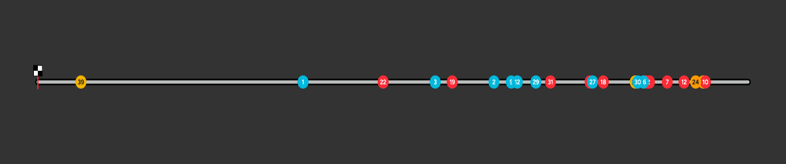

### Weather

Displays the weather information for the current session.

**Features:**

- Current weather conditions: track state, track and air temperature, wind speed and direction, humidity, precipitation, track wetness
- Vertical, horizontal compact, and horizontal full layouts
- Optional humidity display
- Customizable display order for all weather elements
- Temperature units: Auto (based on iRacing settings), Metric (°C), or Imperial (°F)
- Adjustable background opacity
- Option to show only when on track
- Session visibility settings (Race, Lone Qualify, Open Qualify, Practice, Offline Testing)

**Normal layout:**

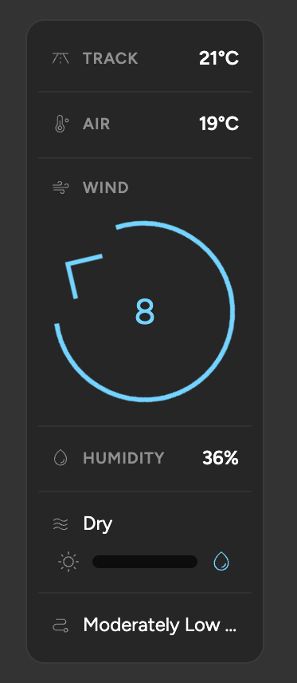

**Horizontal layout:**

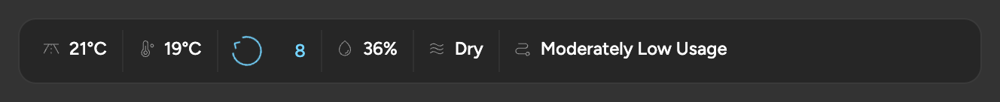

### Weather Forecast

Shows the weather as it is and Le Mans Ultimate's forecast for the rest of the session, as a row of small columns. Le Mans Ultimate only: iRacing publishes the weather as it is and no forecast.

**Features:**

- A "Now" column with the sky, the air temperature and how hard it is raining, with arrows while the temperature or the rain is on the move
- Up to four coming forecast points, soonest first, each with its sky, air temperature and chance of rain; a column whose point has begun drops out
- The first wet point stands out with a blue outline
- When each point starts, as time to go ("~12m", "~1.4h") or as the in-game clock time ("~15:40")
- Optional rain percentage, humidity and the forecast's wind for each point (Le Mans Ultimate does not apply wind on track, so it is not felt in the car)
- Temperature and wind units: Auto, Metric or Imperial
- Left-to-right or right-to-left, with or without the "Now" column, and a choice of keeping the row at its full width
- Uses the forecast of the running session: practice, qualifying or the race, and the race's for the warm-up
- Adjustable background opacity, session visibility and an option to show only when on track (it stays up while you watch a car on track)

**What the times rest on.** The sim publishes what each of its five forecast points holds, and not when it applies. Tearoff places them a fifth of the session apart, starting when the session clock does. In a race that is a fifth of the race's own length (the 15 minutes of a 15-minute race, not the session clock's end time, which also counts the time before the green flag); it is taken from the green flag once that has been seen, and from the race length the session is set to until then. This was measured on one recording: a dry race in real time, where the air temperature met the second and third points' values exactly at their times. In practice and qualifying it is a fifth of the session's length, which is assumed. A session whose weather changes, and one with a time scale above 1, have not been seen, so every time is written with a "~". In a race that ends on laps there is no time to show: the points stay in order with a dash for the time, and drop out as the leader covers each fifth of the laps, which is an assumption as well.

### Wind

Displays wind direction and speed as a standalone overlay.

**Features:**

- Wind compass with live direction and intensity
- Speed units: Auto, km/h, or mph
- Adjustable background opacity and on-track/session visibility controls

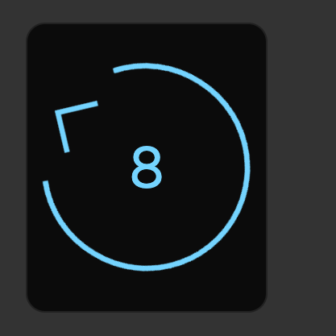

### Faster Cars From Behind

Displays information about faster cars approaching from behind, including driver name, distance, and a visual indicator that pulses when cars are close.

**Features:**

- Driver name and distance display
- Visual pulsing indicator when cars are close
- Configurable distance threshold for alerts
- Real-time detection of faster approaching cars
- Pit status filtering: Option to exclude cars in the pits
- Automatically hidden when on pit road
- Multiple driver display settings for more control over what's shown

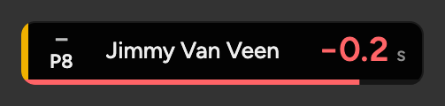

### Fuel Calculator

Displays comprehensive fuel management information including current fuel level, fuel consumption per lap (min, max, averages), pit window timing, fuel required to finish, and consumption history graphs. Features a complete redesign with visual layout editing and real-time consumption calculations.

**Features:**

- Fuel units: Liters (L) or Gallons (gal)
- Compact mode: Three levels (Off, Compact, Ultra) for information density
- Visual layout editing: Drag and drop widgets to customize your fuel display
- Layout options: Vertical or horizontal
- Real-time consumption calculations with pit strategy recommendations
- Multiple display widgets for flexible information presentation
- Consumption statistics:
  - Minimum consumption
  - Last lap consumption
  - 3-lap average
  - 10-lap average
  - Maximum consumption
  - Fuel required calculations
- Pit window timing information
- Endurance strategy display (total pit stops and stint info for long races)
- Consumption history graphs:
  - Histogram (default) or line chart
  - Optional lap table showing fuel used per completed lap
  - Configurable history length
- Configurable safety margin (0-20%) for fuel calculations
- Adjustable background opacity
- Earliest pit lap: Shows the earliest possible lap you can pit and still finish the race
- Fuel-to-add mode: Toggle between showing total fuel needed or just what's needed at the next stop
- Target consumption: Shows what fuel saving is required to reach specific lap targets (±1 from current estimate)

**In Le Mans Ultimate**, a Hypercar, LMDh or LMGT3 stops when its virtual energy runs out, so for those cars the calculator counts virtual energy instead of fuel:

- Every amount is percent of the energy budget, whichever fuel unit is chosen: the level, the use per lap, the averages, the history and the safety margin.
- Where a car on fuel shows the amount to add, a car on energy shows **Fill to**: the level to set in the pit menu, which takes virtual energy as the level the car leaves with. It is rounded up to a whole percent, is for a stop made at the end of the lap you are on, and falls by one lap's energy for every lap you stay out. `OK` means the energy already reaches the flag; `100%` in red means one stop is not enough.
- The fuel tank gets a line of its own under the energy bar, with the laps it lasts. The two are loaded to run out close together, and the car stops when either does, so the line turns amber and reads **Fuel ends first** when the tank will be empty before the energy.
- Lap history is kept per track and car model, separately for energy and for litres.
- LMP2 and LMP3 cars have no virtual energy and are counted in litres or gallons, as in iRacing.

**All sections enabled**, with histogram history, pit planning, fuel-saving targets, and time until empty:

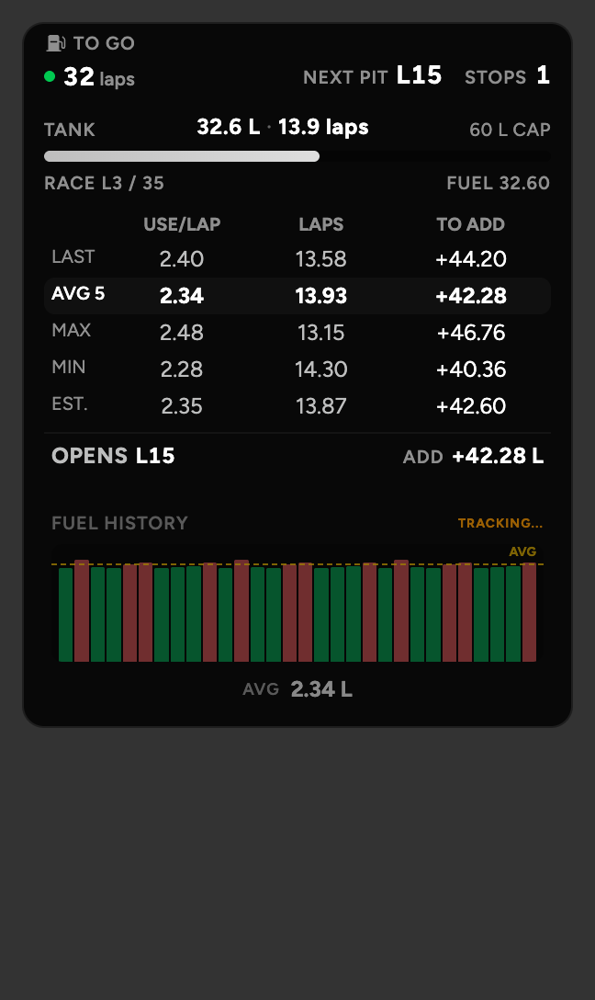

**Default layout**, with the header, fuel gauge, and consumption grid:


### Pit Stop

Answers the question asked before every stop: how long will it take, and where do I come out. Out on the circuit it shows what the visit costs against staying out, large, with the standing time and the pit lane time it is made of. In the pit lane it becomes a countdown, and for a few seconds after the exit it shows how the stop went against its plan. Both simulators, with less under iRacing.

**Features:**

- The loss: the time through the pit lane, the standing time and a configurable extra for reaction and the crew, less what the same stretch of track costs on the racing line
- The standing time of the next stop. Under Le Mans Ultimate it is the sim's own estimate, with a chip for each part that takes time: fuel, virtual energy, tyres, repairs, a driver change, brakes and a penalty. A drive-through to serve is shown as one chip and costed as a pass with no stop. It turns red at a threshold you set
- What the stop adds in fuel or virtual energy, how many laps and minutes the level set lasts, and what the race still needs when that level falls short of it
- In a race, your position after the stop, in class or overall, and the car numbers and gaps of the cars you will come out between. Cars close enough to pass you that are in the pits themselves are not counted and are shown as a count
- Cars standing in the pit lane over cars in it, and under Le Mans Ultimate how many stops are requested
- In the pit lane: the standing time still to go, counting down and on below zero in red if the stop overruns, a progress bar, the time in the lane and the planned standing time
- After the exit, for a time you set: the stop as it was, green within a second of its plan and amber beyond
- An option to show the widget only when a stop is requested, in the pit lane and for the result
- It describes your own entry: it stays up while a team-mate drives the car, and hides with the camera on another car
- Adjustable background opacity, session visibility and an option to show only when on track

**The pit lane is learned, per track.** Its entry and exit lines come from the first car seen crossing each of them, the same calibration the Pitlane Helper uses. Its speed limit is read off your limiter the first time you hold it flat out in the lane (Le Mans Ultimate states no limit; until then 60 km/h is assumed). Its drive time, with the braking into the box and the pulling away, is the median of your own last five stops there. These are kept in `pitLaneData.json` with the calibration, and a track reset in the Pitlane Helper settings clears them. A version of Tearoff older than this one reads a file that holds them as read-only.

**What is reckoned is marked.** A figure that is not measured or stated by the sim is written with a `~`: the loss and the lane time until one of your stops has been timed, a standing time learned from earlier stops, and a rejoin position that turns on a car within a few seconds or, under Le Mans Ultimate, is counted across classes, where the race gaps are approximate. Until both pit lines have been seen the loss cannot be worked out, and the widget shows the standing time alone and says "lane not measured yet". The rejoin assumes no rival stops in the meantime.

**Under iRacing** the sim gives no estimate, so the standing time is the median of your own earlier stops on that track in that car, never less than the required repair, and a dash before the first one. The only parts named are the required and optional repairs, the fuel shown is the amount the pit service is set to add, and there are no stop requests.

**Not yet verified.** No recording of a real pit stop exists, so everything that happens from the pit entry line on has been tested on hand-built data and on a stop staged in a recorded race, not on a stop: the countdown, the measured lane time, the speed limit measurement, and what the sim's estimate does while the car is being serviced. On the one recording there is, the stop is fuel and virtual energy only and its total is the longer of the two; how the sim adds tyres, repairs, brakes and a driver change into a total has not been seen. Whether Le Mans Ultimate goes on publishing the estimate while a team-mate drives is not known either.

### Fuel Saver

A small table for the braking zone: what a lap may cost for the fuel or the energy to last longer. The column in the middle is the laps it lasts now, counted from the start of the lap you are on; each column to its right is one lap more. Each shows the consumption per lap that makes it and, under it, how far above that you are running. Both simulators.

**Features:**

- Virtual energy in percent for a Le Mans Ultimate car that runs on it, litres or gallons otherwise: the same figures the Fuel Calculator counts
- One to five columns for laps more and up to three for laps fewer, each captioned with the stint length it stands for; the middle one reads as laps done over the total
- The saving is green when you are already inside the target, amber when it is within reach, and grey beyond a share of your current consumption that you set (15 % by default)
- The consumption the targets are compared with: a projection that follows the lap you are on, so lifting and coasting shows before the line, the last lap, or an average of up to ten laps that leaves out laps through the pits
- A reserve that is kept back and never counted
- An option to count the last lap of the stint only as far as the pit entry, once that is known for the track
- In a race that still needs a stop, a line for the consumption that would make one stop fewer enough, with the saving and its share. It is left out when it would take more than half of what the car uses
- It describes your own entry: it stays up while a team-mate drives the car, for as long as the sim publishes its energy, and hides with the camera on another car
- Adjustable background opacity, session visibility and an option to show only when on track

The table has been checked against the one recorded race, where the car's 38.7 % lasts 17 laps. The "one stop fewer" line has been checked by arithmetic only: no recorded race is long enough to need two stops, and none is of a car on fuel.

### Finish Projection

Where the race ends, and what that asks of your car. A timed race ends when the leader next crosses the line after the clock runs out, so how many laps you still have to drive hangs on a few seconds at the end, and on how long everyone stands in the pits before then. The widget works that out for no stop and for a set of stop lengths, and under it shows how your class neighbours come out once everyone has made the stops they still owe. Both simulators, with less under iRacing.

**Features:**

- A table with a column for no stop ("Now") and one for each stop length you set: four by default, up to six, each 0 to 300 s. Each column gives how long after the clock the leader takes the flag, the laps you still have to cover, and what has to go in for them
- A finish that comes within a set number of seconds of a line (20 by default, never more than a third of a lap) is amber, with an arrow up when a little quicker means one lap more and an arrow down when a little slower means one lap fewer. The leader's figure is amber when the leader crosses the line that close to the clock running out
- What to add in percent of virtual energy for a Le Mans Ultimate car that runs on it, litres or gallons otherwise, with a second row for one to five laps more. A green 0 means what is aboard already covers the laps. It can show the whole amount the laps need instead
- A "Plan" column for the stop the pit menu is set to: the pit lane, the standing time the sim estimates and a configurable extra, once the pit lane of the track is known (see [Pit Stop](#pit-stop))
- A "Fin" column for the stop that adds exactly what its own laps to go need, costed with the refuelling rates Le Mans Ultimate states. It is red when the finish needs more than the car holds
- A "Last" column for what your last stop and the leader's cost, once either has made one and is out of the pit lane again. A drive-through is not a stop: after one the car's last stop is no longer known, and it is left out
- A choice of whether the leader loses the same time as you in a stop-length column, or none
- A header with the race clock, or the laps left of a lap race, and the share of a lap you lose to the leader every lap
- Class rivals: up to three class cars ahead and three behind, two each by default, with the gap now, the stops each of you still owes as "1 v 2" (theirs against yours), and the gap once they are made, green when you end ahead and red when behind. Until your own first lap has been measured, and while a team-mate drives where the game stops reporting what the car has aboard, your stops are not known: they read `--` and so does the gap, rather than counting you as owing none. The difference in measured pace over the laps left can be added in
- Optional rows with the two lap fractions TinyPedal's table shows
- It describes your own entry: it stays up at the pit wall and while a team-mate drives the car, and hides with the camera on another car
- Adjustable background opacity, session visibility (races only by default) and an option to show only when on track

The laps to go in the first column are the Fuel Calculator's own, and the other columns are worked out from the same pace and progress, so the two never disagree about when the race ends.

**How a rival's stops are reckoned.** From its fuel or virtual energy and what a lap costs it, where the sim gives them: Le Mans Ultimate offline, since online a rival's fuel is withheld. Failing that, from the longest stint it has been seen to drive. Failing that it is assumed from the longest stint seen in its class, or from your own car, and the row is drawn fainter with a `~`. A stop costs the pit lane plus the car's own last standing time, else the median of its class, else your own planned stop. What cannot be known is not guessed at: how much a rival takes on at a stop, its tyre and driver changes, penalties still to be served and neutralisations.

**Under iRacing** there are no refuelling rates, so there is no "Fin" column; a rival's fuel is not published, so its stops come from the stints it has been seen to drive; and the planned stop is learned from your own earlier stops, as in Pit Stop.

**Not yet verified.** The one recorded race is a fifteen-minute timed race in which nobody stops. It confirms the clock, the finishing lap (the Fuel Calculator's own at every second of it), the refuelling rates against the sim's own estimate of the stop (within a tenth of a second) and every class rival's energy use. Everything about a stop has been checked on hand-built data and on that race staged as a longer one: what a stop column costs, a rival's observed stints and standing times, and the last-stop column. A race run to laps, one run to laps and time, the last lap of a timed race, and what Le Mans Ultimate publishes about rivals online have not been recorded. While a team-mate drives the car the "Fin" column is left out, because the sim does not send the fuel in the tank of a car you are not in; and where it sends no energy for it either, the refuel rows show dashes.

### Our Car

Your own entry in a race as the pit wall wants it, on one panel: what is aboard and how long it lasts, the pit window, the stops still to make, where the car is forecast to finish and where it comes out after its stop. It is made for a panel of [the Pit Wall](#the-pit-wall) and can be put on the overlay as well. Both simulators, with less under iRacing.

**Features:**

- What ends your stints, large, with a bar: percent of virtual energy for a Le Mans Ultimate car that runs on it, litres or gallons of fuel otherwise. Under it the laps and minutes left in the stint, what a lap costs, and what runs out first: the energy, the fuel in the tank, or the tyres, where Tyre & Brake Wear has a forecast for them
- The pit window as a range of laps: from the first lap after which the stops you still owe cover the distance, to the last lap you complete on what is aboard. Stop earlier and the race takes a stop more
- The stops to the flag, and what the next costs: the pit lane and the standing time of the stop the pit menu is set to, with no extra time added, which the note says. The Pit Stop widget's loss for the same stop is higher by its Extra Time setting
- The finish forecast: your place among the running cars of your class if everything goes on as it has, green for a place gained on where you are now and red for one lost. Under it the forecast as it stood ten laps ago ("was P4 10 laps ago"), or as far back as is remembered once that is five laps; before then, how far the next place is at the flag
- After the stop: where you rejoin in class if you stop now, the car you come out behind, and how far clear you are of the car behind you
- Tyres in a line: tread on each wheel and the laps the set lasts. Damage in a line: what is damaged, and the repair time set for the next stop. Le Mans Ultimate only; under iRacing both read `--`
- Through a team-mate's stint it leads with four more tiles: the gaps to the class cars ahead and behind with how fast each is closing, the last lap, and the mean of the last five clean laps against the mean of the stint before. They can be shown always, or never
- It describes your own entry: it stays up at the pit wall and while a team-mate drives the car. With the camera on another car, on the grid and outside a race it says in a line why it has nothing to show
- Adjustable background opacity, session visibility (races only by default) and an option to show only when on track

**How the forecast is made.** It is Finish Projection's reckoning, run over every running car of the class instead of three each side, so the two cannot disagree about when the race ends, what a car still owes or what the pit lane and the standing time of a stop come to. Each car keeps its measured pace and makes the stops it still owes: reckoned from its fuel or virtual energy where the sim gives it (Le Mans Ultimate offline), else from the longest stint it has been seen to drive, else assumed from its class or from your own car. A stop costs the pit lane plus the car's own last standing time, else the median of its class, else your own planned stop. Unlike Finish Projection it adds no extra time to your own stops: a net gap here is that widget's After column with Extra Time at 0, and the finishing order adds what the difference in measured pace does over the laps left, as its Include Pace does. The closing rate of a neighbour is the difference of the two cars' means of five clean laps, not a measured change of the gap.

**How sure it is.** The forecast place is drawn quieter, with a `~`, while it rests on less than a reading for a car that decides it: one of the two cars you finish between, or one you change places with on the way, whose stops are assumed, whose stop cannot be costed yet, or which is in the pit lane now. The rejoin place carries a `~` while a car rejoins within two seconds of you (four while the pit lane or the stop is only reckoned). What cannot be known is not guessed at: a full-course yellow, a penalty still to be served, a tyre or driver change, how much a rival takes on. A figure with no source reads `--`.

**While a team-mate drives**, under Le Mans Ultimate, the game stops sending the car's fuel in litres, its tyre wear and its damage, and the panel says so in a line at its foot. Virtual energy is still sent for the car, so a car that runs on it keeps its stint, its window and its forecast; a car on fuel has none of the three until you take the wheel.

**Not yet verified.** No recording of a race with a pit stop, a driver change or a full-course yellow exists. On the one recorded race, a fifteen-minute race in which nobody stops, the forecast has been checked to carry the whole class and to agree with Finish Projection car for car at every second. Everything about a stop, the pit window, the ten-laps-ago figure and a team-mate's stint has been checked on hand-built data and on that race staged as a longer one.

### Class Rivals

Every running car of your class in a race, in the order of their places with yours among them in amber, and what each still has to do. It is made for a panel of [the Pit Wall](#the-pit-wall). Both simulators.

**Features:**

- Place, number on the class colour, driver and the gap to you now
- Stops made, the lap of the last one with its time in the pit lane, and the laps since. A car in the pit lane says so
- Next: the lap each car's next stop is due, marked `~` as the estimate it is. Your own row shows your pit window
- Net gap: the gap once both of you have made the stops you still owe, green when you end ahead and red when behind. No extra time is added to a stop, which the legend says: it is Finish Projection's After column with Extra Time at 0
- Pace 5: each car's mean of its last five clean laps against yours, green when you are the faster. Your own row shows your mean
- Tyres: the compound each car is on, the laps it has run on the set and the tread left, as in `17 ~86%`: the [Timing Tower](#the-tyres-of-your-class)'s figures, with the same marks. `?` for laps told from the length of a stop, `+` for at least that many, `~` for a tread reckoned from your own wear, `--` until your own car has run the compound. Your own row shows your real tread. Under iRacing only the laps are shown
- The whole class by default, scrolling under fixed captions; or a number of cars each side of you, one to ten
- Each group of columns can be switched off, and so can the line under the table that says what Net Gap, Pace 5 and the marks in Tyres are. That line is drawn where the cars listed fit over it: a list that would have to scroll for it has its room instead
- Adjustable background opacity, session visibility (races only by default) and an option to show only when on track

The figures are the same forecast Our Car shows, car by car (see [Our Car](#our-car) for how it is made). A row whose stops are assumed, not read or seen, is drawn fainter where it forecasts, and its net gap carries a `~`. A stop made before Tearoff began watching has no lap to show, a gap that hangs on a stop nobody can cost yet reads `--`, and so does every net gap while your own car's stops are not known.

### Stint Timeline

Your car and a few class rivals as bars from the start of the race to the flag: what has been driven, and what the forecast says is still to come. It is made for a panel of [the Pit Wall](#the-pit-wall). Both simulators.

**Features:**

- Stints driven are filled, with a break at every stop; stints to come are dashed; a white line is now
- Your own car's bars are coloured by driver, with the driver's name on each; a stint to come is in no driver's colour. A rival's bars change shade at each driver change
- Your car and the class cars ahead and behind by default; from no rival to four, the nearest taken from ahead and behind in turn
- Hours along the bottom for a race with a clock, laps for a race run to a lap count
- The names and the line that says what the bars are can be switched off
- Adjustable background opacity, session visibility (races only by default) and an option to show only when on track

The stints driven are the race history's records, kept from the moment the Pit Wall or this widget is switched on: a stint driven before that, or while Tearoff was not running, is a gap in the bar and is not filled in. The stints to come are laid out from the forecast (see [Our Car](#our-car)): the lap the next stop is due, then a full stint and a stop at a time for as many stops as the car owes, the last one running to the flag. Where the forecast cannot say when a car stops there are no dashed bars for it at all, since an unbroken one would say it does not stop. Who drives a stint to come is not known and is not shown.

### Crew and Stints

Who has driven a car for how long and how fast, and every stint it has run with the stop that ended it. It is made for a panel of [the Pit Wall](#the-pit-wall) and can be put on the overlay as well. Both simulators, with less under iRacing.

**Features:**

- It is about your own car, the one you drive or share, until you choose another in its header: your car first, then the cars of your class in the order of their places, then the other classes. The choice lasts while the panel is on screen and is not saved
- A row for each driver who has been at the wheel: stints, time at the wheel, the mean of their clean laps and their best lap. The driver in the car now is highlighted. Your car's drivers take the colours the [Stint Timeline](#stint-timeline) gives them
- Optional drive-time limits, off by default: enter the most one driver may drive and the least each must, and every driver gets a bar of time driven against the maximum with a mark at the minimum, and beside it what they still owe ("needs 0:31"), what they have left before the maximum, or how far past it they are, in red. The limits are your league's: neither simulator states any
- Every stint, newest first: its number, driver, laps, time, mean clean lap, best lap and what a lap of it used
- The stop that ended each stint: how long the car stood still, and what can be seen to have been done. **driver** is another name at the wheel, **tyres** another compound on a wheel, **energy** or **fuel** more aboard at the line after the stop than at the line before it
- The stint under way reads "under way", with its pace against the last stint another driver drove: the [Timing Tower](#timing-tower)'s **vs stint** figure held against the previous driver, green when quicker, and shown once the stint has three clean laps
- The drivers or the stint list can be switched off; adjustable background opacity, session visibility and an option to show only when on track

**What it counts.** Time at the wheel runs from where a stint began, which after a stop is the pit exit, to where it ended, which is the pit entry; the stint under way runs to the session clock, to the minute. A stint that began in the garage is counted from its first crossing of the line, since when the car left the garage is not recorded. What a lap used is the mean of the drops in what the car had left between one lap's line and the next, in percent of a full budget: virtual energy for a car that runs on it, fuel otherwise.

**What it cannot see.** A new set of tyres of the same compound, a top-up smaller than what the lap of the stop used, and anything done in the garage are not shown, because nothing in the records tells them apart from nothing having been done. Only drivers who have driven are listed: neither simulator's session names the rest of an entry's crew, so a driver who has yet to take the car does not appear, and what such a driver still owes of a minimum is not shown until they do.

**Under iRacing** there is no column for what a lap used and a stop reads its standing time and "driver" only: iRacing publishes neither another car's fuel nor a compound for each wheel. The column is left out in the same way for a car Le Mans Ultimate publishes neither energy nor fuel for, as it does not for a rival online.

**What it knows, and from when.** Everything is the race history's, kept from the moment the Pit Wall or this widget is switched on. What was driven before that, or while Tearoff was not running, is not counted: a stint that was under way then ends "laps after it not recorded", and the header says how many laps are missing. No recording of a race with a pit stop or a driver change exists, so the stops and the driver totals have been checked on staged data only. A page opened in a browser reads the same records from Tearoff and shows the same.

### Car Laps

The laps of one car, newest first, with its sectors, what each lap used and a note on what happened on it. It is made for a panel of [the Pit Wall](#the-pit-wall). Both simulators, with less under iRacing.

**Features:**

- Your own car until you choose another in its header, as in [Crew and Stints](#crew-and-stints)
- **Lap** and **Time**, as the sim timed it. The best clean lap of each stint is green, once the stint has two clean laps; it is purple where it is also the best lap of the car's class in the session. A lap that is not a clean one, in the pits, under a full-course yellow or untimed, is written quieter
- **S1**, **S2**, **S3** (Le Mans Ultimate), with the best of the stint in each sector green
- **Energy** (Le Mans Ultimate): what the lap used, in percent of a full budget, and "refilled" for a lap the car ended with more aboard than it began. The column is headed **Fuel** for a car that runs on fuel
- **Note**: "in lap", "out lap", "through the pit lane" for a drive-through, the stop with how long the car stood and what can be seen to have been done ("stop 58 s: energy, tyres, driver change"), "driver change, no stop seen", "from the grid", "yellow", "full-course yellow" and "no time from the sim"
- Laps the car completed while nothing was recording are one quiet line where they would have been: "laps 41 to 47 were not recorded"
- The newest 150 rows are drawn; a button at the foot draws the rest
- The sector and energy columns can be switched off; adjustable background opacity, session visibility and an option to show only when on track

The stop is noted on the lap the car stood still on, which is the lap after the last one of the stint it ended: the in-lap where a circuit's boxes are before the line, the out-lap where they are after it. A note says what the lap's own flags and the car's stints show and nothing else: why a lap was slow, traffic or cold tyres, is not recorded and is not guessed at. Under iRacing the sector and energy columns are left out, and so is the energy column for a car Le Mans Ultimate publishes neither energy nor fuel for. The laps are the race history's, as in [Crew and Stints](#crew-and-stints), and the notes about a stop or a driver change have been checked on staged data only.

### Race Charts

Your car's race lap by lap, one chart at a time: **Pace**, **Gap** and **Usage**. It is made for a panel of [the Pit Wall](#the-pit-wall) and can be put on the overlay as well. Both simulators, without the Usage chart under iRacing.

**Features:**

- **Pace**: your car's lap times, the line in the colour of whoever drove, as in [Crew and Stints](#crew-and-stints), with up to three other cars as thinner lines. Slower is up
- The pace scale is fitted to the clean laps on the chart, so a lap in or out of the pits, the lap from the grid and a lap under a full-course yellow do not flatten the rest. A lap that does not fit, a clean one that lost several seconds among them, is a small mark at the edge it is past, never a spike; pointing at it gives its real time
- **Gap**: each of those cars against yours at the line, above the line while it is ahead of you and below it while it is behind. Every stop, yours or theirs, is a step
- **Usage** (Le Mans Ultimate): what each lap of your car used, in percent of a full budget: virtual energy for a car that runs on it, fuel otherwise
- The last 20, 40 or 80 laps of your car, or the whole race. The chart and its laps are chosen with the buttons over it; what they open on is set in the widget's settings, and what you choose on the panel is not saved
- Which other cars: the leader of your class, the car a place ahead of you and the car a place behind, fewer where two of those are one car; or up to three cars you name by number in the settings. Each has a colour and a line pattern of its own, and keeps them for as long as it is drawn, so the car ahead does not change colour when you pass it
- A line breaks at every stop, at a change of driver, and wherever a lap is not held. Your stops are bands behind the lines, named "stop" or "stop, driver change"; laps driven while nothing was recording are a hatched band. What a band is, is written inside it
- Point at a lap, with a mouse, a finger or the arrow keys once the chart has been clicked, for every car's time or gap on it, who drove, and the note [Car Laps](#car-laps) has for the lap ("stop 58 s: energy, tyres, driver change", "full-course yellow")
- A legend with each car's number and who is driving it; adjustable background opacity, session visibility and an option to show only when on track. In a short panel the legend keeps to one line by naming the other cars by number alone, and it is never more than two; the bar over the chart says what its scale counts

**What the gap is.** The time between your crossing of the line that ended a lap and the other car's crossing that ended the lap of the same number. It is counted lap number for lap number, so a car a lap down reads a whole lap's time behind, not the few seconds it may be from you on the road. Where either car's lap is not held there is no gap for it and the line breaks.

**Which cars, and when.** The cars around you are taken from the race forecast (see [Our Car](#our-car)), which lists your class in the order of its places once the race is under way: outside a race, and before its start, there are none, and the Gap chart says so. Cars named by number are drawn in any session. The charts are about your own car, the one you drive or share; in a session you have no car in, the widget draws nothing.

**Under iRacing** there is no Usage chart, since iRacing publishes nothing of what a car has left. Everything is the race history's, kept from the moment the Pit Wall or this widget is switched on, as in [Crew and Stints](#crew-and-stints). No recording of a race with a pit stop, a driver change or a full-course yellow exists, so all of this has been checked on staged data, not against a real race. A page opened in a browser reads the same records from Tearoff and draws the same charts.

### Stint History

A table of your stints: the one you are driving at the top and the last few finished ones under it, one row each. It is what you read after a stint to see what it cost and how it went. Both simulators, with fewer figures under iRacing.

A stint runs from one service to the next. It starts when the car leaves the pit lane, or at the green flag of a race, and ends when the car is refuelled, gets tyres or another driver, goes back to the garage, or the session ends. A drive-through or a stop that services nothing ends nothing. Tearoff records every stint you drive whether or not the widget is on screen.

**Features:**

- Laps completed and time on track for each stint
- Fuel used in litres or gallons, or percent of virtual energy for a Le Mans Ultimate car that runs on it, with an optional per-lap figure
- The compound the stint was driven on, drawn as four dots for a mixed set
- Tyre wear over the stint as the average of the four tyres or the worst of them: amber when a tyre lost more than 30 points, red above 50
- The stint's best clean lap, purple when it is your best of the session, with an optional consistency figure
- The stop that ended the stint: seconds in the pit lane, how much fuel or energy went in, and marks for a tyre change, a brake change and a driver change. A garage marks a stint that ended in the garage, a chequered flag one that ended with its session
- Optional columns for brake disc wear and the driver's surname
- Choice of how many finished stints to list, the shortest stint worth listing, newest first or last, and whether to include the earlier sessions of the event
- The stints listed are your own. While a team-mate drives the car the widget stays up, says so, and shows your stints so far; with the camera on another car it hides
- Adjustable background opacity, session visibility and an option to show only when on track

Under iRacing there is no virtual energy and no brake disc reading, and tread is only read in the pits, so the wear cells show a dash.

### Blind Spot Monitor

Displays visual indicators on the left and right sides of the screen when cars are detected in your blind spots. The indicator position dynamically adjusts based on the distance to the detected car.

**Features:**

- Left and right side detection with three-wide scenario support
- Visual amber indicator bars that move vertically based on car distance
- Detection of single car or multiple cars on each side
- Configurable border size (0-20px) and indicator color
- Configurable detection distances:
  - Distance ahead (3-6 meters)
  - Distance behind (3-6 meters)
- Adjustable indicator width (5-100px)
- Adjustable background opacity
- Only displays when on track
- Real-time position tracking based on lap distance
- Standard bar or compact Simple mode, with configurable indicator size, position, car count, and colours


### Radar

Shows nearby rivals ahead, behind, and alongside your car. iRacing positions are estimated from track position and spotter calls.

**Features:**

- Nearby traffic display with bumper-to-bumper gaps and grid or pace-line formations
- Configurable warnings for close rivals, fast-closing cars, and hazards ahead, including slow, crashed, and rejoining cars
- Warnings stay quiet during formation and full-course cautions
- Appearance presets, road or oval profiles, colours, distance rings, car numbers, and warning labels
- Live settings preview and configurable session visibility, including warmup


### Battle

Your rivals: a compact three-row view of the cars immediately ahead of and behind you in class position, alongside your own row. While you watch another car, the rivals are that car's.

**Features:**

- The gap as the race counts it: in laps once more than a lap apart, and never the short way round the track
- The gap over the line last lap, and how much the gap has moved a lap over the last three laps
- A catch forecast: about how many laps until you catch the car ahead or the car behind catches you. Shown only after three laps in a row without a pit stop, and only while the gap is closing on at least two of them
- PIT and OUT badges with the time spent in the pit lane, penalties, and finished / DNF / DQ
- Stint length, with the lap the stint can reach on the energy or fuel left, pit stops made (lit while the car has asked for one), energy left and energy per lap (Le Mans Ultimate only)
- Optional position, places gained since the grid, car number, driver name, tyre compound, best and last lap time, speed, and track-limits points columns, with optional column labels
- Reorderable columns and configurable gap precision, lap-time format, and speed units
- Last-lap highlights for personal-best and session-fastest laps, and a mark on a last lap the sim gave no time (Le Mans Ultimate only)
- Adjustable background opacity and on-track/session visibility controls


### Slow Car Ahead Warning

Displays a warning indicator when a slower car is detected ahead on the track. The distance in meters to the car is displayed, as well as bars that grow as the car gets closer. The color of the bars change based on the track position and speed of the slow car:

- Green: Car is off-track
- Amber: Car is on-track and moving (depends on configured threshold)
- Red: Car is on-track and stopped, or moving very slowly (depends on configured threshold)

**Features:**

- Adjustable distance threshold
- Adjustable slow speed threshold
- Adjustable stopped speed threshold
- Adjustable bar thickness
- Automatically hidden when on pit road


### Garage Cover

Displays a custom image overlay when you are in the garage. Perfect for streaming to show a branded or custom image while in the garage instead of the default iRacing garage view.

**Features:**

- Custom image upload (drag and drop or file selection)
- Only displays when in garage
- Browser source compatible for OBS and other streaming software
- Accessible via browser at `http://localhost:3000/dashboard` (displays as part of your dashboard)
- Image preview in settings


### Rejoin Indicator

Displays a safety indicator showing the gap to the car behind and whether it's safe to rejoin the track after leaving the pits or garage. Provides clear visual feedback with color-coded status (Clear/Caution/Do Not Rejoin).

**Features:**

- Real-time gap calculation to the nearest on-track car behind
- Color-coded status indicators:
  - Green (Clear): Safe to rejoin (gap above care threshold)
  - Amber (Caution): Exercise caution when rejoining (gap between care and stop thresholds)
  - Red (Do Not Rejoin): Not safe to rejoin (gap below stop threshold)
- Configurable speed threshold (default: 30 km/h) - only shows when at or below this speed
- Configurable gap thresholds:
  - Care gap: Distance where caution is needed
  - Stop gap: Distance where rejoining is unsafe
- Automatically hides when:
  - Player is in garage, pit stall, or on pit road
  - No valid on-track car is detected behind
  - During standing start (pre-race session states)
- Only displays when driving and on track


### Pitlane Helper

Helps you manage your pit stops with clear visual guidance. It assists with speed limits, finding your pit box, and monitoring pitlane traffic.

**Features:**

- Speed Limit Assistant: Vertical colour-coded indicator (Green/Amber/Red) showing proximity to the pit speed limit, toggleable speed bar with decimal precision and selectable speed unit (Auto/MPH/KM/H).
- Pitbox Countdown: A distance tracker and progress bar show exactly how far you are from your pit stall.
- Countdown Bars: Colour-coded progress bars for pit entry, pitbox, and pit exit distances (Green -> Yellow -> Blue).
  - Configurable vertical/horizontal orientation with side-by-side layout option
  - Three semantic rows (32x80px) for compact display
- Pit Exit Inputs: Throttle/clutch display to optimize pit exits with phase-based visibility options.
- Traffic Monitor: See how many cars are currently ahead or behind you in the pitlane.
- Refuel Target (Le Mans Ultimate only): Shows what the next stop is set to put in, read from the pit menu: litres of fuel, or the virtual energy level the stop fills to for a car that runs on it.
- Fully resizable with theme-matching background
- Early Warning: Alerts you if your pitbox is located near the pit entry.
- Pit limiter alerts: Flashing warnings if you enter the pits without your limiter active (auto-disabled for series with automatic limiters).
- Calibration controls in Settings: View and reset learned pit-lane positions for the current track, or open and reload the calibration file after manual edits.


### Lap Timer

**Features:**

- Current lap: Show current lap time, highlights green for personal best and purple for session best.
- Predicted lap: Shows an estimate of the lap time based on the current delta.
- Best and last lap: Display the best and last lap times.
- Personal best lap: Optionally show the best lap ever recorded by Tearoff for the current car and track combo, persisted across sessions.
- Lap history: Show a history of your most recent lap times along with optional deltas. The list is read from the record Tearoff keeps of every lap you drive, so it has the laps driven while the widget was hidden and is still there after the overlay reloads.
- What each lap cost, as optional columns: the lap's number within its stint, the fuel it used (percent of virtual energy for a Le Mans Ultimate car that runs on it, litres or gallons otherwise), and the tread it wore as the average of the four tyres or the worst of them, amber when well above the other laps shown. Tyre wear per lap is Le Mans Ultimate only: iRacing reads tread in the pits, not lap by lap. With every column on the widget wants about 320 px of width.
- Lap marks beside the lap number: a garage for an in-lap or an out-lap, a cross for a lap the sim voided or one with an incident, a yellow flag for a yellow (with FCY for a full-course caution), a drop for a wet lap, and a green flag for the first lap of a race. A line across the list marks where one stint ends and the next begins.
- Optional first row for the lap under way, with its running time and what it has used so far, and an option to list only the laps of the current stint.
- A lap is a lap from the line to the line. The run from the garage to the line is not listed; under Le Mans Ultimate the first lap of a race is, with the time the sim gives it, which runs from the green flag.
- The laps listed are the ones you drove. While a team-mate has the car the timer follows their lap and the list stays as it was.
- Optionally hide pit laps and laps under a full-course caution from the lap history list and graph.
- Fully configurable: Decide which laps your interested in and toggle them on and off individually.
- Fully customisable: Resize, scale and align to position the widget to your taste.


### Sector Delta

Displays per-sector timing deltas for the current lap, colour-coded by performance against a ghost lap or your session best. Sectors are shown as a strip that can scroll continuously with the current sector pinned to the centre.

**Features:**

- Per-sector deltas coloured green/yellow/red based on performance vs reference
- Comparison source: the ghost lap when available, your best sectors of the session, the sectors of your best lap of the session, your all-time best sectors, or the sectors of your all-time best lap. Where the chosen one does not exist yet a card shows the sector's time rather than a delta to something else
- All-time best sectors: your best time for each sector on this track in this car, kept between sessions, with the sectors of your best whole lap beside them. Only a sector you drove yourself counts: entered at a boundary you were seen to cross, without leaving the track, not on a lap the game had voided, and not on pit road. A lap that touched pit road or began on the grid is never the best lap. They are gathered while a widget that shows sector times is on the dashboard
- Target lap (optional row): the time the comparison adds up to as far as the sector you are in, with your running lap time beside it. With best sectors that is the theoretical best lap, marked TB; a best lap is marked PB and the ghost REF. For a few seconds after each sector the row shows how far up or down the lap is on the target so far, green or red, and the lap time at that point
- Le Mans Ultimate: the three sectors and their times are the game's own, so they match its timing screen; the ghost is your all-time reference lap for the track and car
- Continuous scrolling strip with the current sector position-pinned to the centre
- Option to limit the number of visible sectors (sliding carousel)
- Track incident sectors: sectors where you picked up incidents are flagged with a warning icon
- Configurable colour thresholds (green and yellow limits as a percentage of session best)
- Time format with configurable decimal precision
- Adjustable background opacity


### Lap Delta

Your current lap against your own best: how far up or down you are, whether you are gaining or losing right now, and the lap time you are heading for. Works in iRacing and Le Mans Ultimate.

**Features:**

- The delta to the reference lap at the point of the track you are at, green when ahead and red when behind, to two or three decimals
- A trend bar that fills green while you are gaining on the reference and red while you are losing to it, with adjustable sensitivity
- Predicted lap time: the reference lap plus the current delta
- A choice of four references: your best clean lap of this session; your all-time reference on this track in this car, which comes from the [lap library](#lap-library) and is kept between sessions; your best clean lap of the stint, which starts again after a stop for fuel, energy, tyres or a driver change and not after a drive-through; or the lap you have just driven, clean or not
- The other references beside it: an optional strip under the trend bar with the delta to each of the other laps you switch on, marked S (session), A (all-time), T (stint) and L (last lap)
- The result after the line: for a few seconds after you cross the line (three by default, adjustable, or off) the figure is how the lap you just finished ended against the reference, with its lap time, before the live delta takes over again
- Dashes rather than a guess: before the chosen reference exists, and on a lap that was not seen from its start (the out-lap, or after a return to the pits), nothing is shown in its place
- The references are your own: a lap a team-mate drove in your car is never a best of yours or your last lap, and neither is a lap that touched pit road or the lap that opens a race
- The all-time reference is your quickest clean lap: one you drove yourself from line to line, without a pit visit, not voided by the sim for track limits and without an incident. In **Settings > Laps** you can pin a different lap as the reference, or delete a lap you do not want to count
- Adjustable background opacity, session visibility and an option to show only when on track

Laps are timed from the point where the lap distance wraps rather than from the sim's own lap clock, so the delta and the reference always share one start line. In Le Mans Ultimate that point is a couple of metres from the timing line, so a predicted lap can differ from the official time by a hundredth or two. There the lap that opens a race is not used as a reference either: the sim reports no lap position until the car first reaches the line, so that lap has no start to time it from.

### Corner Delta

The corner you have just driven against the same corner on one of your own laps: the time you gained or lost through it, and how much faster or slower you went in and came out. Works in iRacing and Le Mans Ultimate.

**Features:**

- The name or turn number of the corner just completed, and the time through it against the reference, green when quicker and red when slower, to two or three decimals
- Entry and exit speed: your speed where the corner starts and where it ends, each with the difference to the reference, in km/h or mph
- A choice of what to compare with: your all-time reference on this track in this car (from the [lap library](#lap-library)), your best clean lap of this session, or the last time you drove the corner
- A short list of the corners before the last one, so a sequence of esses or a chicane stays readable
- Dashes rather than a guess: where the chosen reference does not exist yet, the speeds you drove are still shown and the differences are not replaced by another lap's
- A corner counts when it was driven from its start to its end in one go. A corner left through the pit lane, interrupted by a tow or driven to a standstill is not reported, and a difference of more than ten seconds is left blank
- Adjustable background opacity, session visibility and an option to show only when on track

Corners come from the bundled track data, the same data the Corner Names overlay uses, so the widget says so on a track that has none. Both ends of a corner are placed between the two telemetry frames either side of them, so the figures do not depend on where a frame happened to fall. The list is cleared in the pit lane.

### Timing

The lap in one glance: a block of tiles with the lap you are on, the delta to a reference lap, your last and best laps and your sector times. Works in iRacing and Le Mans Ultimate.

**Features:**

- Lap: the lap you are driving, on a blue tile
- Delta: how far up or down you are on the reference lap at this point of the track, green when ahead and red when behind, to two or three decimals. The reference is your best clean lap of this session, your all-time reference on this track in this car from the [lap library](#lap-library), your best clean lap of the stint, or the lap you have just driven; before the chosen one exists the tile shows dashes
- Last lap: purple when it is the best of the session, green when it is your own best. In Le Mans Ultimate a lap the game gave no time, such as one voided for track limits, is still shown, timed from line to line, greyed and marked with a warning sign
- Best lap: your best of the session, on a purple tile, with a crown when it is also the best of the session in your class, or of every car if you choose so
- Sector times: one tile per sector with a bar coloured against your own best for that sector (purple at your best, then green, yellow and red). A tile shows this lap's time once the sector is done and the previous lap's, dimmed, until then; for five seconds after the line all of them show the lap just finished. They can also show this lap only, or your best sectors
- A lap in progress that the game has voided greys the delta and says so in its label, and a sector with an incident in it carries a warning sign, or is left out if you prefer
- Optional rows: current lap time, predicted lap, session best, all-time best, stint best and your recent pace
- Tracks with more than three sectors (iRacing) get a tile per sector, up to a number you choose; past it the row follows you round the lap
- Adjustable precision for the delta, the lap times and the sector times, text size, background opacity, session visibility and an option to show only when on track

The default size fits the three default rows; make the widget taller when you switch on optional rows, and wider on a track with many sectors. Sector colours use the green and yellow thresholds set for [Sector Delta](#sector-delta). In Le Mans Ultimate the sector a stint starts in has no time, because the game only times a sector it saw you enter.

### Lap Library

Every lap you complete is recorded, grouped by the session it was driven in, and listed in **Settings > Laps**. Works in iRacing and Le Mans Ultimate, and records whether or not any widget is on screen.

**Features:**

- Sessions listed most recent first, with the track, car, session type, simulator, number of laps and best lap
- Each lap with its time, the gap to the session's best, and the fuel or virtual energy it used
- Notes on why a lap is not counted as clean: a pit lap, voided by the sim, incident points, not driven by you, or timed without a full trace
- The lap that Lap Delta uses as its all-time reference is marked with a star: your quickest clean lap for that track and car, or one you have pinned
- Pin any lap that has a trace as the reference for its track and car, and unpin it to go back to the quickest clean lap
- Delete a single lap or a whole session, after a confirmation
- A lap is recorded once it has been driven from the line to the line. The stretch before the first crossing, such as leaving the pits or the start of a race in Le Mans Ultimate, is not a lap and is not listed

The laps are kept in a database, `laps.db`, in the app's data folder. It holds up to 5000 laps; past that the oldest go first, and the reference lap of each track and car is never dropped. Each lap is stored with its time and speed against distance, a point every ten metres, which is what the delta is measured against.

### Delta Speed

Compares your current speed with your session-best clean lap at the same point on track.

**Features:**

- Colour indicator fades toward green when faster and red when slower
- Optional numeric speed difference, with Auto, km/h, or mph units
- Shows "No clean lap" until a usable reference is available

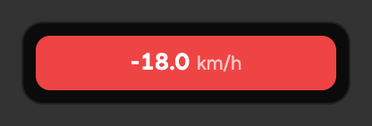

### Flag Widget

Displays racing flags in an LED-matrix style, automatically showing the most relevant flag when multiple are active. Perfect for keeping track of track conditions and race control messages.

**Features:**

- LED-matrix style flag display
- Automatic flag priority: Shows the most important flag when multiple are active
- Support for all iRacing racing flags (green, yellow, white, checkered, blue, black, etc.)
- Option to display two identical flags within a single widget
- Matrix mode: choose the LED resolution (8x8, 16x16, or uniform 1x1) for a more detailed or compact look
- Optional flag label and "no flag" state display
- Green while the track is clear, or only for a few seconds after the start and after a yellow, as iRacing itself shows it
- A blue flag is shown over a yellow that is somewhere else on the circuit; a yellow close to you still comes first
- Optional glow effect and configurable flag animation (toggle plus blink period)
- Customizable size and positioning
- Adjustable background opacity
- Session visibility settings (Race, Lone Qualify, Open Qualify, Practice, Offline Testing)

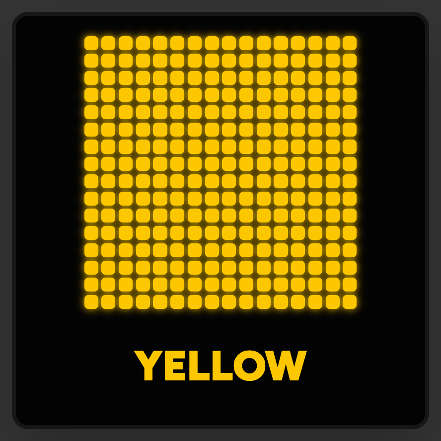

### Flag Panel

A wide card that names the flag that applies to you right now and explains it in one line. Under a blue flag it becomes the plate of the car coming to lap you. Works in iRacing and Le Mans Ultimate; each sim has states the other cannot report.

**Features:**

- The flag as a colour block, its name in capitals and a one-line explanation: "Track clear", "Incident 320 m ahead", "Pit lane open for lead-lap cars", "10 s in your pit box"
- Under a blue flag: the number of the car to let by on the block, its driver or team under the title, its class as the standings draw it, and how many metres it is behind
- A count of the further cars queued behind that one, and the plate handed to the next car as each one goes by
- In a race the car named is one that is lapping you or one of a faster class, never a rival on your own lap; in practice and qualifying it is the nearest car behind, a closing one first
- Local yellows with the distance to the stopped car they are for, ahead or just behind you, and the block pulsing when it is close. A yellow somewhere else on the circuit is named without taking the card over, so it does not hide a blue
- Full course yellow with its sub-phase where the sim states one (pit lane closed, open for lead-lap cars, green next time by) and a pit closed marker
- The states before a race (reconnaissance laps, the grid, the formation lap, the start lights), the last lap, the chequered flag, red flag and disqualification
- Penalties still to serve: drive-through, stop-go with its seconds, time penalty, and iRacing's black flag, warning and meatball
- The whole card tinted in the flag's colour for the states that need attention, or always, or never
- Metres or feet, the name format, which states to show, and whether to show green or hide the card while the track is clear
- Adjustable background opacity, session visibility and an option to show only when on track

Le Mans Ultimate has no white flag and does not say which car a blue flag is for, so the last lap and the car are worked out from the timing data. Its sector flags are read in the order its sector numbers use, which no recording has confirmed yet, so naming the sector of a yellow is an option that is off by default. iRacing reports no sector yellows, no start-light count and no penalty kind.

### Traffic

Who is coming, and when. In a multi-class race it stands in for the mirror: the cars closing from behind, how fast, and a forecast of when and where the next one arrives. Works in iRacing and Le Mans Ultimate.

**Features:**

- The cars behind you inside 500 m and 8 s, nearest first: car number on its class colour, driver or class, the gap in seconds and an arrow for how fast it is closing, with the seconds a lap it gains
- Cars are told apart by the rule the Flag Panel uses for a blue: a car a lap or more ahead is lapping you and is outlined in blue with its laps, a faster class is traffic whatever the laps, and a car of your own class on your lap within three seconds is shown muted as a rival, not as traffic. Further traffic queued behind the rows is counted
- A forecast for the car that reaches you soonest: "in about 18 s, at Turn 6". It is an estimate and says so: nothing is forecast until the gap has closed steadily for six seconds and by at least half a second; it becomes a range ("in 14 to 40 s") when the closing rate has swung, and disappears when the car stops closing; a corner is named only for an arrival no further off than the closing was measured for (twenty seconds), and only when the earliest and latest arrival fall on the same corner or neighbouring ones; an arrival a lap or more off is given in laps
- The gap is the interval a timing line would read: how long ago you were where the other car is now, measured from your own running rather than from distance, so it does not shrink in every braking zone
- A table of laps until you meet three cars: the one ahead you are catching soonest, the race leader coming round to lap you, and the one behind that catches you soonest, each with its gap now. A meeting inside the lap under way is highlighted
- In the pit lane the widget becomes the pit exit: who goes past the exit before you get there and who arrives just behind, in seconds, on green, amber or red. It reads where the pit exit is on the lap from the data the Pitlane Helper learns, and stays for a few seconds after you rejoin
- The same block when you are slower than 29 km/h on the track or off it, with the car arriving behind
- Rows, labels, corner names or numbers, which columns to show, the windows and gaps of the pit exit block, background opacity, session visibility and an option to show only when on track

Gaps and closing rates are measured from lap positions and the clock, and laps from measured lap times; the lap time a sim estimates is not used (Le Mans Ultimate states one figure for every class). While you stand in your pit box the pit exit figures are for leaving now, since no pit stop timings are read. The corner list comes from the bundled track data; on a track without one the forecast says how far round the lap. Shown for your own car while a team-mate drives it, hidden while the camera is on another car.

### Race Log

What happened in the race, one line an event, newest first: made for somebody who looks at the Pit Wall after an hour away and wants to catch up. It is a panel for the Pit Wall, and an ordinary widget for the overlay as well. Works in Le Mans Ultimate and iRacing.

**Features:**

- One line an event: the time, the car's number on its class colour, and what happened. Your own car's lines are amber
- A car into the pits and from which place in its class; out again with how long it was in the pit lane and how long it stood, and who got out and who got in when the driver changed
- A pass down the pit lane without stopping, a driver change with no stop seen, and each class's fastest lap, with its time
- The flags for the whole field: the start, a full-course yellow or safety car with how long it lasted, a red flag, the chequered flag. Local yellows are not listed
- A car that has been in its garage or out of the session for five minutes, said once, and that it is back when it is; a car the sim lists as retired or disqualified
- A penalty given and served, where the sim says so: Le Mans Ultimate's count for each car, with drive-through, stop-and-go or time penalty once the sim names it, and iRacing's black flag
- Your own place in class, once it has held for a little over a lap, so a place swapped back and forth in a fight or through a round of stops is one line and not ten
- Le Mans Ultimate's forecast changing, with how far off its first rain is. That figure is an estimate, the Weather Forecast's own, and is marked with `~`
- Switches over the list: all cars, your class or your car, and each kind of event on or off. What they open with is set in the widget's settings; what you switch on the panel is not saved
- New lines arrive at the top. If you have scrolled down to read, the list stays where you are and counts the new lines in a button that takes you back to the top
- The lines are in the order they were said, and each carries the time the thing happened. A fastest lap is said once it has stood for fifteen seconds, so its line can sit above one timed a few seconds later; nothing is ever put in among lines you have already read
- The clock in the sim on each line, or the session clock
- Background opacity, session visibility and an option to show only when on track

The log is kept in the background for the whole race from the moment the Pit Wall or this widget is switched on, whether or not it is on screen, and is stored with the race: started again in the middle of a race, Tearoff carries the log on and measures a full-course yellow that was out through the restart from when it began. What happened while Tearoff was not running, or before the log began, is not in it and is not filled in. The list shows the most recent 200 events and reads earlier ones a page at a time; a race keeps 1000, and past 900 the oldest fastest laps and changes of place go first.

A stop is what can be seen from outside a car: standing still in the pit lane for more than a second. What was done at it is not known and not said, and a pass with no standing is listed as a pass, not as a penalty served. A class's fastest lap is listed from the third lap of the class on, and when several cars better it within a quarter of a minute the one that stands is listed. iRacing publishes no forecast and does not name a penalty, so under it there is no forecast line and a penalty is a black flag shown and cleared. A page opened in a browser reads the earlier pages from Tearoff as the app's own windows do.

No recording of a race with a pit stop, a driver change, a full-course yellow or a penalty exists, so all of those have been checked on staged data, not against a real race.

### Setup Comparison Tool

Side-by-side setup analysis to compare car setup changes between sessions.

**Features:**

- Side-by-side setup diff with changed values highlighted in red
- Snapshot timestamps for each saved setup
- Move setups left/right to reorder comparisons


### Stream Chat Overlay

Displays live Twitch and YouTube chat in one overlay, useful for streamers who want chat visible while racing. Works the same in the overlay and in an OBS browser source.

**Features:**

- Live Twitch chat by channel name and YouTube live chat by `@handle` (no OAuth or API keys required); leave a channel empty to turn that platform off
- Messages from both platforms are mixed in the order they arrive
- Optional platform logo in front of every message
- Twitch emotes (including BTTV and 7TV) and YouTube emoji, plus YouTube owner, moderator, verified and member badges
- Colored nicknames using each chatter's Twitch username color
- Optional auto-disappearing messages with a configurable interval (10-90s)
- Configurable font size and background opacity
- YouTube chat connects automatically once the channel goes live
- Chat connections run in the app itself, so an OBS browser source needs no internet access of its own
- Visible even when iRacing is not running

Settings are split into **Display**, **Twitch** and **YouTube** tabs. Chat from the older Twitch Chat widget is carried over automatically.

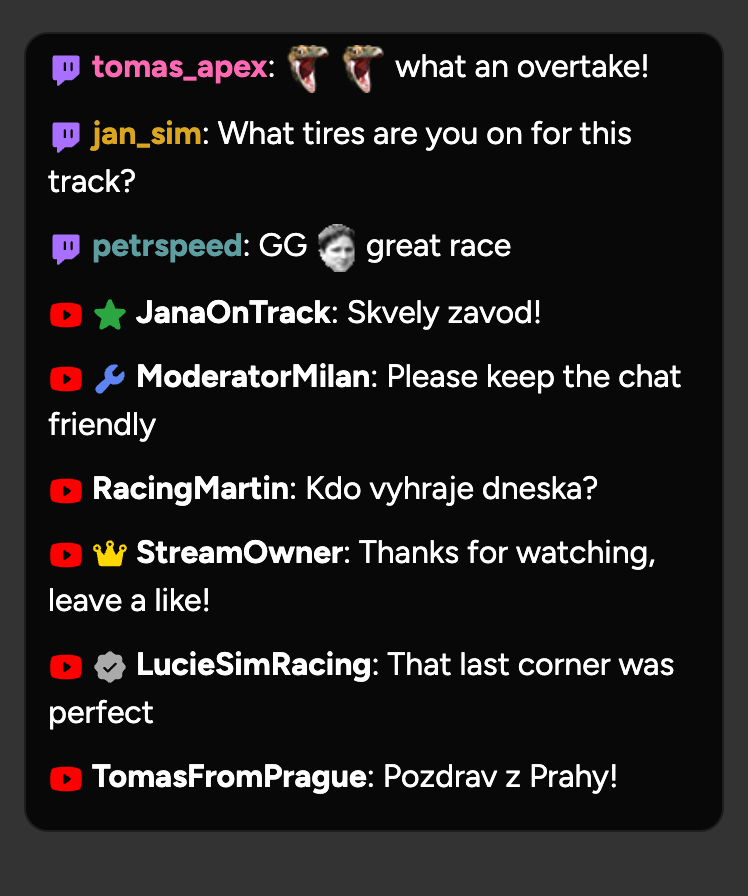

### Heart Rate

Displays your live heart rate from [HypeRate](https://www.hyperate.io/) by embedding its overlay — no API key or account required, just your session id.

**Features:**

- No key/account needed — paste the session id from your HypeRate share link (`app.hyperate.io/`**`KiY`**)
- Optional widget/theme: paste any HypeRate widget link or name (e.g. `Bouncing_Heart_Widget`, or an `app.hyperate.io/animation/<n>/...` route); your session id is filled in automatically and any baked-in id is ignored
- Transparent background and no scrollbar (the embedded page is restyled like an OBS browser source)
- Auto-fits the graphic to the widget and scales it on resize (no truncation)
- Visible even when iRacing is not running


### Information Bar

A standalone widget that displays session and timing information independently from the Standings and Relative widgets.

**Features:**

- Displays flag status, lap counter, session time, and other session info
- Optional fuel level, last and best lap times, top speed, manufacturer position, and class rank
- Optional overall position, places gained since the grid, and laps done against your projected distance at the flag
- Weather items including humidity, precipitation, wind, and air/track temperature
- In-game clock in the system's, the 24-hour or the 12-hour format, with how fast the in-game day runs beside it ("x2") when that is not real time
- Optional countdown beside the clock to the next of sunrise, midday, sunset and midnight, from the sunrise and sunset you enter for the track
- Fully configurable: reorder items and toggle each one on or off
- Adjustable background opacity
- Session visibility settings (Race, Lone Qualify, Open Qualify, Practice, Offline Testing)

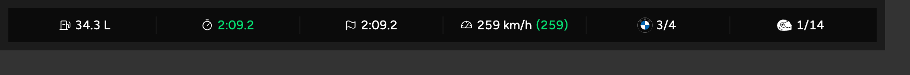

### System Performance

Shows what the machine, Tearoff and the sim are costing, in a small widget for a corner of the screen.

**Features:**

- System: CPU load of the whole machine, across all logical cores, and the memory in use
- Tearoff: its own CPU load, as a share of the whole machine, and its memory, with all of its windows and processes counted together
- Sim (iRacing only): the frame rate and iRacing's own CPU and GPU meters
- The System and Tearoff CPU figures are averaged over about ten seconds, so they read as a level rather than a flicker
- Figures are white until they cross a threshold: a CPU or GPU figure turns amber from a load you set (85% by default) and red from 95%, and the frame rate turns amber below a rate you set (60 fps by default) and red below half of it. Memory is never coloured
- One row per group, or everything on a single strip; each group can be switched off
- Adjustable background opacity, session visibility and an option to show only when on track. It is off by default, since the widget describes the machine rather than the car
- Read once a second, and only while the widget is on screen

**What it cannot show:**

- Under Le Mans Ultimate there is no Sim row. LMU publishes no frame rate and no CPU or GPU load, and Tearoff cannot read another program's usage, so there the widget shows the machine and Tearoff only
- The GPU load of the machine, GPU temperature and video memory are not measured under either sim. The GPU figure in the Sim row is iRacing's own meter
- iRacing's CPU and GPU figures are how much of each frame its own threads use, not the load on the whole machine, so they are not the numbers Task Manager shows for the sim
- The System CPU figure is the share of time the cores were busy, which is Windows' "% Processor Time". Task Manager's headline CPU figure also weighs in how far above its base clock speed the processor is running, so it can read higher than the widget on a processor that boosts

### Telemetry Inspector

A powerful tool for viewing live data coming from the active simulator, with units shown for known values. While mostly used for debugging, it's great for seeing exactly what data the app is receiving in real-time.


### Corner Name Overlay

Displays the current track section (corner or named straight) along with corner number and progress through the section. Track section data is sourced from [lovely-track-data](https://github.com/Lovely-Sim-Racing/lovely-track-data).

**Features:**

- Section name display (e.g. "Eau Rouge", "Kemmel Straight", "La Source")
- Corner number badge (e.g. T1, T12) when the section is a numbered turn
- Progress bar showing position within the current section
- Optional overall lap-distance percentage
- Configurable font size and background opacity
- Session visibility settings (Race, Lone Qualify, Open Qualify, Practice, Offline Testing)


### The Gantry

A race control window with live standings, an automatic incident feed, and a per-lap graph. Unlike the other widgets it opens in its own resizable window instead of sitting on top of the sim, so it suits a second monitor, a spotter, or a race director. Enable it in Settings, then use **Show Window** to bring it back if you close it.

**Features:**

- Standings and incidents shown side by side with a draggable divider, plus a separate Lap Graph tab
- Optional always-on-top mode, controlled from the tab bar or settings for windowed or borderless simulators
- Dock Fuel Calculator, Track Map, or Flat Track Map panels beneath the incident feed, side by side or in tabs, with optional Gantry-only fuel layouts
- Review recorded incidents and lap history while watching an iRacing replay; history follows the selected replay session and requires recordings made by Tearoff on this PC
- Final standings and lap graphs remain available after iRacing closes, including when switching tabs, until the next session loads or Tearoff closes
- Standings list
  - Grouped by car class: position, car number, driver name, tyre compound, iRating, pit/DNF status
  - Gap to the class leader, interval to the car ahead, best lap and last lap
  - Lap deltas for the last three laps, each compared against your own lap of the same age (green means they were slower than you, red means faster)
  - Configurable driver name format
  - Click a row to point the sim camera at that car (works in a replay or while spectating)
- Incident feed
  - Detects crashes, off-tracks, slowdowns, pit entries, and black flags as they happen
  - Filter chips per incident type, plus a dropdown to narrow the feed to a single driver
  - Group incidents by practice, qualifying, warmup, and race, with filters for the current session or a chosen session
  - Replay jump buttons (-5s, -10s, -30s) move the sim's replay to just before the incident and point the camera at the car
  - Choose the camera used for incident replays, defaulting to Far Chase
  - Incidents are saved to disk: keep every session, or only the last 5, 10, or 20
  - Tunable detection thresholds: slow speed and duration, crash impact severity and minimum speed, off-track duration, pit entry duration, and a per-type cooldown
  - Threshold speeds shown in mph, km/h, or auto (always stored in km/h, so switching units never changes detection)
- Lap Graph
  - Three y axes: Race Trace (time gained or lost against the class leader's reference pace), Position (class position at the end of each lap), and Gap (seconds behind the class leader)
  - Consistent driver colours and dash patterns, with matching swatches in the driver list
  - Class selector for multi-class sessions
  - Pin drivers from the side list, or let auto-pin follow the player, the class leader, and the cars around the player
  - Hover the chart for a crosshair readout of the nearby lines; hover a name to lift that driver's line above the field
  - Pan and zoom the lap window by dragging or scrolling, with an overview strip below the chart, and it follows the latest lap
  - Configurable default axis, laps shown, and auto-pin


### The Pit Wall

One page about the race from your own car's side, in an ordinary window of its own: made for a second monitor, and for the hours of an endurance race when a team-mate drives and you sit at the monitor. Switch it on in Settings (it is under Standings); the window opens once, and **Show Window** on its settings page or **Pit Wall** in the tray menu brings it back after you close it. It works under Le Mans Ultimate and iRacing.

Nothing of it has been seen in a live game yet: it has been checked on staged data only.

**What is there:**

- A header with the simulator that is connected, the session and the track, the time left, the in-game clock, the flag, your car's number, class, place in class and overall, who is at the wheel, and "You are watching" while that is not you. From 1280 pixels wide it keeps to one line whatever it holds: the name of the session and the track is cut short first, then the simulator is shown as its dot alone, and so on down to the end of the driver's name; the clock, the flag and your car's place are never cut
- Four layouts, switched in the header and remembered: three fixed ones, **Race** for a full second monitor, **Watching** for a team-mate's stint and **Compact** for a tablet, and **Custom**, which you arrange yourself
- Panels that each host one of Tearoff's widgets, with the settings you gave that widget, whether or not it is switched on for the overlay. A gear on each panel opens that widget's settings
  - Race: on the left the [Timing Tower](#timing-tower), tall enough for a class of fourteen, over the [Race Charts](#race-charts), which have the column's width for their plot; on the right [Our Car](#our-car) and the Track Map, [Class Rivals](#class-rivals) across, [Crew and Stints](#crew-and-stints) with the [Race Log](#race-log), and the Weather Forecast across
  - Watching: Our Car, which leads with the gaps and the pace while a team-mate drives, over [Car Laps](#car-laps); the [Stint Timeline](#stint-timeline) over Crew and Stints; the Timing Tower, the Weather Forecast and the Race Log
  - Compact: a page of tabs with touch-sized buttons. **Overview** has the Timing Tower, Our Car, the Weather Forecast and the Race Log; **Timing** the tower alone, wide enough for every column; **Strategy** Class Rivals and the Stint Timeline; **Crew** Crew and Stints and Car Laps; **Map**, **Charts** and **Log** one panel each. The tab in front is remembered
  - Custom: a page of your own, on a grid of 24 cells by 16 that fills the window. It starts as a copy of Race, and goes on being Race as each version of Tearoff has it until you have arranged it yourself. With Custom chosen, the header of the Pit Wall window has an **Edit layout** button, a pencil beside the layout switch that carries its words where the header has the room for them:
    - drag a panel by its title bar to move it and by its lower right corner to size it, with a mouse or a finger. The cells it would take are shown as you drag, green where it fits and red where another panel is in the way, where it would leave the page or where it would be smaller than its widget can be read at; let go on red and the panel stays where it was, as it does on Escape. Nothing pushes another panel aside
    - the cross on a panel's title bar takes it off the page. **Add panel** lists what the page can host and does not: the panels the fixed layouts are made of, then the overlay widgets they do not use (Standings, Fuel Calculator, Pit Stop, Finish Projection, Stint History, Tyre & Brake Wear, Traffic, Flag Panel, Timing, Lap Timer, Tyres, Damage and Weather). The one you choose goes into the first free place it fits, at its smallest size; where there is none the list says so. Each widget can be on the page once
    - from the keyboard, with a panel's title bar in focus, the arrow keys move it a cell and Shift with an arrow key sizes it by a cell
    - **Reset** brings back the copy of Race, after asking. **Done** saves the arrangement into the profile; **Cancel** drops what you changed. Nothing is saved before Done, and while you arrange the page its panels show their name and size in place of their content, which goes on being kept up to date behind them
    - a panel may be made smaller than its widget would like: it is then drawn smaller or scrolls, as any narrow panel is
- On a phone, or any page narrower than 700 pixels, the page is always the tabs of Compact, with the panels of a tab one under another at the page's width. The page itself never scrolls sideways: a table wider than the phone scrolls inside its panel. The header is two rows there: the clock and the flag, then your car, its place and who drives it
- A panel whose widget the running simulator does not support is left out and its neighbours take the room. Le Mans Ultimate supports every panel of the fixed layouts; under iRacing the Weather Forecast is left out, and on the Race page its rows go to Class Rivals and to Crew and Stints with the Race Log. On the Custom page such a panel's place is left empty, and while you arrange the page it is shown with a note, so that one arrangement serves both simulators
- On this page the widgets ignore their "show only when on track" and session switches. Those keep a widget off the game's screen, and this is a screen of its own
- A panel too narrow for its widget shows what the widget makes of the room: the Timing Tower leaves columns out and a wide table scrolls sideways inside its panel. Only a panel narrower than its widget can be read at is drawn smaller. A widget taller than its panel scrolls inside it
- While the Pit Wall is switched on the race is recorded for its panels from the start, whether or not the window is open: every car's laps, stints, stops and driver changes, and the log
- Full screen with F11 or the button in the header; the window remembers its place, its size, its monitor and whether it was maximised
- The page's own scale, in its settings
- The same page in an ordinary browser, at `http://localhost:3000/pitwall` on this PC. With **Enable Network Access** on, a tablet or a second PC on your network opens it too, by the link under **Settings > Pit Wall > In a browser**. That link carries a key: a device that is not this PC is refused everything the web server has without it, and **New key** there replaces it at once and disconnects whoever held the old one. A layout or a tab chosen in a browser is kept by that browser and leaves the window as it is; a browser has no settings window to open, so the page there has no gears. A browser shows the Custom layout as the window saved it and has no Edit layout button: the arrangement is the profile's, and is changed in the window
- A browser page shows what the window shows, the race history included: a car's laps and stints, the driver changes and the earlier pages of the race's log are read from Tearoff as the window reads them, and a browser can change none of it. If the page loses its connection to Tearoff it keeps what it last had, and a mark under the right end of its header, or of its tab bar where the page has one, says **Reconnecting** until the connection is back

In Race, Watching and Compact the panels cannot be moved or resized; Custom is the layout for that. The widgets the fixed layouts' panels took the place of (Standings, Fuel Calculator, Pit Stop, Finish Projection, Stint History, Traffic, Flag Panel, Tyre & Brake Wear, Timing, Lap Timer, Tyres, Damage and Weather) are not in those three; they are on the overlay as before, and the Custom layout can host any of them. Arranging has been checked in specs, and in a browser with a mouse, the keyboard and an emulated finger; nobody has yet arranged a page by hand in the Pit Wall window itself, or on a real touch screen. The page is for your own devices on your own network: nothing reaches it from outside.

### Broadcast overlays

TV-style overlays for iRacing streams, configured together in **Settings > Broadcast**. Each is an independent widget with its own position and browser-source URL.

**Features:**

- **Tower:** Multi-class standings with rotating or fixed pages for names, gaps, positions gained, pit stops, and tyres; optional focused-driver card and pre-race/post-race screens
- **Ticker:** A scrolling standings strip for the bottom of your broadcast
- **Events:** Timed alerts for incidents, flags, fastest laps, pit stops, and race milestones, with selectable event types
- **Weather:** A weather panel shown at configurable intervals
- **Podium:** Class podiums after the checkered flag, with steps or trophy styles
- IMSA, WEC, and F1 themes, a custom logo and title, and configurable backgrounds


### Other Features

**Features:**

- Profile Management
  - Save and switch between different dashboard configurations
  - Multiple profiles for different racing scenarios or streaming setups
  - Assign profiles to practice, qualifying, races, testing, time trials, and warmup for automatic layout switching
  - Optional spotting profile activates after 20 seconds out of the car and switches back immediately when you resume driving
  - Clone existing profiles with one click to create variations without starting from scratch
  - Bind shortcuts to cycle to the previous or next profile, with an on-screen profile-name banner
  - Each profile can be accessed as its own browser source URL for OBS streaming
  - Dashboard import/export to share layouts between users or back up your setup
- Streamer & OBS Ready
  - Built-in Web Server: All overlays can be used as a browser source in OBS. `http://localhost:3000/dashboard` follows the active profile; `http://localhost:3000/dashboard?profile=<profileId>` selects a specific profile. Copy the actual URLs from Settings > Profiles if the server uses another port.
  - Separate browser layouts: Each profile stores its browser widget positions independently of the desktop layout. Use **Settings > Profiles > Actions > Edit Browser Layout** to arrange widgets for OBS. Set the browser source's width and height to match your intended canvas.
  - Single Widget URLs: `http://localhost:3000/widget/<widgetId>` shows one widget filling the page, including widgets hidden from the desktop layout, for hosts that take one page per source such as OpenKneeboard in VR. `http://localhost:3000` lists the URL for every widget in the active dashboard; older component links redirect to the widget pages.
  - Optional Web Server: Disable the built-in server when browser sources are not needed; restart the app to free its port.
  - Network Access: Enable network access in settings to allow other devices on your local network to access the dashboard (useful for dual-PC streaming setups). A device that is not this PC needs a link with the key in it: copy it from **Settings > Profiles** or **Settings > Pit Wall**. This PC needs no key, by `localhost` or by its own network address, so browser sources on it work as before.
  - Who the server answers: only its own pages, opened by this PC's name or address. A page from another website cannot connect to it, a device on the network is refused everything until it shows the key, and a browser page can change nothing but where its widgets sit and the pit lane it measured; every other setting is changed in the app. The race history is read by a browser page and never written by one.
  - Garage Cover: Automatically hide your screen with a custom image when you enter the garage to keep your car setup private.
  - Transparent backgrounds: All overlays are designed to look great on top of your game or stream.
  - Reduced GPU usage: Overlay windows are sized to fit only the widgets on each display, rather than covering the full screen.
- Customization & Themes
  - Per-widget scaling: Scale any widget's text and content from 50% to 200% independently in its settings, then resize its container to fit your layout.
  - Color themes: Choose from built-in themes or create your own custom look.
  - Highlight color: Pick a custom color that is used across all widgets to match your branding or preference.
  - Font sizes: Multiple font size options (including 2x Small, 3x Small, and Tiny for large or ultra-wide monitors) to ensure readability on any screen.
  - Font weight: Choose between Normal, Bold, or Extra Bold text for improved readability.
- Ease of Use
  - Configurable key bindings: Rebind shortcuts for global overlay visibility, edit layout, telemetry, layout-profile cycling, and individual widget visibility. Supports keyboard chords, controller buttons, and controller-button combos.
  - Per-widget visibility shortcuts: Show or hide individual widgets without affecting the rest of the dashboard.
  - Overlay on/off: Turn every overlay off and back on, while the sim is running or not, without changing which widgets are enabled. The same switch is the **Overlay** button in the settings window header, **Show Overlay** in the tray menu and the Hide / Show UI shortcut (Alt+H by default), and each follows the others. It applies to this run of the app: the overlay is on again after a restart.
  - Hidden while paused: The overlay goes off the screen while the game is paused and comes back when you resume, within about a second. The same goes for a screen that stops the session without calling it a pause, such as the pit stop screen in a race against the AI (there it takes about two seconds). On by default; turn it off under **Settings > General > Hide Overlay While the Game Is Paused**. Le Mans Ultimate only: iRacing does not report a pause.
  - Shown while watching: Widgets set to show only when on track stay on screen while you watch a car on track from outside it, such as a team-mate's stint in a team race, and follow that car: Standings, Relative, Minimap, Track Map, Flat Track Map, Battle, Information Bar, Flag, Flag Panel, Weather and Weather Forecast. The widgets about your own car show your team car's numbers while a team-mate drives it and the camera is on it: Lap Delta, Corner Delta, Lap Time Log, Delta Speed, Corner Names, Timing, the own-car items of the Information Bar, and the Fuel Calculator for a car on virtual energy. Their laps are measured against your own reference laps and are never kept as yours: not as a personal best, a reference lap or fuel history. Input, Shift Light, Tyres and Lap Trace show the team car too, where the game sends that car's pedals and revs: the inputs as the car received them, the shift lights, the brake temperatures and the compound, and their lap drawn against your reference. Tyre temperatures and pressures are sent only for a car you are in, so in Tyres they show as dashes, and so do the pressure offsets, the deflection and the load. The fuel in litres and the tread left are shown while the AI drives your car; for a team-mate driving online they are left out until it is known what the game sends for them. With the camera on another car those widgets hide, as they do not follow it. Car Systems, Chassis, Damage, Friction Circle, Brake Performance, Hybrid and Lift and Coast Lights stay hidden while you watch: they are made of readings the game sends only for a car you are in. A car that is in its garage does not count as one being watched. On by default; turn it off under **Settings > General > Keep Widgets On Screen While Watching**. Le Mans Ultimate only for now.
  - Shown while watching: Widgets set to show only when on track stay on screen while you watch a car on track from outside it, such as a team-mate's stint in a team race, and follow that car: Standings, Relative, Minimap, Track Map, Flat Track Map, Battle, Information Bar, Flag, Flag Panel and Weather. The widgets about your own car show your team car's numbers while a team-mate drives it and the camera is on it: Lap Delta, Corner Delta, Lap Time Log, Delta Speed, Corner Names, Timing, Traffic, the own-car items of the Information Bar, and the Fuel Calculator for a car on virtual energy. Their laps are measured against your own reference laps and are never kept as yours: not as a personal best, a reference lap or fuel history. With the camera on another car those widgets hide, as they do not follow it. Input, Shift Light, Tyres, Car Systems and Lap Trace stay hidden for now, and a car that is in its garage does not count as one being watched. On by default; turn it off under **Settings > General > Keep Widgets On Screen While Watching**. Le Mans Ultimate only for now.
  - Reset widget position: Reset any widget's position to the top-left corner if it gets lost off-screen.
  - Close to tray: Closing the window minimizes to the system tray instead of quitting (configurable).
  - Always on top: Keep your overlays visible even when clicking on other windows.
  - System autostart: Optionally have the app start automatically when your computer boots up.
  - Start minimized: Launch the settings window in minimized state for a cleaner desktop
  - Auto port fallback: If port 3000 is in use, the app automatically tries the next available port and updates all URLs in settings.
  - Configurable Chromium flags: Advanced Settings exposes recommended graphics fixes (disable native window occlusion, ANGLE backend selection, disable Direct Composition) plus custom enable/disable feature lists and freeform switches for troubleshooting rendering issues (e.g. black flickering on some GPUs).
  - Log file access: Open the log folder or export the log file directly from Advanced Settings.
  - Automatic updates: The app keeps itself up to date with the latest features and bug fixes.

## Prerequisites (for development)

- Node.js (v24 or higher, matching `package.json`)
- npm (comes with Node.js)
- Windows build tools if you are on Windows
  - Modern Node.js installations include the necessary build tools. If you encounter issues building native modules, ensure you selected the option to install build tools during Node.js installation, or reinstall Node.js with build tools enabled.
- Windows and an installed simulator for live telemetry (iRacing, or Le Mans Ultimate for the supported beta widgets)

> Note: Developing on MacOS is fully supported and does not require iRacing or any additional tools to be installed as it uses a mocked SDK.

## Installation (for development)

To install Tearoff for development, follow these steps:

1. Clone the repository
2. Navigate to the project directory
3. Install the required dependencies:

```bash
npm ci
```

4. Run the application:

```bash
npm start
```

5. Optionally, you can run the storybook to view the components in isolation:

```bash
npm run storybook
```

## Usage (for development)

To start using Tearoff, run the following command:

```bash
npm start
```

This will start the application.

Look for the application in your app tray.

### Simulator overrides

For normal use, choose the simulator in **Settings > General > Simulator**. See [Supported simulators](#supported-simulators) for LMU setup and beta limitations.

To override the saved simulator setting, use `tearoff.exe --sim=lmu` or
`tearoff.exe --sim=iracing`. For development, set `IRDASHIES_SIM` instead:

```powershell
$env:IRDASHIES_SIM = 'lmu'
npm start
```

Without an override, Tearoff uses the saved simulator preference. In Auto mode,
it detects the running simulator and follows changes without restarting, giving
iRacing priority if both simulators are active when detection runs.

> You will need to have Node.js installed on your machine to run the application. You can download it from [here](https://nodejs.org/).

> On macOS you will see mocked data from a sample session. To connect to iRacing, you will need to run the application on Windows.

While developing, it's recommended you run Storybook as it gives you a quick way to iterate your changes:

```bash
npm run storybook
```

## Folder Structure

The project is structured as follows:

```
irdashies/
  ├── src/
  │   ├── app/
  │   ├── frontend/
  │   ├── types/
```

- `src/app/` contains the main Electron application code.
- `src/app/irsdk/` contains the iRacing SDK code including the native C++ bindings.
- `src/app/processors/` computes derived telemetry and publishes typed channel snapshots.
- `src/frontend/` contains the React components for the overlays.
- `src/frontend/domain/` contains shared selectors and widget-independent UI logic.
- `src/types/` contains TypeScript type definitions shared between the frontend and backend (e.g. telemetry types).
- `src/types/widgets/` contains widget manifests, default layouts, and settings metadata; widgets register their React components in a co-located `widget.ts`.

> Note: Frontend components should NOT import anything from ./app as these are Electron-specific modules. Any communication should be done via IPC and types exposed via the types folder.

Read [Architecture Rules](./docs/ARCHITECTURE_RULES.md) before making non-trivial changes.

## Storybook

To view the components in Storybook, run the following command:

```bash
npm run storybook
```

This allows you to easily develop, test, and visualise the widgets/overlays in isolation.

Open `http://localhost:6006`. Stories use mock telemetry or saved channel snapshots, so you can develop the UI without a simulator installed.

## Package (create .exe)

To package the application and create the .exe, run the following command:

```bash
npm run package
```

To create the .exe and the installer run the following:

```bash
npm run make
```

## Testing

To run the tests, run the following command:

```bash
npm run test
```

## Linting

To run the linting, run the following command:

```bash
npm run lint
```

> Ensure you have ESLint extension installed if using VS Code. This project uses ESLint flat config format (eslint.config.mjs).

## Developing on Mac

As you may know, the iRacing SDK is only available on Windows. To develop on Mac OS, there is a mock SDK that is loaded which generates some dummy data for you to work with. This is useful for developing the UI components and widgets.

## Acknowledgments

This project is a fork of **[irDashies](https://github.com/tariknz/irdashies)** by Tarik Alani and its contributors, and makes use of data and resources from the following projects:

- **[lovely-car-data](https://github.com/Lovely-Sim-Racing/lovely-car-data)** - Comprehensive car telemetry data including RPM thresholds, LED configurations, and shift point information for various racing games.
- **[lovely-track-data](https://github.com/Lovely-Sim-Racing/lovely-track-data)** - Per-track corner names, sectors, pit-lane markers, and named straights for various racing games.

## License

This project is licensed under the MIT License. See the [LICENSE](LICENSE) file for more details.
