# Tearoff - Real-time Racing Overlays

<div align="center" style="padding-bottom: 20px;">
  
</div>

A personal sim racing overlay built with React and Electron, with iRacing support and beta support for Le Mans Ultimate.

> Tearoff is an independent fork of [irDashies](https://github.com/tariknz/irdashies) by Tarik Alani, taken at v2.1.1 and developed separately since. Much of this README still describes the upstream feature set. Compared with upstream, this fork has its own update feed, unsigned builds, no analytics, and no RaceOS driver-rating lookup.

## Try it out

Download the latest `Setup.exe` from the [releases page](https://github.com/dev1antdev/tearoff/releases).

Install the Windows .exe and run it. The build is not code signed, so Windows SmartScreen warns on the first install. The application will automatically update from this repository's releases when a new version is available. For overlays to appear over the simulator, use windowed or borderless mode.

## Table of Contents

- [Introduction](#introduction)
- [Supported simulators](#supported-simulators)
- [Available overlays](#available-overlays)
- [Prerequisites](#prerequisites-for-development)
- [Installation](#installation-for-development)
- [Usage](#usage-for-development)
- [Folder Structure](#folder-structure)
- [Storybook](#storybook)
- [Package (create .exe)](#package-create-exe)
- [Testing](#testing)
- [Linting](#linting)
- [Developing on Mac](#developing-on-mac)
- [Acknowledgments](#acknowledgments)
- [License](#license)

## Introduction

This project is built with React and Electron and retrieves live telemetry from iRacing and Le Mans Ultimate to power configurable overlays and race utilities.

See the [latest release notes](https://github.com/dev1antdev/tearoff/releases/latest) for the latest updates.

## Supported simulators

iRacing is the primary supported simulator. Le Mans Ultimate support is in beta as of [v2.0.0](https://github.com/tariknz/irdashies/releases/tag/v2.0.0), with a limited set of supported widgets.

Choose **Auto**, **iRacing**, or **Le Mans Ultimate** in **Settings > General > Simulator**. Auto detects the running simulator and follows simulator changes without restarting Tearoff. If both simulators are active when detection runs, iRacing takes priority; select Le Mans Ultimate explicitly if needed. Unsupported widgets are hidden for the active simulator.

### Le Mans Ultimate setup and limitations

1. In LMU, enable **Settings > Gameplay > Enable Plugins**, then restart the simulator.
2. Start Tearoff and load into an LMU session to receive telemetry.

**Supported overlays:** Standings, Relative, Class Fields, Input, Lap Trace, Pitlane Helper, Corner Names, Battle, Flag, Flag Panel, Information Bar, System Performance (without its Sim row), Tyres, Chassis, Damage, Friction Circle, Brake Performance, Minimap, Lap Delta, Corner Delta, Timing, Car Systems, and Fuel Calculator. Telemetry Inspector is also available for diagnostics. All other widgets are currently unavailable in LMU, including both full-size track maps, Radar, Gantry, Lap Timer, Tachometer, and Shift Light.
**Supported overlays:** Standings, Relative, Class Fields, Input, Lap Trace, Pitlane Helper, Corner Names, Battle, Flag, Flag Panel, Information Bar, System Performance (without its Sim row), Tyres, Hybrid (for cars that have the system), Lift and Coast Lights, Weather Forecast, Minimap, Lap Delta, Corner Delta, Timing, Car Systems, and Fuel Calculator. Telemetry Inspector is also available for diagnostics. All other widgets are currently unavailable in LMU, including both full-size track maps, Radar, Gantry, Lap Timer, Tachometer, and Shift Light.

- Standings use class colours and manufacturer badges, with best-lap ordering in practice and position ordering in races. Driver ratings, incident counts, and team data are not yet integrated; car numbers are placeholders, and iRacing rating columns are hidden.
- Corner Names and Lap Trace corner feedback depend on available LMU track data. Unnamed turns use turn numbers where provided.
- Lap Trace does not yet check LMU lap validity, so laps invalidated by track limits may still become saved references. Imports support iRacing `.ibt` files and Garage 61 CSV laps, with no native LMU telemetry-file import.
- Input and Lap Trace need your own car's telemetry, which can be unavailable while spectating or in the garage.
- The steering wheel is drawn at the range of the driver's own wheel when LMU knows it, otherwise at the steering lock of the car setup, and at the cockpit animation's range only until the setup has been read. The animation's range turned the drawn wheel about half as far again as the real one on an LMGT3.
- Lap positions are estimated between updates; cars without full telemetry may update in larger steps. Automatic units are metric, and Pitlane Helper currently uses a fixed 60 km/h pit limit.
- Virtual energy: Hypercar, LMDh and LMGT3 cars run on virtual energy, LMP2 and LMP3 on fuel. The optional **VE** column in Standings and Relative shows what each car has left to run on, with a pump icon marking a figure that is fuel. The Fuel Level item shows your virtual energy ahead of the litres, and Pitlane Helper shows what the next stop is set to put in. Fuel Calculator counts a car on virtual energy in percent of its energy and a fuel-limited car in litres; see [Fuel Calculator](#fuel-calculator).
- LMU in-game replays do not yet have iRacing's replay-aware handling. LMU session recording and playback tools are development tools.

## Available overlays

The features below describe iRacing support. See [Supported simulators](#supported-simulators) for LMU availability and limitations.

Screenshots show example layouts. Each widget's appearance and visible information can be configured in Settings.

### Input trace

Displays the throttle, clutch, and brake input traces, as well as the current gear and speed.

**Features:**

- Input source, chosen at the top of the widget's settings:
  - **Car**: what the car receives, the throttle and brake after traction control, ABS and shift cuts. Works while you watch another car and in replays, where the sim gives that car's inputs.
  - **Pedals**: what you press, the raw pedal position before the assists.
  - Where the chosen source has no value, the other one is shown rather than nothing.
- Input trace visualization (throttle, brake, ABS and traction control marks, steering)
  - Configurable stroke width (1-10px)
  - Configurable max samples (50-1000)
  - Toggle individual inputs (throttle, brake, ABS, traction control, steering)
  - ABS activity marked on the brake trace and traction control on the throttle trace, as an overlay or a highlighted fill beneath the curve. Traction control activity is reported by Le Mans Ultimate only; iRacing publishes the dial but not when it cuts.
- Input bar display (clutch, brake, throttle, ABS and traction control indicators)
  - Toggle individual inputs (clutch, brake, throttle, ABS, traction control)
  - A full-travel marker above each pedal, lit while the pedal is flat, whichever source is shown
  - Optional side-by-side bars: a narrow strip of pedal travel beside a wide strip of what the car received, with the brake's wide strip optionally taken from the brake line pressure
  - Optional force feedback bar, which turns amber while the force is clipping
- Current gear display with speed (auto/mph/km/h units) and dynamic sizing to fit container
- Optional speed-first gear layout
- Steering wheel visualization with multiple styles (default, formula, LMP, NASCAR, U-shape, ring) and color themes (light/dark)
  - Angle readout in degrees: past 270° (default), always, or never
  - Optional rotation arc around the wheel, always or only at a standstill
  - Manual wheel rotation range, for a wheel whose range the sim gets wrong
  - Front wheel angle and steering ratio under the wheel (Le Mans Ultimate only)
- Optional steering meter: a bar that fills from its centre toward the steered side, with scale marks at a configurable spacing
- Customizable display order for all components
- Drag-and-drop layout editor to arrange traces, bars, steering, the steering meter, gear, and ABS indicators
- Multiple Input widgets with independent layouts, including a gear-only layout for a detached gear indicator
- Optional background shift flash at redline or custom Tachometer shift points, with a configurable colour
- Adjustable background opacity
- Option to show only when on track
- Session visibility settings (Race, Lone Qualify, Open Qualify, Practice, Offline Testing)


### Lap Trace

Compares your current lap against a saved reference to show where you gain or lose time.

**Features:**

- Automatically saves the fastest reference lap for each car and track, with clean-lap checks in iRacing
- Import reference laps from iRacing `.ibt` telemetry files or Garage 61 CSV laps
- Compare throttle, braking, and gear changes against the reference, with ABS activity where available
- Configurable audio or visual countdowns to reference braking points, with audio-device selection and a minimum brake-pressure filter
- Corner feedback showing time gained or lost, braking distance, and minimum speed where corner data is available

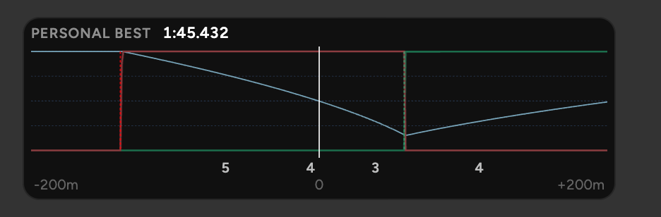

### Tachometer

Displays a real-time tachometer with optional RPM text display.

**Features:**

- Tachometer with optional RPM text display
  - Car-specific LED color and RPM thresholds (powered by [lovely-car-data](https://github.com/Lovely-Sim-Racing/lovely-car-data))
  - Custom shift points configuration per car and gear
  - Multiple indicator styles (glow, pulse, border) with customizable colors
  - Horizontal or vertical orientation
  - Consistent sizing across different cars
  - Option to show RPM text above the tachometer
  - Optional oil and water temperature displays, with configurable placement and overheat warnings
- Resizable and adjustable background opacity
- Option to show only when on track
- Session visibility settings (Race, Lone Qualify, Open Qualify, Practice, Offline Testing)


### Shift Light

A standalone shift indicator for drivers who do not need the full Tachometer widget.

**Features:**

- Automatic shift cues or custom shift points for each car and gear
- Glow, border, or pulse indicators with configurable colour
- Optional RPM readout

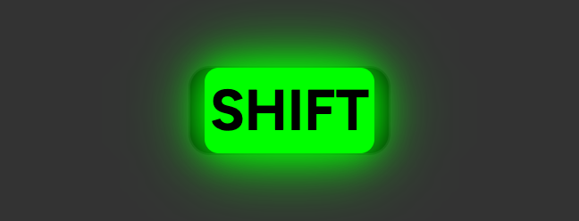

### Car Systems

Displays your car's in-car adjustments in one compact widget.

**Features:**

- Live brake bias, ABS, traction control, and other adjustments supported by your car
- Car-specific control labels, including brake migration, brake valves, and engine maps
- Configurable columns, with independent options to hide unsupported or switched-off systems
- The dial you just moved lights up, and the widget can stay off screen until you move one: it then appears for a few seconds with every column in its usual place
- The ABS column lights while ABS is working, and an optional small figure under the brake bias shows how far it has moved since the car last stood in the pits
- Works under Le Mans Ultimate, with a column list of its own: brake bias, ABS, traction control (TC), TC slip, TC cut, brake migration and the engine or motor map, plus the anti-roll bars, the wipers and the setup's regeneration level, which are off by default. A dial the car does not have reads `--`, or is left out with the option above. Under LMU the TC column also lights while traction control cuts power, each dial can show the top of its scale (`6/11`), and the names are the sim's own, the same on every car. The regeneration level is the garage's figure and may not follow a change made on track

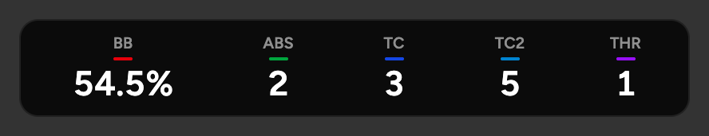

### Tyres

Shows the state of your tyres and brakes, one axle per block. Le Mans Ultimate only: iRacing does not publish tyre temperatures while the car is moving.

**Features:**

- Tyre temperature across the tread, drawn as a gradient from the outer shoulder to the inner one, with the average as the headline number
- Choice of which temperature to show: tread surface, the rubber layer under it, or the carcass
- Working window that follows the temperature the sim states for the fitted compound, or one you set yourself: blue when cold, green in the window, yellow to red when overheating
- Live tyre pressures in psi, kPa or bar, optionally coloured against a target hot pressure per axle
- A pressure is drawn blue while its tyre is cold (carcass under 65 °C by default), whatever the target says: a cold pressure cannot be judged against a hot target
- Optional offset under each pressure, showing how far it sits below the highest of the four, averaged over a few seconds
- Brake temperature per axle, coloured against its own working window
- Optional tread remaining per tyre and the compound fitted to each axle
- Optional load bar under each tyre: its share of the load on all four wheels, growing outwards from the centre of the car and full at 50%, red when the wheel carries next to nothing. Le Mans Ultimate withholds tyre load, so the share is taken from suspension load and is an estimate: the split between left and right is sound, the split between front and rear is approximate
- Optional tyre deflection in millimetres, red when the wheel is off the ground
- Adjustable background opacity, session visibility and an option to show only when on track

### Chassis

Shows how your car sits on the road, a row per figure. Le Mans Ultimate only: iRacing publishes no ride height, camber or toe while the car is moving.

**Features:**

- Ride height at the four corners in millimetres, with a bar each and a red warning below a bottoming height you set per axle
- Rake as an angle and in millimetres, blue when the nose is the higher end
- Roll at the front and rear axle, positive with the right side higher, and optionally the share of the roll the front axle takes
- Camber at each wheel, amber when a wheel is upright or leaning out
- Toe as the total of each axle, in or out, or at each of the four wheels
- Optional suspension travel at the four corners
- The sim publishes no wheelbase or track widths, so the rake and roll angles use lengths you enter (2800 mm and 1800 mm by default) and are as good as those numbers; the millimetres are the sim's own
- Each row can be switched off; adjustable background opacity, session visibility and an option to show only when on track

### Damage

Shows your car from above and what has happened to it. Le Mans Ultimate only: iRacing publishes no body, aero or suspension state.

**Features:**

- Car diagram, nose up: eight body zones around the outline, grey when sound, amber for a light dent, red for a heavy one, and black with a red edge for bodywork that has come off
- A wheel in each corner, coloured by suspension damage from green through amber and orange to red. A flat tyre is an empty red rim, and a wheel that has come off is black with a red edge. Detached parts pulse, which can be switched off
- Last impact: a red wedge towards where the car was hit, for 15 seconds. A touch too light to be contact with a car or a wall, such as a kerb or the floor on the road, is not marked unless it leaves damage
- Aero, body and suspension integrity and the tread left on the most worn tyre, in per cent, each turning red at a threshold you set. The figure in the middle of the car is the aero figure, the body figure or nothing, and can count damage up instead of integrity down
- Repair line: what the pit menu is set to repair, in the sim's own words, and the time it adds to the next stop. It appears once there is something to repair
- A thermometer in the car while the sim shows its overheating warning
- Options to show the widget only when the car is damaged and only when on track, plus background opacity and session visibility

**What is confirmed and what is not.** One recorded race stands behind this widget, with five knocks to the nose. Confirmed on it: a light dent in the front zone, when an impact happened and where it came from, the aero damage figure, and the repair the pit menu offers ("Do Not Repair" and "Repair Body"). Not seen on any recording, and built on how the sim is understood to report them: dents in the other seven zones, heavy dents, a lost rear wing, a lost wheel, a flat tyre, suspension damage and its scale, the overheating warning, and a repair that has actually been chosen, so the repair time has only ever read zero. Any of these may turn out to be drawn in the wrong place or not at all. The force below which an impact is not marked rests on the same five impacts: three knocks against other cars read 1,233 to 3,017 on the sim's own scale, two brushes read 40 and 63, and the line is drawn at 250.

### Friction Circle

Shows how hard your car is cornering against how hard it is braking or accelerating, in g. Works under iRacing and Le Mans Ultimate.

**Features:**

- A dot at the current reading, with a fading trail of the last few seconds (1 to 10, four by default)
- Rings at each whole g and a cross through the centre; the edge of the circle is a scale you set, from 1 to 6 g. A reading beyond it is drawn on the edge, with the dot in amber
- Choice of direction: where you are thrown (up under braking, to the right in a left-hand corner) or where the car is being pushed (the other way round)
- Lateral and longitudinal g as figures in the top corners, and the highest of each over the last five seconds in the bottom corners
- A dashed ring at the best lateral g the car has held through a corner lately, which a kerb or a single spike does not move
- For two seconds after an impact the maxima and the ring are not raised, so a knock is not taken for grip. Le Mans Ultimate states when the car was hit; under iRacing the moment your incident count rises stands in, which misses contact that costs no incident points
- The rings, the trail, the dashed ring and the figures can each be switched off; adjustable background opacity, session visibility and an option to show only when on track

iRacing's readings include gravity and Le Mans Ultimate's do not, so on banking and on a gradient the iRacing dot sits off centre by the slope's share of 1 g.

### Brake Performance

Shows how hard you stopped: the peak deceleration of each braking zone against your best. Works under iRacing and Le Mans Ultimate; the wheel lock times are Le Mans Ultimate only.

**Features:**

- Peak deceleration in g of the braking zone in progress, then of the last one completed. A zone runs from the brake going on to the brake coming off; pumping the pedal within a quarter of a second is one zone, and a stop shorter than 0.3 s or softer than 0.5 g is not counted
- How the last stop compares with your best, as a percentage or in g: green when harder, amber when softer
- Choice of what "best" means: the hardest stop of roughly the last minute, which follows the tyres and the fuel load, or the hardest of the session
- Zone detail: the speed the stop began and ended at, how far and how long it ran, its average deceleration, and how long the ABS was working. While you are on the brakes it shows the entry speed with the distance and time running
- Speeds in km/h or mph, following the sim or set by hand; the distance follows in metres or feet
- Wheel lock time: how long a front and a rear wheel were locked under braking on this lap, amber above zero and red from one second. Le Mans Ultimate only, because iRacing publishes no wheel speeds
- A stop that runs into something is discarded and never becomes a best. Le Mans Ultimate states when the car was hit; under iRacing the moment your incident count rises stands in
- Adjustable background opacity, session visibility and an option to show only when on track

**What is confirmed and what is not.** On a recorded Le Mans Ultimate race in an LMGT3 the widget finds 26 braking zones in four minutes, with a best of 2.39 g, and discards the two stops that ran into another car. That car has ABS and never locked a wheel, so the lock times have only ever read zero on a recording. On a recorded iRacing race a single frame of 3.68 g, with no incident counted for it, stands as the best stop of the race where the hardest clean stop is 2.16 g: under iRacing a kerb strike or a light touch can still be taken for braking.

### Hybrid

The hybrid battery of your car: how much charge is left, whether the motor is deploying or regenerating, and what the lap has cost. Le Mans Ultimate only, and drawn only for a car that has the system: a car whose motor never states what it is doing and whose battery charge never moves, such as a GT3, an LMP2 or an LMP3, gets no widget at all rather than an empty one.

**Features:**

- Battery charge as a large figure and a bar: red when nearly empty, amber when nearly full, because a full battery has nowhere to put what the next braking zone recovers. Both thresholds are adjustable, and the figure can pulse ten times as it enters either band
- A chip that reads DEPLOY, REGEN or IDLE
- Charge used and recovered on this lap, in percentage points. For the first seconds after the line they hold last lap's totals, marked LAST, so they can be read on the straight
- Net: what this lap is on course to add to or take from the battery, measured against your last clean lap at the same point of the track. Blank until a lap has been driven from the line without a visit to the pits
- Seconds the motor has spent deploying on this lap
- Optional motor row: motor and coolant temperature coloured against overheat thresholds, motor speed, torque, power and the sim's regeneration reading, in Celsius or Fahrenheit and kW, hp or PS
- Adjustable decimals, background opacity, session visibility and an option to show only when on track

**Not verified yet.** No recording of a hybrid car exists, so the widget is built from the sim's data layout and from how TinyPedal reads the same fields, and has only been tested on hand-built data. In particular:

- The motor states (idle, deploying, regenerating) are numbered as TinyPedal numbers them. Where the sim states none for a car whose charge moves, the state is inferred from the charge rising or falling
- The units of the motor row are unconfirmed. Temperatures may be written in Celsius or in Kelvin, so a reading above 200 is taken as Kelvin; the regeneration reading is taken to be a power in kilowatts
- Which cars have a hybrid system is read from the car, not from a list of classes: the widget appears once the motor states what it is doing, or once the charge is seen to move. A car for which the sim states no motor state therefore gets its widget at the first deployment or braking zone rather than at once
- Under iRacing the widget is switched off until a session in a hybrid car has been captured to confirm the names and scales of its battery data

### Lift and Coast Lights

A strip of lights for the top of the screen that follows Le Mans Ultimate's own lift-and-coast signal, the one behind the lights in the car when an energy-saving target is set. Le Mans Ultimate only: iRacing has no such signal.

**Features:**

- The strip fills as the signal rises: one light for any signal at all, every light when it is full
- The lit lights turn from violet to pink once the signal passes a threshold you set (80 % by default): lift now
- Without a target, in a car or a session that has none, the signal reads zero and the strip stays dark, or is not drawn at all with **Hide While Dark**
- ABS takes the whole strip in yellow while it works, and traction control in blue while it cuts power. Each can be switched off
- 3 to 20 lights, filling right, left, up or down, with an optional mirrored second strip; the lights size themselves to the box
- Transparent by default, with an adjustable background, session visibility and an option to show only when on track

**Not verified yet.** The signal reads zero for the whole of the one recording there is, a GT3 with no saving target, so how it rises on the approach to a corner and where the sim's own lights change have not been seen. The 80 % threshold is the point TinyPedal changes colour at. Two further stages, a locked wheel and wheelspin, are specified but switched off and greyed in the settings: they need the slip ratio of each wheel, which Tearoff does not measure yet.

### Standings

Displays standings information for the current session.

**Features:**

- Driver information: position, car number, country flags, driver name, team name, pit status
  - Country flags: Support for 250+ countries, can be enabled/disabled, shows iRacing flag for unaffiliated drivers
  - Driver name format: Multiple display formats (e.g., "J. Smith", "John S.", "John Smith", etc.)
  - Configurable name subtext: Show the team below the driver name or the driver below the team name; team names appear beneath driver names by default in team sessions
  - Pit status indicators: DNF (red), TOW (orange, animated), OUT (green), PIT (yellow, animated), last pit lap number, repair/meatball flag (orange dot), penalty/black flag (orange), slowdown (orange, animated)
  - Optional pit time display
  - Pit lap display mode: Show pit lap number or laps since last pit
  - Compact Mode: Three levels (Off, Compact, Ultra) for maximum information density
  - Incidents & Off-tracks: Driver rows highlight in yellow when they go off-track
  - Spectator Support: Automatically follows the driver you are watching in iRacing
- Driver Tags: Assign color-coded visual indicators to specific drivers
  - Preset groups: Dangerous, Friend, Twitch, YouTube — each with a unique icon and color
  - Custom groups with custom names, colors, and icons (600+ icons or uploaded images)
  - Display styles: icon badges or compact colored pills
  - Driver labels: custom display names that alternate with the real driver name on a configurable timer
  - Toggle the driver tag column on or off per widget
- Car details: manufacturer (with option to hide if single-make series), tire compound
- Driver badges with multiple format options (license/rating combinations)
  - Full iRating: Option to display the full iRating value instead of just the badge
- Styling customizations: toggle minimal license badges, minimal status badges, position background color, and car number background/border independently
- Timing information: gap, interval, best lap time, last lap time (multiple time format options)
  - Configurable decimal precision (1, 2, or 3) for gap and interval
  - Gap and interval display in practice and qualifying sessions
  - Lapped cars in laps: a car more than a lap behind reads "-2L" instead of a time, while cars on the same lap read in seconds. The gap always works this way; the interval does when **Interval Display** is **Laps When Lapped**, the default for a new dashboard (**Time** keeps "3:35")
  - A last lap the sim gave no time is dimmed and marked with a warning sign: a lap voided for track limits or a cut, or an out-lap (Le Mans Ultimate only; can be switched off)
- Optional column headers
- Class headers:
  - Estimated race lap counts, or scheduled totals in fixed-lap races
  - Compact Strength of Field values and optional manufacturer counts
  - Cars still running of the cars entered ("12/14") once a car of the class is out
- Class ordering: Use iRacing's class order or sort by each class leader's overall position
- Optional Push-to-Pass column, showing a driver's active state and remaining time in supported series
- Configurable radio icon duration, so recent transmissions remain visible without flickering
- iRating change display, with optional hypothetical estimates during online practice
- Lap time deltas (configurable number of laps: 1-5)
- Title bar with session progress bar
- Header and footer bars with customizable items and display order:
  - Session name, session time (remaining/elapsed), session clock time, incident count
  - Enhanced incident display showing your count against the initial and subsequent incident limits (e.g. "3 / 8 / 12 x")
  - Session clock time: the in-game time of day in the system's, the 24-hour or the 12-hour format, with how fast the in-game day runs beside it ("x2") when that is not real time. The speed is measured from the sim's two clocks, so it appears about five seconds into a session
  - Brake bias, local time, track wetness, precipitation, humidity, wind speed/direction
  - Air and track temperature (Metric/Imperial units)
  - Track name
  - Fuel level, last and best lap times, top speed, manufacturer position, and class rank
  - Session time: configurable mode (Remaining/Elapsed), format, and label style
  - Accurate race clock for fixed-lap races (calculated from P1 average lap time)
  - Remaining-lap estimates in lone qualifying
- Driver standings configuration:
  - Drivers to show around player
  - Drivers to show in other classes
  - Minimum drivers in player's class
  - Top drivers to always show
  - Configurable divider line between pinned and remaining drivers
- Optional position change column (arrows vs qualifying grid baseline)
- All drivers shown immediately at practice/pre-qualifying start (sorted by car number)
- Toggle to strip car numbers from driver names
- Customizable display order for all columns
- Widget scaling from 50% to 200%
- Adjustable background opacity
- Option to show only when on track
- Option to use live position standings (updates continuously vs only at start/finish line)
- Session visibility settings (Race, Lone Qualify, Open Qualify, Practice, Offline Testing)

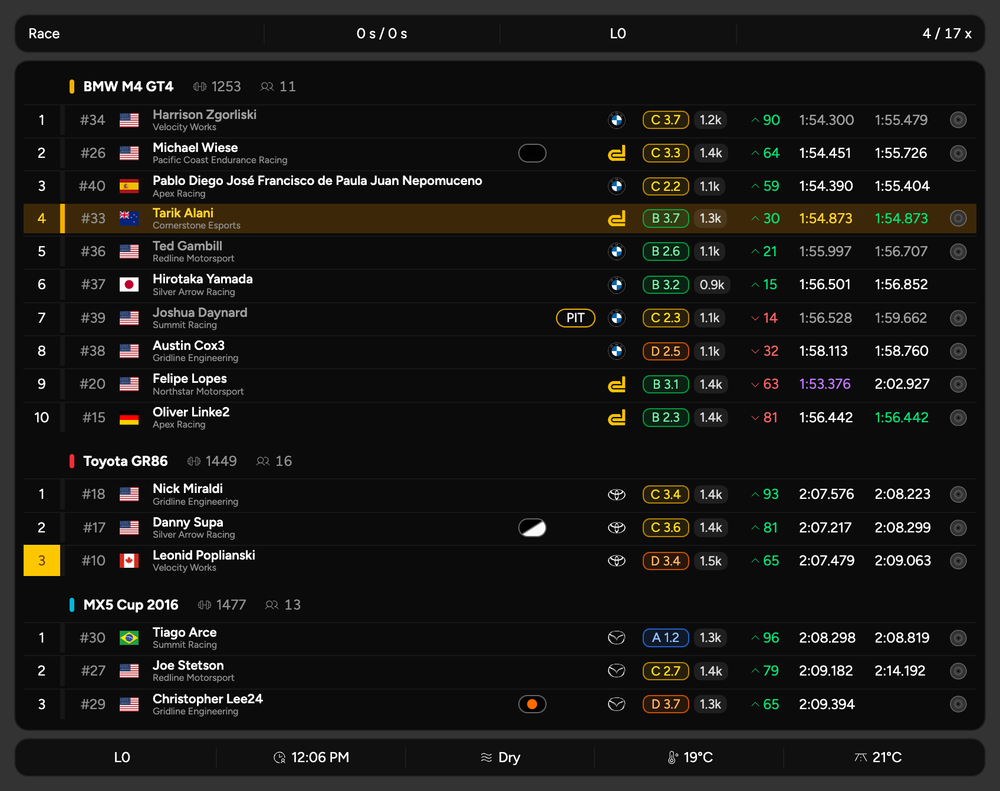

### Relative

Displays drive relative delta information for the current session.

**Features:**

- Driver information: position, car number, country flags, driver name, team name, pit status
  - Country flags: Support for 250+ countries, can be enabled/disabled, shows iRacing flag for unaffiliated drivers
  - Driver name format: Multiple display formats (e.g., "J. Smith", "John S.", "John Smith", etc.)
  - Pit status indicators: DNF (red), TOW (orange, animated), OUT (green), PIT (yellow, animated), last pit lap number, repair/meatball flag (orange dot), penalty/black flag (orange), slowdown (orange, animated)
  - Optional pit time display
  - Pit lap display mode: Show pit lap number or laps since last pit
  - Compact Mode: Three levels (Off, Compact, Ultra) for maximum information density
  - Incidents & Off-tracks: Driver rows highlight in yellow when they go off-track
  - Spectator Support: Automatically follows the driver you are watching in iRacing
- Driver Tags: Assign color-coded visual indicators to specific drivers
  - Preset groups: Dangerous, Friend, Twitch, YouTube — each with a unique icon and color
  - Custom groups with custom names, colors, and icons (600+ icons or uploaded images)
  - Display styles: icon badges or compact colored pills
  - Driver labels: custom display names that alternate with the real driver name on a configurable timer
  - Toggle the driver tag column on or off per widget
- Car details: manufacturer (with option to hide if single-make series), tire compound
- Driver badges with multiple format options (license/rating combinations)
- Styling customizations: toggle minimal license badges, minimal status badges, position background color, and car number background/border independently
- Relative delta timing display with configurable precision
- Timing information: best lap time, last lap time (multiple time format options: full, mixed, minutes, seconds-full, seconds-mixed, seconds)
  - A last lap the sim gave no time is dimmed and marked with a warning sign (Le Mans Ultimate only; can be switched off)
- Optional Push-to-Pass column, showing a driver's active state and remaining time in supported series
- Configurable radio icon duration, so recent transmissions remain visible without flickering
- Lap time delta column (configurable number of laps: 1-5)
- Optional flag contour: draws a colored border around the widget when a session flag is active, with configurable border width
- iRating change display (optional)
- Enhanced gap calculation with advanced options:
  - Interpolation methods (linear, cubic spline)
  - Configurable max lap history (3, 5, 7, or 10 laps)
  - Uses position/time records for accurate multi-class gaps
- Title bar with session progress bar
- Header and footer bars with customizable items and display order:
  - Session name, session time (remaining/elapsed), session clock time, incident count
  - Brake bias, local time, track wetness, precipitation, humidity, wind speed/direction
  - Air and track temperature (Metric/Imperial units)
  - Track name
  - Fuel level, last and best lap times, top speed, manufacturer position, and class rank
  - Session time: configurable mode (Remaining/Elapsed), format, and label style
- Configurable number of drivers to show around player (1-10)
- Optional position change column showing positions gained or lost within each class from the qualifying grid during races
- Optional pit-stall filtering to hide stopped drivers while keeping pit-road traffic and the focused car visible
- Toggle to strip car numbers from driver names
- Customizable display order for all columns
- Adjustable background opacity
- Option to show only when on track
- Option to use live position (updates continuously vs only at start/finish line)
- Session visibility settings (Race, Lone Qualify, Open Qualify, Practice, Offline Testing)

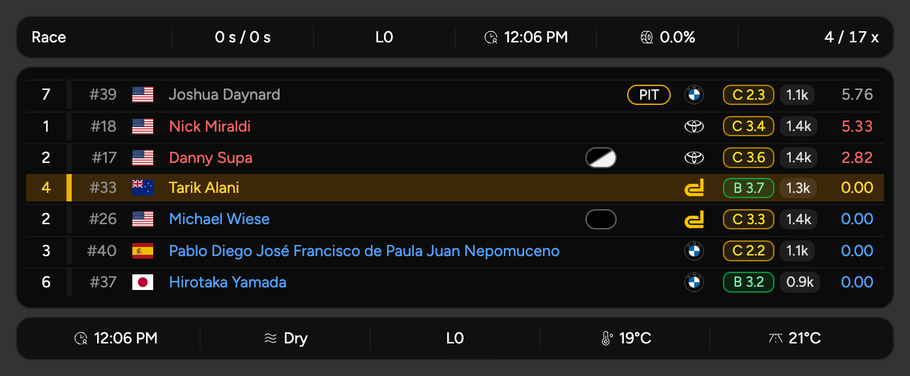

### Class Fields

The field at a glance: one chip per class with the cars still running and the cars entered, for a multi-class race where the full Standings table is not on screen. Works in iRacing and Le Mans Ultimate.

**Features:**

- Each class as the Standings draw it, its name on the class colour, followed by the cars still running of the cars entered: "12/14"
- A car is out once it is parked in its garage, has retired or been disqualified, or has left the session. A car stopped at its pit box is still running, and so is a car that has finished: the end of the race is not counted as cars going out
- Classes ordered by the overall place of each class's leader, so the strip reads as a legend of the race, or fastest class first as the Standings list them
- Your own class outlined; while you watch a car during a team-mate's stint, the class of the car you are watching
- Optional count of the cars out, and of the class's cars in the pit lane
- A row or a column, and a limit on the classes shown that always keeps your own
- Adjustable background opacity, session visibility and an option to show only when on track

iRacing has no garage flag: a car that is not in the world counts as out, which covers both a driver who has left and one sitting in the garage, so most of a practice field reads as out. Le Mans Ultimate states the garage stall and the finish status for every car.

### Track Map

Displays a track map with the current position of the cars on track and the track layout with the turn numbers / names.

**Features:**

- Real-time car positions on track (live telemetry)
- Track layout visualization
- Optional turn numbers and names display
  - Toggleable high contrast backgrounds for turn name labels
  - Adjustable turn name font sizes
- Pit lane highlighting with "P" indicators for cars in the pits
- Show/hide car numbers on driver circles
- Configurable driver and player circle sizes (10-100px)
- Configurable track line width (1-100px) and outline width (1-150px)
- Option to invert track colors (black track with white outline)
- Option to use highlight color for player circle
- Custom player car icon: upload an image (PNG, JPG, GIF, WebP, SVG) to replace your player circle
- Option to use an inverted color for the leader to make them stand out
- Multi-class support
- Session visibility settings (Race, Lone Qualify, Open Qualify, Practice, Offline Testing)
- Race positions: Driver circles can display their current race position
- Off-track highlighting: Car markers highlight when a driver goes off the track (yellow outline)
- Styling customizations: toggle minimal track outline and minimal car marker shadows

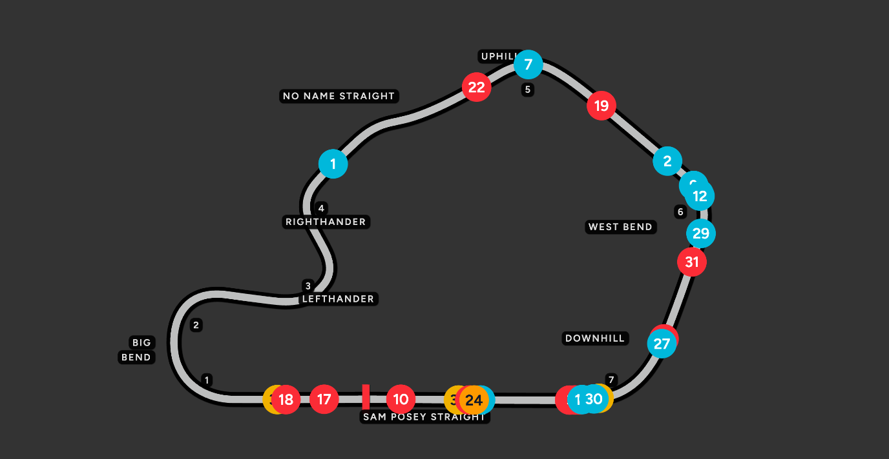

### Minimap

A close-range map of the track around the car you are watching, with the cars near you. Works in iRacing and Le Mans Ultimate.

**Features:**

- A circular map centred on your car, showing the stretch of track within a range you choose (75 to 800 m)
- Every car in range as a marker coloured by class, labelled with its position, class position or car number
- Your own car in white with a ring in your highlight colour
- Fixed orientation, matching the full track map, or heading up so your car always points to the top
- Other parts of the track that pass close by are drawn too, with the cars on them
- Start/finish line marker, and cars on pit road drawn faded
- In Le Mans Ultimate the map comes with the session; a circuit without a bundled map appears after one full lap has been driven
- Adjustable track width, marker size, background opacity, session visibility and an option to show only when on track

### Flat Track Map

Displays a simplified horizontal track map showing driver positions along a flat line representation of the track. Similar to Track Map but uses a linear horizontal layout.

**Features:**

- Real-time car positions on horizontal track line
- Start/finish line with checkered flag
- Show/hide car numbers on driver circles
- Configurable driver and player circle sizes (10-100px)
- Configurable track line width (5-40px) and outline width (10-80px)
- Option to invert track colors (black track with white outline)
- Option to use highlight color for player circle
- Auto-scales to container width
- Multi-class support


### Weather

Displays the weather information for the current session.

**Features:**

- Current weather conditions: track state, track and air temperature, wind speed and direction, humidity, precipitation, track wetness
- Vertical, horizontal compact, and horizontal full layouts
- Optional humidity display
- Customizable display order for all weather elements
- Temperature units: Auto (based on iRacing settings), Metric (°C), or Imperial (°F)
- Adjustable background opacity
- Option to show only when on track
- Session visibility settings (Race, Lone Qualify, Open Qualify, Practice, Offline Testing)

**Normal layout:**


**Horizontal layout:**


### Weather Forecast

Shows the weather as it is and Le Mans Ultimate's forecast for the rest of the session, as a row of small columns. Le Mans Ultimate only: iRacing publishes the weather as it is and no forecast.

**Features:**

- A "Now" column with the sky, the air temperature and how hard it is raining, with arrows while the temperature or the rain is on the move
- Up to four coming forecast points, soonest first, each with its sky, air temperature and chance of rain; a column whose point has begun drops out
- The first wet point stands out with a blue outline
- When each point starts, as time to go ("~12m", "~1.4h") or as the in-game clock time ("~15:40")
- Optional rain percentage, humidity and the forecast's wind for each point (Le Mans Ultimate does not apply wind on track, so it is not felt in the car)
- Temperature and wind units: Auto, Metric or Imperial
- Left-to-right or right-to-left, with or without the "Now" column, and a choice of keeping the row at its full width
- Uses the forecast of the running session: practice, qualifying or the race, and the race's for the warm-up
- Adjustable background opacity, session visibility and an option to show only when on track (it stays up while you watch a car on track)

**What the times rest on.** The sim publishes what each of its five forecast points holds, and not when it applies. Tearoff places them a fifth of the session apart, starting when the session clock does. In a race that is a fifth of the race's own length (the 15 minutes of a 15-minute race, not the session clock's end time, which also counts the time before the green flag); it is taken from the green flag once that has been seen, and from the race length the session is set to until then. This was measured on one recording: a dry race in real time, where the air temperature met the second and third points' values exactly at their times. In practice and qualifying it is a fifth of the session's length, which is assumed. A session whose weather changes, and one with a time scale above 1, have not been seen, so every time is written with a "~". In a race that ends on laps there is no time to show: the points stay in order with a dash for the time, and drop out as the leader covers each fifth of the laps, which is an assumption as well.

### Wind

Displays wind direction and speed as a standalone overlay.

**Features:**

- Wind compass with live direction and intensity
- Speed units: Auto, km/h, or mph
- Adjustable background opacity and on-track/session visibility controls


### Faster Cars From Behind

Displays information about faster cars approaching from behind, including driver name, distance, and a visual indicator that pulses when cars are close.

**Features:**

- Driver name and distance display
- Visual pulsing indicator when cars are close
- Configurable distance threshold for alerts
- Real-time detection of faster approaching cars
- Pit status filtering: Option to exclude cars in the pits
- Automatically hidden when on pit road
- Multiple driver display settings for more control over what's shown


### Fuel Calculator

Displays comprehensive fuel management information including current fuel level, fuel consumption per lap (min, max, averages), pit window timing, fuel required to finish, and consumption history graphs. Features a complete redesign with visual layout editing and real-time consumption calculations.

**Features:**

- Fuel units: Liters (L) or Gallons (gal)
- Compact mode: Three levels (Off, Compact, Ultra) for information density
- Visual layout editing: Drag and drop widgets to customize your fuel display
- Layout options: Vertical or horizontal
- Real-time consumption calculations with pit strategy recommendations
- Multiple display widgets for flexible information presentation
- Consumption statistics:
  - Minimum consumption
  - Last lap consumption
  - 3-lap average
  - 10-lap average
  - Maximum consumption
  - Fuel required calculations
- Pit window timing information
- Endurance strategy display (total pit stops and stint info for long races)
- Consumption history graphs:
  - Histogram (default) or line chart
  - Optional lap table showing fuel used per completed lap
  - Configurable history length
- Configurable safety margin (0-20%) for fuel calculations
- Adjustable background opacity
- Earliest pit lap: Shows the earliest possible lap you can pit and still finish the race
- Fuel-to-add mode: Toggle between showing total fuel needed or just what's needed at the next stop
- Target consumption: Shows what fuel saving is required to reach specific lap targets (±1 from current estimate)

**In Le Mans Ultimate**, a Hypercar, LMDh or LMGT3 stops when its virtual energy runs out, so for those cars the calculator counts virtual energy instead of fuel:

- Every amount is percent of the energy budget, whichever fuel unit is chosen: the level, the use per lap, the averages, the history and the safety margin.
- Where a car on fuel shows the amount to add, a car on energy shows **Fill to**: the level to set in the pit menu, which takes virtual energy as the level the car leaves with. It is rounded up to a whole percent, is for a stop made at the end of the lap you are on, and falls by one lap's energy for every lap you stay out. `OK` means the energy already reaches the flag; `100%` in red means one stop is not enough.
- The fuel tank gets a line of its own under the energy bar, with the laps it lasts. The two are loaded to run out close together, and the car stops when either does, so the line turns amber and reads **Fuel ends first** when the tank will be empty before the energy.
- Lap history is kept per track and car model, separately for energy and for litres.
- LMP2 and LMP3 cars have no virtual energy and are counted in litres or gallons, as in iRacing.

**All sections enabled**, with histogram history, pit planning, fuel-saving targets, and time until empty:


**Default layout**, with the header, fuel gauge, and consumption grid:

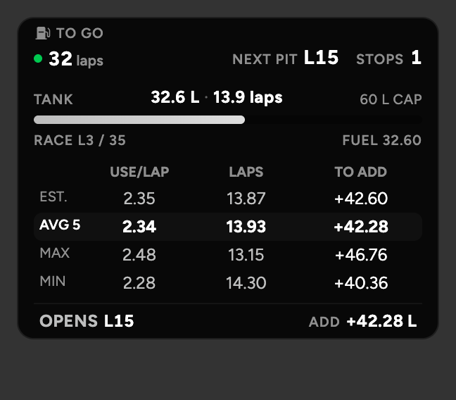

### Blind Spot Monitor

Displays visual indicators on the left and right sides of the screen when cars are detected in your blind spots. The indicator position dynamically adjusts based on the distance to the detected car.

**Features:**

- Left and right side detection with three-wide scenario support
- Visual amber indicator bars that move vertically based on car distance
- Detection of single car or multiple cars on each side
- Configurable border size (0-20px) and indicator color
- Configurable detection distances:
  - Distance ahead (3-6 meters)
  - Distance behind (3-6 meters)
- Adjustable indicator width (5-100px)
- Adjustable background opacity
- Only displays when on track
- Real-time position tracking based on lap distance
- Standard bar or compact Simple mode, with configurable indicator size, position, car count, and colours


### Radar

Shows nearby rivals ahead, behind, and alongside your car. iRacing positions are estimated from track position and spotter calls.

**Features:**

- Nearby traffic display with bumper-to-bumper gaps and grid or pace-line formations
- Configurable warnings for close rivals, fast-closing cars, and hazards ahead, including slow, crashed, and rejoining cars
- Warnings stay quiet during formation and full-course cautions
- Appearance presets, road or oval profiles, colours, distance rings, car numbers, and warning labels
- Live settings preview and configurable session visibility, including warmup


### Battle

Displays a compact three-row view of the cars immediately ahead of and behind you in class position, alongside your own row.

**Features:**

- Live gap, previous-lap gap, and gap-change display
- Optional position, car number, driver name, stint length, last lap time, and speed columns
- Reorderable columns and configurable gap precision, lap-time format, and speed units
- Last-lap highlights for personal-best and session-fastest laps, and a mark on a last lap the sim gave no time (Le Mans Ultimate only)
- Adjustable background opacity and on-track/session visibility controls

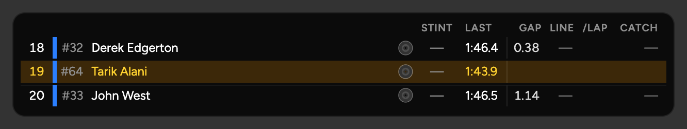

### Slow Car Ahead Warning

Displays a warning indicator when a slower car is detected ahead on the track. The distance in meters to the car is displayed, as well as bars that grow as the car gets closer. The color of the bars change based on the track position and speed of the slow car:

- Green: Car is off-track
- Amber: Car is on-track and moving (depends on configured threshold)
- Red: Car is on-track and stopped, or moving very slowly (depends on configured threshold)

**Features:**

- Adjustable distance threshold
- Adjustable slow speed threshold
- Adjustable stopped speed threshold
- Adjustable bar thickness
- Automatically hidden when on pit road


### Garage Cover

Displays a custom image overlay when you are in the garage. Perfect for streaming to show a branded or custom image while in the garage instead of the default iRacing garage view.

**Features:**

- Custom image upload (drag and drop or file selection)
- Only displays when in garage
- Browser source compatible for OBS and other streaming software
- Accessible via browser at `http://localhost:3000/dashboard` (displays as part of your dashboard)
- Image preview in settings


### Rejoin Indicator

Displays a safety indicator showing the gap to the car behind and whether it's safe to rejoin the track after leaving the pits or garage. Provides clear visual feedback with color-coded status (Clear/Caution/Do Not Rejoin).

**Features:**

- Real-time gap calculation to the nearest on-track car behind
- Color-coded status indicators:
  - Green (Clear): Safe to rejoin (gap above care threshold)
  - Amber (Caution): Exercise caution when rejoining (gap between care and stop thresholds)
  - Red (Do Not Rejoin): Not safe to rejoin (gap below stop threshold)
- Configurable speed threshold (default: 30 km/h) - only shows when at or below this speed
- Configurable gap thresholds:
  - Care gap: Distance where caution is needed
  - Stop gap: Distance where rejoining is unsafe
- Automatically hides when:
  - Player is in garage, pit stall, or on pit road
  - No valid on-track car is detected behind
  - During standing start (pre-race session states)
- Only displays when driving and on track

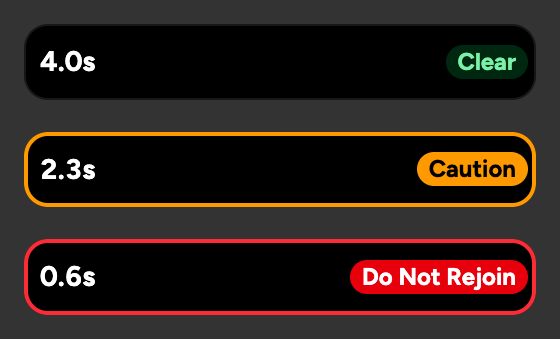

### Pitlane Helper

Helps you manage your pit stops with clear visual guidance. It assists with speed limits, finding your pit box, and monitoring pitlane traffic.

**Features:**

- Speed Limit Assistant: Vertical colour-coded indicator (Green/Amber/Red) showing proximity to the pit speed limit, toggleable speed bar with decimal precision and selectable speed unit (Auto/MPH/KM/H).
- Pitbox Countdown: A distance tracker and progress bar show exactly how far you are from your pit stall.
- Countdown Bars: Colour-coded progress bars for pit entry, pitbox, and pit exit distances (Green -> Yellow -> Blue).
  - Configurable vertical/horizontal orientation with side-by-side layout option
  - Three semantic rows (32x80px) for compact display
- Pit Exit Inputs: Throttle/clutch display to optimize pit exits with phase-based visibility options.
- Traffic Monitor: See how many cars are currently ahead or behind you in the pitlane.
- Refuel Target (Le Mans Ultimate only): Shows what the next stop is set to put in, read from the pit menu: litres of fuel, or the virtual energy level the stop fills to for a car that runs on it.
- Fully resizable with theme-matching background
- Early Warning: Alerts you if your pitbox is located near the pit entry.
- Pit limiter alerts: Flashing warnings if you enter the pits without your limiter active (auto-disabled for series with automatic limiters).
- Calibration controls in Settings: View and reset learned pit-lane positions for the current track, or open and reload the calibration file after manual edits.

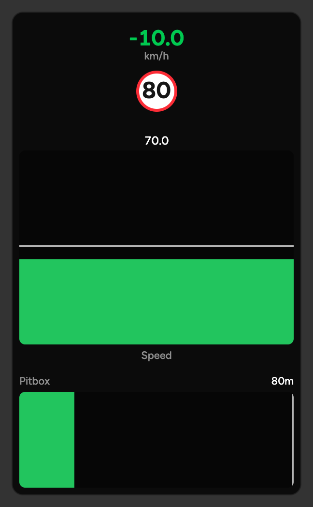

### Lap Timer

**Features:**

- Current lap: Show current lap time, highlights green for personal best and purple for session best.
- Predicted lap: Shows an estimate of the lap time based on the current delta.
- Best and last lap: Display the best and last lap times.
- Personal best lap: Optionally show the best lap ever recorded by Tearoff for the current car and track combo, persisted across sessions.
- Lap history: Show a history of your most recent lap times along with optional deltas.
- Optionally hide pit laps from the lap history list and graph.
- Fully configurable: Decide which laps your interested in and toggle them on and off individually.
- Fully customisable: Resize, scale and align to position the widget to your taste.

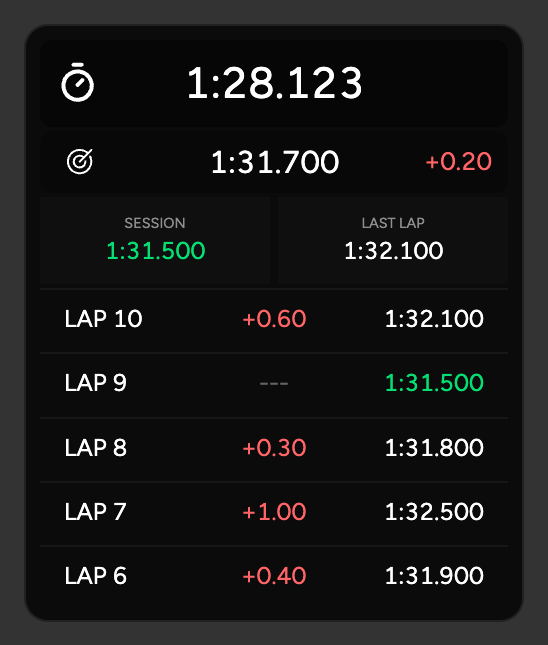

### Sector Delta

Displays per-sector timing deltas for the current lap, colour-coded by performance against a ghost lap or your session best. Sectors are shown as a strip that can scroll continuously with the current sector pinned to the centre.

**Features:**

- Per-sector deltas coloured green/yellow/red based on performance vs reference
- Comparison source: ghost lap when available, or session best only
- Le Mans Ultimate: the three sectors and their times are the game's own, so they match its timing screen; the ghost is your all-time reference lap for the track and car
- Continuous scrolling strip with the current sector position-pinned to the centre
- Option to limit the number of visible sectors (sliding carousel)
- Track incident sectors: sectors where you picked up incidents are flagged with a warning icon
- Configurable colour thresholds (green and yellow limits as a percentage of session best)
- Time format with configurable decimal precision
- Adjustable background opacity

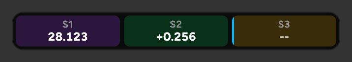

### Lap Delta

Your current lap against your own best: how far up or down you are, whether you are gaining or losing right now, and the lap time you are heading for. Works in iRacing and Le Mans Ultimate.

**Features:**

- The delta to the reference lap at the point of the track you are at, green when ahead and red when behind, to two or three decimals
- A trend bar that fills green while you are gaining on the reference and red while you are losing to it, with adjustable sensitivity
- Predicted lap time: the reference lap plus the current delta
- A choice of reference: your best clean lap of this session, or your all-time reference on this track in this car, which comes from the [lap library](#lap-library) and is kept between sessions
- Dashes rather than a guess: before the chosen reference exists, and on a lap that was not seen from its start (the out-lap, or after a return to the pits), nothing is shown in its place
- The all-time reference is your quickest clean lap: one you drove yourself from line to line, without a pit visit, not voided by the sim for track limits and without an incident. In **Settings > Laps** you can pin a different lap as the reference, or delete a lap you do not want to count
- Adjustable background opacity, session visibility and an option to show only when on track

Laps are timed from the point where the lap distance wraps rather than from the sim's own lap clock, so the delta and the reference always share one start line. In Le Mans Ultimate that point is a couple of metres from the timing line, so a predicted lap can differ from the official time by a hundredth or two. There the lap that opens a race is not used as a reference either: the sim reports no lap position until the car first reaches the line, so that lap has no start to time it from.

### Corner Delta

The corner you have just driven against the same corner on one of your own laps: the time you gained or lost through it, and how much faster or slower you went in and came out. Works in iRacing and Le Mans Ultimate.

**Features:**

- The name or turn number of the corner just completed, and the time through it against the reference, green when quicker and red when slower, to two or three decimals
- Entry and exit speed: your speed where the corner starts and where it ends, each with the difference to the reference, in km/h or mph
- A choice of what to compare with: your all-time reference on this track in this car (from the [lap library](#lap-library)), your best clean lap of this session, or the last time you drove the corner
- A short list of the corners before the last one, so a sequence of esses or a chicane stays readable
- Dashes rather than a guess: where the chosen reference does not exist yet, the speeds you drove are still shown and the differences are not replaced by another lap's
- A corner counts when it was driven from its start to its end in one go. A corner left through the pit lane, interrupted by a tow or driven to a standstill is not reported, and a difference of more than ten seconds is left blank
- Adjustable background opacity, session visibility and an option to show only when on track

Corners come from the bundled track data, the same data the Corner Names overlay uses, so the widget says so on a track that has none. Both ends of a corner are placed between the two telemetry frames either side of them, so the figures do not depend on where a frame happened to fall. The list is cleared in the pit lane.

### Timing

The lap in one glance: a block of tiles with the lap you are on, the delta to a reference lap, your last and best laps and your sector times. Works in iRacing and Le Mans Ultimate.

**Features:**

- Lap: the lap you are driving, on a blue tile
- Delta: how far up or down you are on the reference lap at this point of the track, green when ahead and red when behind, to two or three decimals. The reference is your best clean lap of this session or your all-time reference on this track in this car, from the [lap library](#lap-library); before the chosen one exists the tile shows dashes
- Last lap: purple when it is the best of the session, green when it is your own best. In Le Mans Ultimate a lap the game gave no time, such as one voided for track limits, is still shown, timed from line to line, greyed and marked with a warning sign
- Best lap: your best of the session, on a purple tile, with a crown when it is also the best of the session in your class, or of every car if you choose so
- Sector times: one tile per sector with a bar coloured against your own best for that sector (purple at your best, then green, yellow and red). A tile shows this lap's time once the sector is done and the previous lap's, dimmed, until then; for five seconds after the line all of them show the lap just finished. They can also show this lap only, or your best sectors
- A lap in progress that the game has voided greys the delta and says so in its label, and a sector with an incident in it carries a warning sign, or is left out if you prefer
- Optional rows: current lap time, predicted lap, session best, all-time best and your recent pace
- Tracks with more than three sectors (iRacing) get a tile per sector, up to a number you choose; past it the row follows you round the lap
- Adjustable precision for the delta, the lap times and the sector times, text size, background opacity, session visibility and an option to show only when on track

The default size fits the three default rows; make the widget taller when you switch on optional rows, and wider on a track with many sectors. Sector colours use the green and yellow thresholds set for [Sector Delta](#sector-delta). In Le Mans Ultimate the sector a stint starts in has no time, because the game only times a sector it saw you enter.

### Lap Library

Every lap you complete is recorded, grouped by the session it was driven in, and listed in **Settings > Laps**. Works in iRacing and Le Mans Ultimate, and records whether or not any widget is on screen.

**Features:**

- Sessions listed most recent first, with the track, car, session type, simulator, number of laps and best lap
- Each lap with its time, the gap to the session's best, and the fuel or virtual energy it used
- Notes on why a lap is not counted as clean: a pit lap, voided by the sim, incident points, not driven by you, or timed without a full trace
- The lap that Lap Delta uses as its all-time reference is marked with a star: your quickest clean lap for that track and car, or one you have pinned
- Pin any lap that has a trace as the reference for its track and car, and unpin it to go back to the quickest clean lap
- Delete a single lap or a whole session, after a confirmation
- A lap is recorded once it has been driven from the line to the line. The stretch before the first crossing, such as leaving the pits or the start of a race in Le Mans Ultimate, is not a lap and is not listed

The laps are kept in a database, `laps.db`, in the app's data folder. It holds up to 5000 laps; past that the oldest go first, and the reference lap of each track and car is never dropped. Each lap is stored with its time and speed against distance, a point every ten metres, which is what the delta is measured against.

### Delta Speed

Compares your current speed with your session-best clean lap at the same point on track.

**Features:**

- Colour indicator fades toward green when faster and red when slower
- Optional numeric speed difference, with Auto, km/h, or mph units
- Shows "No clean lap" until a usable reference is available


### Flag Widget

Displays racing flags in an LED-matrix style, automatically showing the most relevant flag when multiple are active. Perfect for keeping track of track conditions and race control messages.

**Features:**

- LED-matrix style flag display
- Automatic flag priority: Shows the most important flag when multiple are active
- Support for all iRacing racing flags (green, yellow, white, checkered, blue, black, etc.)
- Option to display two identical flags within a single widget
- Matrix mode: choose the LED resolution (8x8, 16x16, or uniform 1x1) for a more detailed or compact look
- Optional flag label and "no flag" state display
- Green while the track is clear, or only for a few seconds after the start and after a yellow, as iRacing itself shows it
- A blue flag is shown over a yellow that is somewhere else on the circuit; a yellow close to you still comes first
- Optional glow effect and configurable flag animation (toggle plus blink period)
- Customizable size and positioning
- Adjustable background opacity
- Session visibility settings (Race, Lone Qualify, Open Qualify, Practice, Offline Testing)


### Flag Panel

A wide card that names the flag that applies to you right now and explains it in one line. Under a blue flag it becomes the plate of the car coming to lap you. Works in iRacing and Le Mans Ultimate; each sim has states the other cannot report.

**Features:**

- The flag as a colour block, its name in capitals and a one-line explanation: "Track clear", "Incident 320 m ahead", "Pit lane open for lead-lap cars", "10 s in your pit box"
- Under a blue flag: the number of the car to let by on the block, its driver or team under the title, its class as the standings draw it, and how many metres it is behind
- A count of the further cars queued behind that one, and the plate handed to the next car as each one goes by
- In a race the car named is one that is lapping you or one of a faster class, never a rival on your own lap; in practice and qualifying it is the nearest car behind, a closing one first
- Local yellows with the distance to the stopped car they are for, ahead or just behind you, and the block pulsing when it is close. A yellow somewhere else on the circuit is named without taking the card over, so it does not hide a blue
- Full course yellow with its sub-phase where the sim states one (pit lane closed, open for lead-lap cars, green next time by) and a pit closed marker
- The states before a race (reconnaissance laps, the grid, the formation lap, the start lights), the last lap, the chequered flag, red flag and disqualification
- Penalties still to serve: drive-through, stop-go with its seconds, time penalty, and iRacing's black flag, warning and meatball
- The whole card tinted in the flag's colour for the states that need attention, or always, or never
- Metres or feet, the name format, which states to show, and whether to show green or hide the card while the track is clear
- Adjustable background opacity, session visibility and an option to show only when on track

Le Mans Ultimate has no white flag and does not say which car a blue flag is for, so the last lap and the car are worked out from the timing data. Its sector flags are read in the order its sector numbers use, which no recording has confirmed yet, so naming the sector of a yellow is an option that is off by default. iRacing reports no sector yellows, no start-light count and no penalty kind.

### Setup Comparison Tool

Side-by-side setup analysis to compare car setup changes between sessions.

**Features:**

- Side-by-side setup diff with changed values highlighted in red
- Snapshot timestamps for each saved setup
- Move setups left/right to reorder comparisons


### Stream Chat Overlay

Displays live Twitch and YouTube chat in one overlay, useful for streamers who want chat visible while racing. Works the same in the overlay and in an OBS browser source.

**Features:**

- Live Twitch chat by channel name and YouTube live chat by `@handle` (no OAuth or API keys required); leave a channel empty to turn that platform off
- Messages from both platforms are mixed in the order they arrive
- Optional platform logo in front of every message
- Twitch emotes (including BTTV and 7TV) and YouTube emoji, plus YouTube owner, moderator, verified and member badges
- Colored nicknames using each chatter's Twitch username color
- Optional auto-disappearing messages with a configurable interval (10-90s)
- Configurable font size and background opacity
- YouTube chat connects automatically once the channel goes live
- Chat connections run in the app itself, so an OBS browser source needs no internet access of its own
- Visible even when iRacing is not running

Settings are split into **Display**, **Twitch** and **YouTube** tabs. Chat from the older Twitch Chat widget is carried over automatically.


### Heart Rate

Displays your live heart rate from [HypeRate](https://www.hyperate.io/) by embedding its overlay — no API key or account required, just your session id.

**Features:**

- No key/account needed — paste the session id from your HypeRate share link (`app.hyperate.io/`**`KiY`**)
- Optional widget/theme: paste any HypeRate widget link or name (e.g. `Bouncing_Heart_Widget`, or an `app.hyperate.io/animation/<n>/...` route); your session id is filled in automatically and any baked-in id is ignored
- Transparent background and no scrollbar (the embedded page is restyled like an OBS browser source)
- Auto-fits the graphic to the widget and scales it on resize (no truncation)
- Visible even when iRacing is not running


### Information Bar

A standalone widget that displays session and timing information independently from the Standings and Relative widgets.

**Features:**

- Displays flag status, lap counter, session time, and other session info
- Optional fuel level, last and best lap times, top speed, manufacturer position, and class rank
- Weather items including humidity, precipitation, wind, and air/track temperature
- In-game clock in the system's, the 24-hour or the 12-hour format, with how fast the in-game day runs beside it ("x2") when that is not real time
- Fully configurable: reorder items and toggle each one on or off
- Adjustable background opacity
- Session visibility settings (Race, Lone Qualify, Open Qualify, Practice, Offline Testing)


### System Performance

Shows what the machine, Tearoff and the sim are costing, in a small widget for a corner of the screen.

**Features:**

- System: CPU load of the whole machine, across all logical cores, and the memory in use
- Tearoff: its own CPU load, as a share of the whole machine, and its memory, with all of its windows and processes counted together
- Sim (iRacing only): the frame rate and iRacing's own CPU and GPU meters
- The System and Tearoff CPU figures are averaged over about ten seconds, so they read as a level rather than a flicker
- Figures are white until they cross a threshold: a CPU or GPU figure turns amber from a load you set (85% by default) and red from 95%, and the frame rate turns amber below a rate you set (60 fps by default) and red below half of it. Memory is never coloured
- One row per group, or everything on a single strip; each group can be switched off
- Adjustable background opacity, session visibility and an option to show only when on track. It is off by default, since the widget describes the machine rather than the car
- Read once a second, and only while the widget is on screen

**What it cannot show:**

- Under Le Mans Ultimate there is no Sim row. LMU publishes no frame rate and no CPU or GPU load, and Tearoff cannot read another program's usage, so there the widget shows the machine and Tearoff only
- The GPU load of the machine, GPU temperature and video memory are not measured under either sim. The GPU figure in the Sim row is iRacing's own meter
- iRacing's CPU and GPU figures are how much of each frame its own threads use, not the load on the whole machine, so they are not the numbers Task Manager shows for the sim
- The System CPU figure is the share of time the cores were busy, which is Windows' "% Processor Time". Task Manager's headline CPU figure also weighs in how far above its base clock speed the processor is running, so it can read higher than the widget on a processor that boosts

### Telemetry Inspector

A powerful tool for viewing live data coming from the active simulator, with units shown for known values. While mostly used for debugging, it's great for seeing exactly what data the app is receiving in real-time.

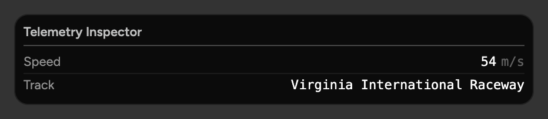

### Corner Name Overlay

Displays the current track section (corner or named straight) along with corner number and progress through the section. Track section data is sourced from [lovely-track-data](https://github.com/Lovely-Sim-Racing/lovely-track-data).

**Features:**

- Section name display (e.g. "Eau Rouge", "Kemmel Straight", "La Source")
- Corner number badge (e.g. T1, T12) when the section is a numbered turn
- Progress bar showing position within the current section
- Optional overall lap-distance percentage
- Configurable font size and background opacity
- Session visibility settings (Race, Lone Qualify, Open Qualify, Practice, Offline Testing)

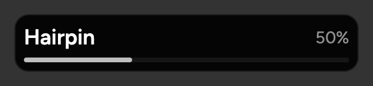

### The Gantry

A race control window with live standings, an automatic incident feed, and a per-lap graph. Unlike the other widgets it opens in its own resizable window instead of sitting on top of the sim, so it suits a second monitor, a spotter, or a race director. Enable it in Settings, then use **Show Window** to bring it back if you close it.

**Features:**

- Standings and incidents shown side by side with a draggable divider, plus a separate Lap Graph tab
- Optional always-on-top mode, controlled from the tab bar or settings for windowed or borderless simulators
- Dock Fuel Calculator, Track Map, or Flat Track Map panels beneath the incident feed, side by side or in tabs, with optional Gantry-only fuel layouts
- Review recorded incidents and lap history while watching an iRacing replay; history follows the selected replay session and requires recordings made by Tearoff on this PC
- Final standings and lap graphs remain available after iRacing closes, including when switching tabs, until the next session loads or Tearoff closes
- Standings list
  - Grouped by car class: position, car number, driver name, tyre compound, iRating, pit/DNF status
  - Gap to the class leader, interval to the car ahead, best lap and last lap
  - Lap deltas for the last three laps, each compared against your own lap of the same age (green means they were slower than you, red means faster)
  - Configurable driver name format
  - Click a row to point the sim camera at that car (works in a replay or while spectating)
- Incident feed
  - Detects crashes, off-tracks, slowdowns, pit entries, and black flags as they happen
  - Filter chips per incident type, plus a dropdown to narrow the feed to a single driver
  - Group incidents by practice, qualifying, warmup, and race, with filters for the current session or a chosen session
  - Replay jump buttons (-5s, -10s, -30s) move the sim's replay to just before the incident and point the camera at the car
  - Choose the camera used for incident replays, defaulting to Far Chase
  - Incidents are saved to disk: keep every session, or only the last 5, 10, or 20
  - Tunable detection thresholds: slow speed and duration, crash impact severity and minimum speed, off-track duration, pit entry duration, and a per-type cooldown
  - Threshold speeds shown in mph, km/h, or auto (always stored in km/h, so switching units never changes detection)
- Lap Graph
  - Three y axes: Race Trace (time gained or lost against the class leader's reference pace), Position (class position at the end of each lap), and Gap (seconds behind the class leader)
  - Consistent driver colours and dash patterns, with matching swatches in the driver list
  - Class selector for multi-class sessions
  - Pin drivers from the side list, or let auto-pin follow the player, the class leader, and the cars around the player
  - Hover the chart for a crosshair readout of the nearby lines; hover a name to lift that driver's line above the field
  - Pan and zoom the lap window by dragging or scrolling, with an overview strip below the chart, and it follows the latest lap
  - Configurable default axis, laps shown, and auto-pin


### Broadcast overlays

TV-style overlays for iRacing streams, configured together in **Settings > Broadcast**. Each is an independent widget with its own position and browser-source URL.

**Features:**

- **Tower:** Multi-class standings with rotating or fixed pages for names, gaps, positions gained, pit stops, and tyres; optional focused-driver card and pre-race/post-race screens
- **Ticker:** A scrolling standings strip for the bottom of your broadcast
- **Events:** Timed alerts for incidents, flags, fastest laps, pit stops, and race milestones, with selectable event types
- **Weather:** A weather panel shown at configurable intervals
- **Podium:** Class podiums after the checkered flag, with steps or trophy styles
- IMSA, WEC, and F1 themes, a custom logo and title, and configurable backgrounds


### Other Features

**Features:**

- Profile Management
  - Save and switch between different dashboard configurations
  - Multiple profiles for different racing scenarios or streaming setups
  - Assign profiles to practice, qualifying, races, testing, time trials, and warmup for automatic layout switching
  - Optional spotting profile activates after 20 seconds out of the car and switches back immediately when you resume driving
  - Clone existing profiles with one click to create variations without starting from scratch
  - Bind shortcuts to cycle to the previous or next profile, with an on-screen profile-name banner
  - Each profile can be accessed as its own browser source URL for OBS streaming
  - Dashboard import/export to share layouts between users or back up your setup
- Streamer & OBS Ready
  - Built-in Web Server: All overlays can be used as a browser source in OBS. `http://localhost:3000/dashboard` follows the active profile; `http://localhost:3000/dashboard?profile=<profileId>` selects a specific profile. Copy the actual URLs from Settings > Profiles if the server uses another port.
  - Separate browser layouts: Each profile stores its browser widget positions independently of the desktop layout. Use **Settings > Profiles > Actions > Edit Browser Layout** to arrange widgets for OBS. Set the browser source's width and height to match your intended canvas.
  - Single Widget URLs: `http://localhost:3000/widget/<widgetId>` shows one widget filling the page, including widgets hidden from the desktop layout, for hosts that take one page per source such as OpenKneeboard in VR. `http://localhost:3000` lists the URL for every widget in the active dashboard; older component links redirect to the widget pages.
  - Optional Web Server: Disable the built-in server when browser sources are not needed; restart the app to free its port.
  - Network Access: Enable network access in settings to allow other devices on your local network to access the dashboard (useful for dual-PC streaming setups).
  - Garage Cover: Automatically hide your screen with a custom image when you enter the garage to keep your car setup private.
  - Transparent backgrounds: All overlays are designed to look great on top of your game or stream.
  - Reduced GPU usage: Overlay windows are sized to fit only the widgets on each display, rather than covering the full screen.
- Customization & Themes
  - Per-widget scaling: Scale any widget's text and content from 50% to 200% independently in its settings, then resize its container to fit your layout.
  - Color themes: Choose from built-in themes or create your own custom look.
  - Highlight color: Pick a custom color that is used across all widgets to match your branding or preference.
  - Font sizes: Multiple font size options (including 2x Small, 3x Small, and Tiny for large or ultra-wide monitors) to ensure readability on any screen.
  - Font weight: Choose between Normal, Bold, or Extra Bold text for improved readability.
- Ease of Use
  - Configurable key bindings: Rebind shortcuts for global overlay visibility, edit layout, telemetry, layout-profile cycling, and individual widget visibility. Supports keyboard chords, controller buttons, and controller-button combos.
  - Per-widget visibility shortcuts: Show or hide individual widgets without affecting the rest of the dashboard.
  - Overlay on/off: Turn every overlay off and back on, while the sim is running or not, without changing which widgets are enabled. The same switch is the **Overlay** button in the settings window header, **Show Overlay** in the tray menu and the Hide / Show UI shortcut (Alt+H by default), and each follows the others. It applies to this run of the app: the overlay is on again after a restart.
  - Hidden while paused: The overlay goes off the screen while the game is paused and comes back when you resume, within about a second. The same goes for a screen that stops the session without calling it a pause, such as the pit stop screen in a race against the AI (there it takes about two seconds). On by default; turn it off under **Settings > General > Hide Overlay While the Game Is Paused**. Le Mans Ultimate only: iRacing does not report a pause.
  - Shown while watching: Widgets set to show only when on track stay on screen while you watch a car on track from outside it, such as a team-mate's stint in a team race, and follow that car: Standings, Relative, Minimap, Battle, Information Bar, Flag, Flag Panel, Weather and Weather Forecast. The widgets about your own car show your team car's numbers while a team-mate drives it and the camera is on it: Lap Delta, Corner Delta, Lap Time Log, Delta Speed, Corner Names, Timing, the own-car items of the Information Bar, and the Fuel Calculator for a car on virtual energy. Their laps are measured against your own reference laps and are never kept as yours: not as a personal best, a reference lap or fuel history. Input, Shift Light, Tyres and Lap Trace show the team car too, where the game sends that car's pedals and revs: the inputs as the car received them, the shift lights, the brake temperatures and the compound, and their lap drawn against your reference. Tyre temperatures and pressures are sent only for a car you are in, so in Tyres they show as dashes, and so do the pressure offsets, the deflection and the load. The fuel in litres and the tread left are shown while the AI drives your car; for a team-mate driving online they are left out until it is known what the game sends for them. With the camera on another car those widgets hide, as they do not follow it. Car Systems, Chassis, Damage, Friction Circle, Brake Performance, Hybrid and Lift and Coast Lights stay hidden while you watch: they are made of readings the game sends only for a car you are in. A car that is in its garage does not count as one being watched. On by default; turn it off under **Settings > General > Keep Widgets On Screen While Watching**. Le Mans Ultimate only for now.
  - Reset widget position: Reset any widget's position to the top-left corner if it gets lost off-screen.
  - Close to tray: Closing the window minimizes to the system tray instead of quitting (configurable).
  - Always on top: Keep your overlays visible even when clicking on other windows.
  - System autostart: Optionally have the app start automatically when your computer boots up.
  - Start minimized: Launch the settings window in minimized state for a cleaner desktop
  - Auto port fallback: If port 3000 is in use, the app automatically tries the next available port and updates all URLs in settings.
  - Configurable Chromium flags: Advanced Settings exposes recommended graphics fixes (disable native window occlusion, ANGLE backend selection, disable Direct Composition) plus custom enable/disable feature lists and freeform switches for troubleshooting rendering issues (e.g. black flickering on some GPUs).
  - Log file access: Open the log folder or export the log file directly from Advanced Settings.
  - Automatic updates: The app keeps itself up to date with the latest features and bug fixes.

## Prerequisites (for development)

- Node.js (v24 or higher, matching `package.json`)
- npm (comes with Node.js)
- Windows build tools if you are on Windows
  - Modern Node.js installations include the necessary build tools. If you encounter issues building native modules, ensure you selected the option to install build tools during Node.js installation, or reinstall Node.js with build tools enabled.
- Windows and an installed simulator for live telemetry (iRacing, or Le Mans Ultimate for the supported beta widgets)

> Note: Developing on MacOS is fully supported and does not require iRacing or any additional tools to be installed as it uses a mocked SDK.

## Installation (for development)

To install Tearoff for development, follow these steps:

1. Clone the repository
2. Navigate to the project directory
3. Install the required dependencies:

```bash
npm ci
```

4. Run the application:

```bash
npm start
```

5. Optionally, you can run the storybook to view the components in isolation:

```bash
npm run storybook
```

## Usage (for development)

To start using Tearoff, run the following command:

```bash
npm start
```

This will start the application.

Look for the application in your app tray.

### Simulator overrides

For normal use, choose the simulator in **Settings > General > Simulator**. See [Supported simulators](#supported-simulators) for LMU setup and beta limitations.

To override the saved simulator setting, use `tearoff.exe --sim=lmu` or
`tearoff.exe --sim=iracing`. For development, set `IRDASHIES_SIM` instead:

```powershell
$env:IRDASHIES_SIM = 'lmu'
npm start
```

Without an override, Tearoff uses the saved simulator preference. In Auto mode,
it detects the running simulator and follows changes without restarting, giving
iRacing priority if both simulators are active when detection runs.

> You will need to have Node.js installed on your machine to run the application. You can download it from [here](https://nodejs.org/).

> On macOS you will see mocked data from a sample session. To connect to iRacing, you will need to run the application on Windows.

While developing, it's recommended you run Storybook as it gives you a quick way to iterate your changes:

```bash
npm run storybook
```

## Folder Structure

The project is structured as follows:

```
irdashies/
  ├── src/
  │   ├── app/
  │   ├── frontend/
  │   ├── types/
```

- `src/app/` contains the main Electron application code.
- `src/app/irsdk/` contains the iRacing SDK code including the native C++ bindings.
- `src/app/processors/` computes derived telemetry and publishes typed channel snapshots.
- `src/frontend/` contains the React components for the overlays.
- `src/frontend/domain/` contains shared selectors and widget-independent UI logic.
- `src/types/` contains TypeScript type definitions shared between the frontend and backend (e.g. telemetry types).
- `src/types/widgets/` contains widget manifests, default layouts, and settings metadata; widgets register their React components in a co-located `widget.ts`.

> Note: Frontend components should NOT import anything from ./app as these are Electron-specific modules. Any communication should be done via IPC and types exposed via the types folder.

Read [Architecture Rules](./docs/ARCHITECTURE_RULES.md) before making non-trivial changes.

## Storybook

To view the components in Storybook, run the following command:

```bash
npm run storybook
```

This allows you to easily develop, test, and visualise the widgets/overlays in isolation.

Open `http://localhost:6006`. Stories use mock telemetry or saved channel snapshots, so you can develop the UI without a simulator installed.

## Package (create .exe)

To package the application and create the .exe, run the following command:

```bash
npm run package
```

To create the .exe and the installer run the following:

```bash
npm run make
```

## Testing

To run the tests, run the following command:

```bash
npm run test
```

## Linting

To run the linting, run the following command:

```bash
npm run lint
```

> Ensure you have ESLint extension installed if using VS Code. This project uses ESLint flat config format (eslint.config.mjs).

## Developing on Mac

As you may know, the iRacing SDK is only available on Windows. To develop on Mac OS, there is a mock SDK that is loaded which generates some dummy data for you to work with. This is useful for developing the UI components and widgets.

## Acknowledgments

This project is a fork of **[irDashies](https://github.com/tariknz/irdashies)** by Tarik Alani and its contributors, and makes use of data and resources from the following projects:

- **[lovely-car-data](https://github.com/Lovely-Sim-Racing/lovely-car-data)** - Comprehensive car telemetry data including RPM thresholds, LED configurations, and shift point information for various racing games.
- **[lovely-track-data](https://github.com/Lovely-Sim-Racing/lovely-track-data)** - Per-track corner names, sectors, pit-lane markers, and named straights for various racing games.

## License

This project is licensed under the MIT License. See the [LICENSE](LICENSE) file for more details.
